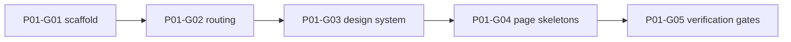

# Phase 1 — Project foundation and visual shell

> **Derived from:** `MASTER_PLAN.md` version `1.0.0` (2026-10-19)  
> **Phase IDs:** `P01-G01` … `P01-G05`  
> **Status:** Execution plan. This file does not authorize code outside Phase 1.  
> **Baseline:** The repository contains `MASTER_PLAN.md` and this plan. There is no `src/` tree yet.

---

## 1. Parent plan contract

Authority is `MASTER_PLAN.md` `1.0.0`. On conflict, the master plan wins. This phase plan wins over any `plans/phase1/guide<number>.md` and over implementation.

Relevant master sections:

- **§1** — Touchline OS is an offline-first sporting-director companion. It does not simulate matches or claim to change an external game.
- **§2 and §2.1** — Vite, React, TypeScript `strict`, pnpm, Tailwind tokens, React Router, Lucide, ESLint, Prettier, Vitest, React Testing Library, Playwright. IndexedDB, Dexie, Zod, and `vite-plugin-pwa` are frozen decisions for later phases, not for this one.
- **§3** — Welcome launcher, campaign workspace sections, dark terminal visual system, campaign URL shape, empty and error states, visible unofficial-companion disclaimer.
- **§8** — Folder boundaries. Phase 1 creates only the app shell, shared UI, feature placeholders, and tests.
- **§9 Phase 1** — Outcome, guide order, and commit subjects below. Do not reorder, merge, or rename these guides.
- **§10** — Required shape of this file.
- **§12.3** — Scripts `pnpm lint`, `pnpm typecheck`, `pnpm test`, `pnpm build`, `pnpm test:e2e`.
- **§14** — No secrets, no hosted player data, no runtime CDN fonts, visible disclaimer.

Roadmap entries, in order:

| ID | Deliverable | Commit subject |
| --- | --- | --- |
| `P01-G01` | Scaffold Vite/React/TypeScript/pnpm, strict config, lint, format, scripts, README | `chore(p01-g01): scaffold typed application` |
| `P01-G02` | Router, welcome and workspace routes, missing-campaign handling | `feat(p01-g02): add app routing and layouts` |
| `P01-G03` | Design tokens, dense dark primitives, responsive shell | `feat(p01-g03): establish terminal design system` |
| `P01-G04` | Navigable skeletons, demo landing, empty and error states, static preview marking | `feat(p01-g04): build navigable product shell` |
| `P01-G05` | Vitest, React Testing Library, Playwright smoke, CI scripts, clean production build | `test(p01-g05): establish verification gates` |

One guide is one commit. Split a guide only by editing this phase file first.

---

## 2. Phase objective and user-visible outcome

At the end of Phase 1 a reviewer can:

1. Install dependencies with pnpm and run a production build.
2. Open the welcome screen, read what Touchline OS is, and see the unofficial-companion disclaimer.
3. Open a **static** fictional-demo workspace at `/app/demo/command-center` and move between every primary section with the pointer or the keyboard.
4. See a persistent banner that the workspace is a preview and that nothing is saved.
5. Hit a missing-campaign address and an unknown address and get an explicit state for each.
6. Run lint, typecheck, unit tests, the production build, and a browser smoke test.

The shell looks like the dark terminal described in master §3.2. It does not contain a database, a seeded club, or figures presented as a real save.

---

## 3. Prerequisites

No earlier phase exists.

Before `P01-G01`, the only required input is `MASTER_PLAN.md`. There are no source files, models, or tests to inspect. Each later guide inspects the files the previous guide committed.

Local tools the implementer must have, and must record by version in the `P01-G01` README:

- A current Node.js LTS, written to `.nvmrc`
- pnpm, recorded in `package.json` `packageManager`

Do not invent a version number in a guide. Resolve the current stable release of each new dependency at the moment that guide is implemented, then commit the lockfile.

---

## 4. In scope / out of scope

### In scope

- Typed Vite + React application in strict TypeScript.
- Quality scripts and formatting.
- Welcome screen and campaign-shaped routes with placeholders.
- Dark graphite visual system, collapsible navigation, status text, empty and error states.
- Static preview of every primary workspace section.
- Unit tests, one Playwright smoke, and a CI workflow for lint, typecheck, unit test, and build.
- `README.md` with the pitch, non-goals, disclaimer, and how to run the checks.

### Out of scope (deferred)

| Item | Phase |
| --- | --- |
| Dexie, IndexedDB, repositories, migrations, campaign revision | Phase 2 |
| Zod entity schemas and domain types | Phase 2 |
| Command and audit framework | Phase 2 |
| Deterministic seed, 72 clubs, featured demo save, campaign create/switch/delete | Phase 3 |
| Real command-center numbers from saved records | Phase 3 |
| Squad table behavior, player editing | Phase 4 |
| SVG crests and interactive pitch | Phase 4 |
| Constitution editor, ledger math, rule verdicts | Phase 5 |
| Transfer, contract, and registration commands | Phase 6 |
| Match entry and season rollover | Phase 7 |
| Charts, archetype scores, insight feed | Phase 8 |
| CSV/JSON parse, backup export/restore | Phase 9 |
| `vite-plugin-pwa`, web app manifest, service worker, precache, install prompt | Phase 10 |
| `ARCHITECTURE.md` and `DECISIONS.md` | Phase 10 (`P10-G05`) |

Also out of this phase: Recharts, TanStack Table, React Hook Form, Zustand, a match visualizer, file reading, `localStorage` or `IndexedDB` writes, and any sample euro amount.

---

## 5. Architecture impact

Phase 1 adds a static client. It does not add a data contract, repository, command, or migration.

```text
src/
  main.tsx
  app/
    App.tsx
    router.tsx
    routes.ts
    copy.ts
    layout/
    pages/
  components/
    ui/
  features/
    campaigns/
    dashboard/
    squad/
    tactics/
    transfers/
    finance/
    registration/
    scouting/
    matches/
    seasons/
    constitution/
    settings/
    help/
  styles/
    tokens.css
    global.css
  test/
e2e/
  smoke.spec.ts
```

`src/domain/`, `src/data/`, and `src/workers/` stay absent. Feature files may import `src/app` and `src/components/ui`. They must not contain business-rule math.

UI state that may exist: which nav disclosure is open, and whether an informational panel (create, import, search, backup) is open. That state is React state in memory. Reload clears it. Preferences follow CSS media features (`prefers-reduced-motion`, `prefers-color-scheme` is not used to switch theme; the theme is dark).

### Route contract

| URL | Result |
| --- | --- |
| `/` | Welcome |
| `/settings` | Static settings note. No saved preferences. |
| `/help` | Static help and data-provenance note |
| `/app` and `/app/` | Missing campaign |
| `/app/:campaignId` | Redirect to `/app/:campaignId/command-center` |
| `/app/:campaignId/<section>` | Workspace section for an allow-listed section |
| Any other path | Not found |

Allow-listed sections, in nav order:

| `id` | Label | Path segment |
| --- | --- | --- |
| `command-center` | Command Center | `command-center` |
| `squad` | Squad | `squad` |
| `tactics` | Tactics | `tactics` |
| `transfers` | Transfers | `transfers` |
| `finance` | Finance | `finance` |
| `registration` | Registration | `registration` |
| `scouting` | Scouting | `scouting` |
| `matches` | Match Journal | `matches` |
| `seasons` | Seasons | `seasons` |
| `constitution` | Constitution | `constitution` |

`src/app/routes.ts` is the only list. The router and the nav rail both read it.

### Assumptions recorded here

1. **Static shell, not the PWA.** “PWA shell” in the Phase 1 outcome means a static production build of the app chrome. Manifest, service worker, and `vite-plugin-pwa` arrive in `P10-G01`.
2. **Campaign ids are opaque.** Any non-empty `campaignId` renders the same static workspace. The id `demo` is only the welcome-screen target. Existence checks against a database arrive in Phase 3.
3. **Dependency timing.** `P01-G01` installs the scaffold toolchain. `P01-G02` adds React Router. `P01-G03` adds Tailwind and `lucide-react`. `P01-G05` adds Vitest, Testing Library, jsdom, and Playwright. Radix is added in `P01-G03` only if a native element cannot meet the keyboard behavior of that primitive. Recharts, TanStack Table, React Hook Form, Zustand, Dexie, Zod, and `vite-plugin-pwa` are not installed.
4. **Package versions.** Guides name packages, not versions. The implementer pins the stable version current on that day via the lockfile and `packageManager`.
5. **Tailwind major.** Use the current stable Tailwind that documents a Vite setup. Token **names** in §6 `P01-G03` are the contract. The config filename may follow that major.
6. **No sample finances.** KPI slots show the label and the value `Preview`. They do not show currency amounts.
7. **Settings and help routes.** Master §3.1 lists these utilities. They are top-level static pages, not campaign sections, so they do not imply a save exists.
8. **Docs files.** `P01-G01` writes `README.md` only. Assumptions stay in this phase file.
9. **End-to-end target.** Playwright drives `vite preview` after `vite build`, so the smoke covers the production bundle.
10. **CI scope.** `.github/workflows/ci.yml` runs lint, typecheck, unit test, and build. `pnpm test:e2e` is required locally before Phase 1 is exited. It is not a required CI job, because the master plan makes browser end-to-end optional on pull requests (§12.3).

### Token and copy contracts later guides must keep

CSS variables defined in `P01-G03`:

- `--surface-0`, `--surface-1`, `--surface-2` — dark graphite page, panel, and raised surface
- `--border`, `--text`, `--text-muted`
- `--amber`, `--teal`, `--block` — accent, informational, and blocker
- `--focus`
- `--nav-width` — expanded width between 240px and 280px inclusive
- `--font-sans` — system UI stack only (`system-ui`, `Segoe UI`, `Roboto`, `Helvetica Neue`, `Arial`, sans-serif)

`P01-G04` puts these exact strings in `src/app/copy.ts` and renders them:

- Disclaimer: `Unofficial fan-made companion; not affiliated with any football game, team or league.`
- Preview banner: `Static preview — not save data`
- Missing campaign title: `Campaign not found`
- Not found title: `Page not found`
- Create panel: `Campaigns cannot be saved in this build.`
- Import panel: `Import is not available in this build.`
- Search panel: `Search is not available in this build.`
- Backup panel: `Backup is not available in this build.`
- Constitution note: `Rules are not active in this build.`

---

## 6. Work breakdown and dependency graph



Implement in that order. `P01-G01` through `P01-G04` are verified with lint, typecheck, and build. The test runner does not exist until `P01-G05`.

### P01-G01 — Scaffold typed application

- **Goal:** A strict TypeScript React app that builds, lints, and typechecks, with a README and no Vite sample counter.
- **Depends on:** `MASTER_PLAN.md` only.
- **Blocks:** every later guide.

**Inspect:** `MASTER_PLAN.md` §2, §8, §12.3, §14.

**Create:**

- `package.json` with `name` suitable for a private app, `"type": "module"`, and scripts `dev`, `build`, `preview`, `lint`, `typecheck`, `format`, `format:check`
- `pnpm-lock.yaml`
- `.nvmrc` — Node major used to verify the scaffold
- `package.json` `packageManager` — pnpm version used to verify the scaffold
- `tsconfig.json` (and the app/node configs the chosen Vite template expects) with `"strict": true`
- `vite.config.ts`
- ESLint flat config covering TypeScript and React, plus Prettier compatibility so the two tools do not disagree
- Prettier config
- `.gitignore` for dependencies, build output, coverage, Playwright artifacts, and logs
- `index.html` with title `Touchline OS`, a module entry, and no stylesheet or font URL on another origin
- `src/main.tsx`, `src/app/App.tsx`, Vite client types
- `public/favicon.svg` — original geometric mark, not the Vite logo and not a real club crest
- `README.md`

**App behavior:** `App` renders the text `Touchline OS` and nothing else. Do not keep the Vite + React counter, hero logos, or documentation links.

**README must include:** the §1.1 pitch; a short non-goals list (no match simulation, no accounts, no hosted player database); the disclaimer sentence from §5 of this file; install, `pnpm dev`, and the check commands that exist after this guide (`lint`, `typecheck`, `build`); the Node and pnpm versions just verified.

**Tests:** none. The runner arrives in `P01-G05`.

**Verification:** `pnpm lint`, `pnpm typecheck`, `pnpm build` exit 0. `pnpm dev` serves the heading.

**Commit:** `chore(p01-g01): scaffold typed application`

### P01-G02 — App routing and layouts

- **Goal:** Every URL in the route contract resolves to a named placeholder, including missing campaign and not found.
- **Depends on:** `P01-G01`.
- **Blocks:** `P01-G03`, `P01-G04`, `P01-G05`.

**Inspect:** `src/main.tsx`, `src/app/App.tsx`, `package.json`.

**Modify / create:**

- Add `react-router` (the current stable major that provides `createBrowserRouter`)
- `src/app/routes.ts` — section table from §5, helpers for a section path and for “is this segment allowed”
- `src/app/router.tsx` — the route table
- `src/app/layout/RootLayout.tsx` — outlet only
- `src/app/layout/WorkspaceLayout.tsx` — skip link target `#main`, a list of section links built from `routes.ts`, and an outlet. Layout is structural; visual design is `P01-G03`
- `src/app/pages/WelcomePage.tsx` — heading `Touchline OS` and the three action labels as inert text: Try fictional demo, Create new campaign, Import backup
- `src/app/pages/MissingCampaignPage.tsx` — title `Campaign not found`
- `src/app/pages/NotFoundPage.tsx` — title `Page not found`
- `src/app/pages/SectionPage.tsx` — renders the active section label
- `src/features/<area>/<Name>Page.tsx` — one thin page per section that renders `SectionPage` for that id, so later phases have a stable file:
  - `src/features/dashboard/CommandCenterPage.tsx`
  - `src/features/squad/SquadPage.tsx`
  - `src/features/tactics/TacticsPage.tsx`
  - `src/features/transfers/TransfersPage.tsx`
  - `src/features/finance/FinancePage.tsx`
  - `src/features/registration/RegistrationPage.tsx`
  - `src/features/scouting/ScoutingPage.tsx`
  - `src/features/matches/MatchJournalPage.tsx`
  - `src/features/seasons/SeasonsPage.tsx`
  - `src/features/constitution/ConstitutionPage.tsx`
- `src/features/settings/SettingsPage.tsx` and `src/features/help/HelpPage.tsx` — titles only
- `src/app/App.tsx` renders the router

**Behavior:**

- `/app/:campaignId` redirects to that campaign’s `command-center`.
- An unknown section under a campaign id renders `NotFoundPage` inside `WorkspaceLayout` (the rail remains available).
- A completely unknown top-level path renders `NotFoundPage` in the root layout.
- Welcome actions do not navigate yet. `P01-G04` wires them.
- No page fetches, and no page reads storage.

**Tests:** none yet. Manual URL pass is the check.

**Verification:** `pnpm lint`, `pnpm typecheck`, `pnpm build`. In the browser, open `/`, `/app`, `/app/demo`, `/app/demo/squad`, `/app/demo/not-a-section`, `/nope`, `/settings`, `/help`. Each shows the title specified above. `/app/demo` ends on `/app/demo/command-center`.

**Commit:** `feat(p01-g02): add app routing and layouts`

### P01-G03 — Terminal design system

- **Goal:** The routed shell uses the dark terminal visual system: tokens, type, nav, focus, status, empty and error primitives.
- **Depends on:** `P01-G02` route and layout files.
- **Blocks:** `P01-G04`, `P01-G05`.

**Inspect:** `src/app/layout/WorkspaceLayout.tsx`, `src/app/router.tsx`, `src/app/routes.ts`, `index.html`.

**Create:**

- `src/styles/tokens.css` — variables named in §5
- `src/styles/global.css` — imports tokens and Tailwind, sets the page background to `--surface-0`, foreground to `--text`, and `font-family` to `--font-sans`
- Tailwind setup required by the installed major, mapping those variables into utilities
- `src/components/ui/Button.tsx` — native `<button>` or `<a>`, variants `primary` and `quiet`, visible `:focus-visible` ring using `--focus`, disabled state
- `src/components/ui/StatusPill.tsx` — prop `tone: 'blocked' | 'warning' | 'informational' | 'passed'` rendering both a Lucide icon and the visible word `Blocked`, `Warning`, `Informational`, or `Passed`
- `src/components/ui/PageHeader.tsx` — title and optional description
- `src/components/ui/KpiRibbon.tsx` — row of items `{ label, value }`, values in tabular numerals
- `src/components/ui/EmptyState.tsx` and `src/components/ui/ErrorState.tsx` — title plus description, not color alone
- `src/components/ui/NavRail.tsx` — links from `routes.ts`; `aria-current="page"` on the active section; expanded width `--nav-width`; collapse control with `aria-expanded` and `aria-controls`
- `src/components/ui/TopBar.tsx` — slots for campaign id text, search, backup, settings, and help
- `src/components/ui/AppShell.tsx` — skip link, rail, top bar, `<main id="main">`
- `src/components/ui/Banner.tsx` — region with `role="status"`; children supplied by the caller

**Modify:** `WorkspaceLayout` so it renders `AppShell`. Welcome, settings, help, missing-campaign, and top-level not-found pages use the same tokens and `PageHeader`. Section pages remain placeholder copy inside the new shell.

**Behavior:**

- Default theme is dark. Do not load a font from a CDN. Do not add a theme toggle.
- Collapse is component state. It is not written to `localStorage`.
- Under `prefers-reduced-motion: reduce`, the rail does not animate width.
- Below a narrow viewport, the rail starts collapsed and can be opened. Desktop and landscape tablet show the expanded rail on first paint.
- Status colors may reinforce the word. The word is always present.
- Top bar controls may be inert buttons until `P01-G04`. Settings and Help are real links to `/settings` and `/help`.
- Add one `StatusPill` example of each tone on the command-center placeholder so the tones are visible before the test guide. `P01-G04` may move that example into the shell’s preview content.

**Tests:** none yet.

**Verification:** `pnpm lint`, `pnpm typecheck`, `pnpm build`. Browser: keyboard from the skip link into main, then along the rail; focus ring is visible; collapsing the rail updates `aria-expanded`; no request to a font CDN in the network panel.

**Commit:** `feat(p01-g03): establish terminal design system`

### P01-G04 — Navigable product shell

- **Goal:** Welcome actions and every section read as an honest static preview. Nothing is stored. No figure looks like a save balance.
- **Depends on:** `P01-G02` routes and `P01-G03` primitives.
- **Blocks:** `P01-G05`.

**Inspect:** feature pages, `AppShell`, `NavRail`, `TopBar`, `Banner`, `EmptyState`, `KpiRibbon`, `routes.ts`.

**Create:** `src/app/copy.ts` exporting the exact strings in §5.

**Modify:**

- `WelcomePage` — pitch paragraph; disclaimer from `copy.ts`; three controls:
  1. **Try fictional demo** is a link to `/app/demo/command-center`.
  2. **Create new campaign** opens an in-page panel with `Campaigns cannot be saved in this build.` It has no form submit and does not change the URL to look like a created id.
  3. **Import backup** opens an in-page panel with `Import is not available in this build.` It does not render `<input type="file">`.
- `WorkspaceLayout` — `Banner` with `Static preview — not save data` on every campaign section. Footer renders the disclaimer.
- `TopBar` — shows the current `campaignId` as plain text (the switcher). Search opens `Search is not available in this build.` Backup opens `Backup is not available in this build.` Neither control reads or writes a file.
- Each feature page — `PageHeader` plus the content below. Shared rule: an `EmptyState` whose description says this build does not store records.

Section bodies:

- **Command Center** — `KpiRibbon` with labels `Transfer capacity`, `Weekly wages`, `Squad`, `Registration`, each value `Preview`. Activity area is an `EmptyState`.
- **Squad** — a table with caption `Squad` and column headers `Name`, `Position`, `Age`, `Wage`, `Value`, `Tier`, `Contract end`, `Minutes`, and an empty body message. Headers are not data.
- **Tactics** — a labeled region `Pitch preview` with text that the board is not interactive in this build. No player markers and no drag behavior.
- **Transfers** — empty shortlist and empty offers, as two empty states.
- **Finance** — empty ledger state. No currency figure.
- **Registration** — empty eligibility state.
- **Scouting** — empty signals state. Do not use the word “AI”.
- **Match Journal** — empty journal state. Do not invent a fixture or a score.
- **Seasons** — empty timeline state.
- **Constitution** — the five rule ids from master §5.2 as a static list (`SELL_TO_BUY`, `MAX_SIGNING_AGE`, `WAGE_TIER_CAP`, `PRESTIGE_BID_SALE`, `REGISTRATION_QUOTA`) plus `Rules are not active in this build.` No toggles that appear to save.
- **Settings** — states that the appearance is the dark terminal theme, motion follows the operating system, and preferences are not saved.
- **Help** — pitch, disclaimer, and a provenance note: this screen is a static shell and contains no club or player records.
- **Missing campaign and not found** — use `ErrorState` with the titles from `copy.ts` and a link back to `/`.

**Tests:** none yet. Do not assert success copy such as “Campaign saved” or “Import complete”; those strings must not exist.

**Verification:** `pnpm lint`, `pnpm typecheck`, `pnpm build`. Browser pass in §8.

**Commit:** `feat(p01-g04): build navigable product shell`

### P01-G05 — Verification gates

- **Goal:** Automated checks cover the welcome screen, routing failures, status text, nav, and one production-build browser smoke. CI runs the non-browser gates.
- **Depends on:** `P01-G04` copy and routes.
- **Blocks:** Phase 1 exit.

**Inspect:** `package.json`, `vite.config.ts`, `src/app/router.tsx`, `src/app/copy.ts`, `src/components/ui/StatusPill.tsx`, `src/components/ui/NavRail.tsx`, feature pages.

**Create / modify:**

- Dev dependencies: Vitest, jsdom, React Testing Library, `@testing-library/jest-dom`, Playwright
- `vitest.config.ts` with jsdom and a setup file that registers jest-dom
- `src/test/setup.ts`
- `src/test/welcome.test.tsx` — renders the welcome route; finds `Touchline OS`, the disclaimer, and a link whose href is `/app/demo/command-center`; activates Create and Import and finds their unavailable copy; does not find `Campaign saved`
- `src/test/routing.test.tsx` — memory router at `/app` shows `Campaign not found`; `/app/demo` resolves to command center; `/app/demo/not-a-section` and `/nope` show `Page not found`
- `src/test/status-pill.test.tsx` — each tone includes its visible word
- `src/test/shell-nav.test.tsx` — on `/app/demo/command-center`, the rail exposes all ten section labels and the preview banner
- `playwright.config.ts` — `webServer` runs the production build then `vite preview`; one browser project is enough (Chromium)
- `e2e/smoke.spec.ts` — the manual smoke in §8, steps 1–8
- `package.json` scripts: `test` = `vitest run`, `test:watch` = `vitest`, `test:e2e` = `playwright test`
- `.github/workflows/ci.yml` — on pull request and on push to `main`: checkout, setup the Node version from `.nvmrc`, enable the pinned pnpm, `pnpm install --frozen-lockfile`, then `pnpm lint`, `pnpm typecheck`, `pnpm test`, `pnpm build`
- README “Verification” section listing all five commands, plus `pnpm exec playwright install chromium` once before e2e

**Failure cases the tests must keep:**

- Welcome without the disclaimer fails `welcome.test.tsx`.
- A demo link that is not `/app/demo/command-center` fails.
- `/app` rendering a workspace fails `routing.test.tsx`.
- A `StatusPill` that relies on color without the word fails `status-pill.test.tsx`.
- A nav that drops a section fails `shell-nav.test.tsx`.
- Smoke fails if the preview banner is absent on the demo command center or on Squad.

**Verification:** all five commands exit 0. CI yaml is valid workflow syntax (structure review is enough in-repo; a live GitHub run is evidence when a remote exists, and is not required to commit the guide).

**Commit:** `test(p01-g05): establish verification gates`

Do not commit a guide when its verification commands fail.

---

## 7. Acceptance criteria

1. `pnpm install` followed by `pnpm build` produces a static production bundle.
2. `/` shows `Touchline OS`, the pitch, the disclaimer sentence, and the three welcome actions.
3. Try fictional demo lands on `/app/demo/command-center`.
4. That workspace, and every other campaign section, shows `Static preview — not save data`.
5. The rail lists all ten sections. The active section matches the URL. A pointer click and a keyboard activation both navigate.
6. Command-center KPI values are the word `Preview`. No euro amount is visible anywhere in the shell.
7. Create, Import, Search, and Backup each show their “not available / cannot be saved” sentence and do not change stored browser data.
8. `/app` shows `Campaign not found` and a way back to `/`.
9. An unknown URL shows `Page not found`.
10. Constitution lists the five rule ids and states that rules are not active.
11. Squad shows headers and an empty body, not invented players.
12. Tactics does not offer drag-and-drop or a match animation.
13. Status tones include the words Blocked, Warning, Informational, and Passed.
14. Focus is visible on the skip link, rail links, and buttons. With reduced motion requested, the rail does not animate.
15. The network panel shows no font or stylesheet request to another origin.
16. `pnpm lint`, `pnpm typecheck`, `pnpm test`, `pnpm build`, and `pnpm test:e2e` pass.
17. The production bundle does not contain a service worker registration.

---

## 8. Verification

From a clean install at the phase exit:

```bash
pnpm install --frozen-lockfile
pnpm lint
pnpm typecheck
pnpm test
pnpm build
pnpm exec playwright install chromium
pnpm test:e2e
```

Expected: each command exits 0. `pnpm test` runs the four files named in `P01-G05`. `pnpm test:e2e` runs `e2e/smoke.spec.ts` against the preview server.

### Manual browser pass

1. `pnpm dev`, open `/`.
2. Confirm the disclaimer and the three actions.
3. Activate **Try fictional demo**. URL is `/app/demo/command-center`. Banner reads `Static preview — not save data`. KPI values read `Preview`.
4. Open **Create new campaign** and **Import backup**. Each stays on `/` and shows its unavailable sentence.
5. Use the rail to open Squad, then Tactics, then Constitution. URLs update. Squad has no player rows. Constitution says rules are not active.
6. Tab from the skip link through the rail. The focus ring is visible. Activate a section with Enter.
7. Open `/app`. The page title is `Campaign not found`. Follow the link to `/`.
8. Open `/app/demo/not-a-section` and `/nope`. Each shows `Page not found`.
9. Open `/settings` and `/help`. Neither offers a saved-preference confirmation.
10. In the network panel, reload and confirm there is no third-party font request.
11. `pnpm build && pnpm preview`, repeat steps 3 and 7 on the preview origin.

### Earlier guides

`P01-G01` through `P01-G04` run `pnpm lint`, `pnpm typecheck`, and `pnpm build` only. `pnpm test` is expected to be absent until `P01-G05`.

---

## 9. Risks, mitigations, rollback

| Risk | Mitigation | Rollback |
| --- | --- | --- |
| A KPI or table shows an invented balance or player as if it were saved | Value copy is fixed to `Preview` or empty states. Acceptance criterion 6. Tests fail if “Campaign saved” appears on welcome. | Revert `P01-G04` |
| Phase 1 installs Dexie, Zod, or `vite-plugin-pwa` and pretends persistence or offline install exists | Dependency timing assumption in §5. Exit check: no `src/data`, no service worker registration. | Remove the dependency in the same guide, before commit |
| Visitors treat the constitution list as enforcement | Required sentence `Rules are not active in this build.` | Revert the constitution page portion of `P01-G04` |
| Opaque `campaignId` is later mistaken for a loaded save | Banner on every workspace route. Phase 3 replaces this assumption with a real lookup; until then the banner stays. | Not a data rollback; Phase 1 stores nothing |
| Tailwind major changes the config shape and a guide hardcodes the wrong one | Token names are the contract. The guide follows the installed major’s Vite setup. | Revert `P01-G03` |
| Lockfile drift across guides | Each guide commits the lockfile only when it adds a dependency. No drive-by upgrades. | Revert that guide’s lockfile with the guide |
| Playwright browsers make CI flaky or slow | CI does not run `pnpm test:e2e`. Local phase exit does. | Drop a failing optional CI job if one was added; do not weaken the local smoke |
| Default Vite sample or CDN font ships in the shell | `P01-G01` forbids the counter and remote fonts. Manual network check in §8. | Revert `P01-G01` or the font addition |
| Rail or status uses color without a name | `StatusPill` requires the word. Keyboard and `aria-current` specified in `P01-G03`. | Revert `P01-G03` |

There is no user data to corrupt and no rule engine to weaken. Revert a bad guide with `git revert` of that commit. Do not reset published history.

---

## 10. Exit criteria and handoff

Phase 1 is complete when all of the following are true:

- [ ] Commits exist, in order, with the five subjects in §1.
- [ ] `pnpm lint`, `pnpm typecheck`, `pnpm test`, `pnpm build`, and `pnpm test:e2e` pass on the phase tip.
- [ ] Acceptance criteria in §7 are true in the production preview.
- [ ] `README.md` documents install, dev, and the five checks.
- [ ] `src/domain/` and `src/data/` do not exist.
- [ ] The lockfile is committed. No secret, no player database, no club crest, and no service worker is in the tree.
- [ ] This file’s assumptions in §5 are still accurate, or they have been edited before the code diverged.

### Progress log

Record each guide commit here when it lands.

| Guide | Commit | Checks |
| --- | --- | --- |
| `P01-G01` | `360b54477e984156d0c76ea29d66cbc7023a24b0` | lint, typecheck, build |
| `P01-G02` |  | lint, typecheck, build |
| `P01-G03` |  | lint, typecheck, build |
| `P01-G04` |  | lint, typecheck, build |
| `P01-G05` |  | lint, typecheck, test, build, test:e2e |

### Handoff to Phase 2

Phase 2 may assume:

- The route table and section ids in `src/app/routes.ts`.
- The shell components in `src/components/ui/`.
- Feature page files exist and own their section’s UI.
- Scripts `lint`, `typecheck`, `test`, `build`, and `test:e2e` exist.
- Campaign ids in the URL are **not** validated. Phase 2 must not pretend a URL id is a saved campaign. Real create/open flows are Phase 3. Phase 2 introduces the database and command boundary those flows will call.
- The preview banner and the “not available” panels stay until a later phase replaces that screen with a real action. Do not remove the banner in Phase 2.
- Stable copy lives in `src/app/copy.ts`.

Phase 2 must not redesign navigation, add the fictional seed, or install the PWA plugin.
