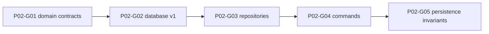

# Phase 2 — Canonical domain, IndexedDB, command infrastructure

> **Derived from:** `MASTER_PLAN.md` version `1.0.0` (2026-10-19)  
> **Phase IDs:** `P02-G01` … `P02-G05`  
> **Status:** Execution plan. This file authorizes `plans/phase2/guide1.md` through `guide5.md`. It does not authorize application code until those guides exist, and it does not authorize work outside Phase 2.  
> **Baseline:** Phase 1 is complete. The implementation tip is `bbdabe871502ac71d044196aa4ce82396c9fbc81` (`docs: record phase 1 guide commits`). `src/domain/` and `src/data/` do not exist. The running app is a static shell.

---

## 1. Parent plan contract

Authority is `MASTER_PLAN.md` `1.0.0`. On conflict, the master plan wins. This phase plan wins over any `plans/phase2/guide<number>.md` and over implementation.

Relevant master sections:

- **§1** — Touchline OS records a career played in another game. It does not simulate matches or claim to have changed that game.
- **§2 and §2.1** — IndexedDB through Dexie, explicit `version().stores()` migrations, Zod at trust boundaries. Repository interfaces live in `src/data/repositories/`. One storage adapter in v1.
- **§4** — Campaign isolation, stable ids, EUR cents, date-only values, unknown versus zero, authority, audit, determinism, provenance. The entity table in §4.2 is the schema contract for this phase. §4.4 is the command path.
- **§5** — Rule evaluation and ledger arithmetic are Phase 5. This phase stores the constitution and ledger shapes those functions will read. It does not evaluate them.
- **§8** — Domain stays free of React, Dexie, and browser globals. Data stays free of JSX. Feature files do not gain database writes in this phase.
- **§9 Phase 2** — Outcome, guide order, and commit subjects below. Do not reorder, merge, or rename these guides.
- **§10** — Required shape of this file.
- **§12.2 invariants 6 and 10** — Unknown wages are not zero. Every read and write is scoped by `campaignId`. The other numbered invariants are later phases.
- **§14** — Treat stored records as data the app itself wrote. No network. No secrets.

Roadmap entries, in order:

| ID | Deliverable | Commit subject |
| --- | --- | --- |
| `P02-G01` | Domain unions, money and date utilities, Zod entity schemas, provenance | `feat(p02-g01): define canonical domain contracts` |
| `P02-G02` | Dexie database v1, indexes, migration discipline, typed table access | `feat(p02-g02): add versioned local database` |
| `P02-G03` | Campaign, season, club, and player repositories with scoped queries | `feat(p02-g03): add isolated repository operations` |
| `P02-G04` | Transaction and command results, revision conflicts, audit events | `feat(p02-g04): introduce atomic command boundary` |
| `P02-G05` | Migration, isolation, rollback, collisions, query failure, rehydration | `test(p02-g05): protect persistence invariants` |

One guide is one commit. Split a guide only by editing this phase file first.

---

## 2. Phase objective and user-visible outcome

At the end of Phase 2 the shell a person can click is still the Phase 1 preview. Welcome still says a campaign cannot be saved. Every workspace section still shows `Static preview — not save data`. Browsing the app does not create a database.

What this phase adds is a tested local persistence core:

1. Every master-plan entity has one Zod schema and one Dexie table at schema version 1.
2. Money is integer cents. Unknown money stays null. Dates and ages are computed from explicit inputs.
3. Repository reads for campaigns, seasons, leagues, clubs, and players are scoped by campaign. A row from campaign A is not returned to campaign B.
4. Three commands — create a campaign, rename it, add a player — write their rows, an audit event, and a new revision in one IndexedDB transaction, or they write nothing.
5. A stale revision is rejected. A thrown command rolls back. Closing and reopening the database returns the same rows.

Phase 3 is what first lets a person create and open a save in the browser. Phase 2 stops at the API those screens will call.

---

## 3. Prerequisites

Phase 1 exit criteria are met. Required commits, oldest first:

| Guide | Commit | Subject |
| --- | --- | --- |
| `P01-G01` | `360b54477e984156d0c76ea29d66cbc7023a24b0` | `chore(p01-g01): scaffold typed application` |
| `P01-G02` | `f8cbb2db83668b501c9ce1a2ac33a04d8f23c92f` | `feat(p01-g02): add app routing and layouts` |
| `P01-G03` | `a406f22113944e9bb5ff8965a0f3e9f6458e65be` | `feat(p01-g03): establish terminal design system` |
| `P01-G04` | `e12589a71b4be5503e1769ec50f0ea6da779e4a2` | `feat(p01-g04): build navigable product shell` |
| `P01-G05` | `1a42719692a114fdec134aab2d682ef18d863870` | `test(p01-g05): establish verification gates` |

The branch tip at planning time also contains `bbdabe871502ac71d044196aa4ce82396c9fbc81`, which records those SHAs in `plans/phase1.md`. Start from that tip.

Inspect before `P02-G01`:

- `MASTER_PLAN.md` §4, §5.2, §5.3, §8
- `plans/phase1.md` §5 route contract and §10 handoff
- `src/app/routes.ts`, `src/app/copy.ts`, `src/main.tsx`
- `package.json`, `tsconfig.app.json`, `eslint.config.js`, `vitest.config.ts`, `src/test/setup.ts`

The app TypeScript config has `strict`, `verbatimModuleSyntax`, `erasableSyntaxOnly`, `noUnusedLocals`, and `noUnusedParameters`. Domain types must be unions and Zod brands. Do not add TypeScript `enum`s or parameter properties.

`pnpm lint`, `pnpm typecheck`, `pnpm test`, and `pnpm build` already exist and must stay green. Do not invent package versions in a guide. Install the current stable `zod` (`P02-G01`), `dexie` (`P02-G02`), and dev dependency `fake-indexeddb` (`P02-G02`), then commit the lockfile.

---

## 4. In scope / out of scope

### In scope

- Pure domain types, money and date functions, and strict Zod schemas for every §4.2 entity.
- Dexie schema version 1, indexes, a named database, and parse-on-read.
- Campaign-scoped repositories for campaigns, seasons, leagues, clubs, and players.
- A transaction helper and a command runner with revision checks, audit rows, and rollback.
- Commands `createCampaign`, `renameCampaign`, and `addPlayer`.
- Vitest coverage of the contracts and of the persistence invariants in §7.
- ESLint fences so the shell cannot import Dexie or the data layer.
- A short README note that the screens still do not save.

League repository operations are in scope inside `P02-G03` because a club may point at a league. The roadmap names club CRUD; a league is the record that `leagueId` refers to.

### Out of scope (deferred)

| Item | Phase |
| --- | --- |
| Welcome flow that creates or opens a campaign, campaign switcher, rename UI, archive, delete | Phase 3 |
| Seeded leagues, clubs, players, and the featured demo | Phase 3 |
| Command-center figures read from IndexedDB | Phase 3 |
| Removing `Static preview — not save data` or the “cannot be saved” panels | Phase 3, and only on the screen that becomes real |
| Squad table, player editing UI, tactics, crests | Phase 4 |
| `evaluateAction`, constitution presets, ledger capacity math, wage commitment | Phase 5 |
| Transfer, offer, contract, and registration commands | Phase 6 |
| Match entry, season rollover, newgens | Phase 7 |
| Scouting scores and charts | Phase 8 |
| Backup import/export and CSV/JSON ingest | Phase 9 |
| Service worker, `vite-plugin-pwa`, storage persistence prompt | Phase 10 |
| `ARCHITECTURE.md` and `DECISIONS.md` | Phase 10 |

Also out of this phase: a second database, a preferences table, `localStorage` writes, React hooks that call commands, route loaders that treat a URL id as a saved campaign, sample euro amounts on screen, and any rule verdict.

---

## 5. Architecture impact

```text
src/domain/          pure types, schemas, money, dates, command result types
  models/
  validation/
  commands/
src/data/
  db.ts
  clock.ts
  ids.ts
  errors.ts
  migrations/v1.ts
  repositories/
  transactions/
  commands/
src/test/            new *.test.ts files plus a fake IndexedDB import in setup.ts
```

No feature page, route, copy string, or shell component changes. `src/main.tsx` stays as it is: it mounts `App` and does not import `src/data` or `src/domain`.

```text
tests and, later, features
  → command function (createCampaign / renameCampaign / addPlayer)
    → Zod parse
    → Dexie transaction
      → re-read revision
      → repository writes
      → audit add
      → revision + 1
    → CommandResult
```

Reads go through repositories. They do not write audit rows and they do not bump `revision`.

### Boundaries

- `src/domain/**` must not import `react`, `react-dom`, `react-router`, `dexie`, or any file under `src/data`, `src/app`, `src/features`, or `src/components`.
- `src/data/**` must not import `react`, `react-dom`, or `react-router`.
- `src/main.tsx`, `src/app/**`, `src/features/**`, and `src/components/**` must not import `dexie`, `src/data/**`, or `src/domain/**`. This fence is temporary. Phase 3 may import command functions and repository reads. It still must not import `src/data/db.ts` from a component.
- `src/domain/**`, `src/data/repositories/**`, `src/data/commands/**`, and `src/data/transactions/**` must not call `Date.now`, `new Date`, or `Math.random`. The clock lives in `src/data/clock.ts`. Id creation lives in `src/data/ids.ts`. Commands receive `now` and ids in their input.
- Enforce the import fences with ESLint `no-restricted-imports` in the guide that creates the layer (`P02-G01` for domain, `P02-G02` for the shell and data). Enforce the clock ban with `no-restricted-syntax` on those same folders, with `src/data/clock.ts` and `src/data/ids.ts` excluded.

### Identifier, money, and time contracts

- Entity ids are strings of 1–64 characters matching `^[A-Za-z0-9-]+$`. Tests use readable ids. `createEntityId()` uses `crypto.randomUUID()`. Commands do not generate ids themselves.
- `MoneyCents` is a Zod-branded nonnegative integer. Parse user text in `parseMoneyCents` by splitting the string. Do not multiply a JavaScript float by 100.
- Accepted money text: optional `€`, optional spaces, digits, and at most two decimal places with `.` as the separator. `10` means 1000 cents. `10.5` and `10.50` mean 1050 cents. Empty text, grouping commas, a minus sign, and a third decimal place are failures, not zero.
- `formatMoneyEuros` renders a known value as `€` plus thousands separators and two decimals (`€10.50`, `€100,000.00`). `formatMoneyUnknown(null)` returns `Unknown`. It must not return `€0.00` for null.
- `DateOnly` is a real calendar day `YYYY-MM-DD`. `2026-02-31` fails.
- `TimestampUtc` is `YYYY-MM-DDTHH:mm:ss.sssZ`.
- `ageInWholeYears(birthDate, asOf)` is the age in whole years on that explicit day.
- `estimateAge(reportedAge, referenceSeasonOrdinal, seasonOrdinal)` is `reportedAge + (seasonOrdinal - referenceSeasonOrdinal)`. There is no function that invents a birth date.
- Stored unknown money, dates, and optional foreign keys are `null`. Schemas must not default them to `0`, `""`, or a fabricated id.

### Provenance and sport enumerations

`RecordSource` is `fictional` | `imported` | `user-entered` | `estimated` | `generated`.

Player `source` is required. `isNewgen` is a required boolean. A missing source does not become `user-entered`.

Position groups are `GK`, `DEF`, `MID`, `FWD`, and `UNKNOWN`. Positions are `GK`, `CB`, `LB`, `RB`, `LWB`, `RWB`, `CDM`, `CM`, `CAM`, `LM`, `RM`, `LW`, `RW`, `ST`, `CF`, and `UNKNOWN`. `positionGroupFor` maps the specific positions onto `GK` / `DEF` / `MID` / `FWD`. A player’s `positionGroup` must match every entry in `positions`. `UNKNOWN` matches only `UNKNOWN`.

Attribute keys, and the only keys schemas accept, are `pace`, `finishing`, `passing`, `dribbling`, `defending`, and `physical`. Each present value is an integer 0–100. Absent keys stay absent. `potential` is an integer 0–100 or `null`.

`SquadTier` is `key` | `rotation` | `youth`. `Formation` is `4-3-3` | `4-2-3-1` | `4-4-2` | `3-5-2`. Nationality, when present, is an ISO 3166-1 alpha-2 code. Club colors are two `#RRGGBB` strings, `primary` and `secondary`.

### Entity schemas

Schemas are strict: unknown keys fail. Types are `z.infer` of those schemas so the TypeScript type and the runtime check cannot drift. Field names follow master §4.2. Additional fields allowed by that section and fixed here:

| Entity | Required shape beyond the master table |
| --- | --- |
| `Campaign` | `kind`: `fictional` or `imported`. `currency` is the literal `EUR`. `revision` is an integer ≥ 0. `seed` and `generatorVersion` are `string` or `null`. |
| `Season` | `status`: `active` or `closed`. `ordinal` is an integer ≥ 1. `startDate` and `endDate` are `DateOnly` or `null`. `closedAt` is `TimestampUtc` or `null`. |
| `League` | `countryCode` is alpha-2 or `null`. `tier` is an integer ≥ 1 or `null`. |
| `Club` | `leagueId` is an id or `null`. `prestige` is an integer 0–100. `academyTier` is an integer 1–5. `scoutingRegion` is a string or `null`. |
| `Player` | Optional scalars are `null` when unknown, including `clubId`, `nationalityCode`, `birthDate`, `reportedAge`, `ageReferenceSeasonOrdinal`, `marketValueCents`, `potential`, and `externalSourceId`. `attributes` is a partial record of the six keys. `positions` has 1–5 unique entries. If `reportedAge` is set, `ageReferenceSeasonOrdinal` is set. The schema does not copy one age field into the other. |
| `Contract` | `status`: `active` or `ended`. `weeklyWageCents` is `MoneyCents` or `null`. `squadTier` is a tier or `null`. Dates are `DateOnly` or `null`. |
| `Constitution` | `version` is an integer ≥ 1. `rules` contains each of the five rule ids exactly once. |
| `LedgerEntry` | `kind` is the closed set below. `amountCents` is nonnegative. `effectiveOn` is a `DateOnly`. |
| `Transfer` | `kind`: `sale`, `purchase`, or `free`. `feeCents` is nonnegative. `free` requires `feeCents` 0. At least one of `fromClubId` and `toClubId` is set. |
| `Offer` | `status`: `open`, `accepted`, or `rejected`. `feeCents` is nonnegative. `receivedOn` is a `DateOnly`. `resolvedOn` is a `DateOnly` or `null`. An open offer has `resolvedOn` null. |
| `Lineup` | `starters` entries are `{ playerId, slot, role }`. `slot` is 1–40 characters. `role` is a string or `null`. `benchPlayerIds` is an array of ids. Duplicate-slot checks belong to Phase 4. |
| `Registration` | `status`: `registered`, `ineligible`, or `unknown`. `homegrownClub` and `homegrownNation` are booleans or `null`. `ageExempt` is a boolean or `null`. `provenance` is a `RecordSource`. |
| `MatchRecord` | `homeAway`: `home` or `away`. `goalsFor` and `goalsAgainst` are integers ≥ 0. `xgFor` and `xgAgainst` are integers ≥ 0 in thousandths of a goal, or `null` (1234 means 1.234). |
| `Appearance` | `minutes` is an integer 0–200. `started` is a boolean or `null`. `goals` and `assists` are integers 0–99 or `null`. `rating` is an integer 0–100 or `null`. |
| `ShortlistItem` | `priority` is an integer 1–5. `status`: `open` or `closed`. |
| `ScoutingReport` | `confidence`: `low`, `medium`, or `high`. `archetype` and `observations` are strings. |
| `DevelopmentPlan` | `status`: `open` or `closed`. `targetRole` is a string or `null`. `notes` is a string. |
| `AuditEvent` | `actionType` is `campaign.create`, `campaign.rename`, or `player.add`. `payload` is a JSON object whose `JSON.stringify` length is at most 20_000. `seasonId` is an id or `null`. |
| `ImportReceipt` | `campaignId` is an id or `null`. `sourceType` is `csv`, `json`, or `backup`. `rowCounts` maps strings to nonnegative integers. `warnings` is an array of strings. `mappingVersion` is a string. `provenance` is a `RecordSource`. |

Name limits: campaign, club, league, and player names are 1–120 characters after trim. `shortName` is 1–16. Season labels are 1–40. Notes and observations are at most 4_000 characters. Put these bounds in `src/domain/validation/limits.ts` and use them from the schemas.

Constitution rule objects use these fields. `enabled` is the opt-in. Parameters are still required when `enabled` is false, so a later edit can turn a rule on without inventing numbers.

| Rule id | Fields |
| --- | --- |
| `SELL_TO_BUY` | `salesReinvestmentPct` and `prizeReinvestmentPct` and `carryoverPct` are integers 0–100. `initialAllocationCents` is `MoneyCents`. |
| `MAX_SIGNING_AGE` | `maxAge` is an integer 15–50. `freeTransfersExempt` is a boolean. |
| `WAGE_TIER_CAP` | `keyWeeklyCapCents`, `rotationWeeklyCapCents`, and `youthWeeklyCapCents` are `MoneyCents`. |
| `PRESTIGE_BID_SALE` | `requiredFeeNumerator` and `requiredFeeDenominator` are integers ≥ 1. `requireHigherPrestige` is a boolean. The master default of 1.5 is numerator 3 and denominator 2. Do not store the multiple as a float. |
| `REGISTRATION_QUOTA` | `rosterLimit` is an integer ≥ 1. `minimumHomegrown` is an integer ≥ 0. `ageExemptionUnder` is an integer ≥ 1 or `null`. `competitionKey` is 1–40 characters. |

This phase does not build the Balanced or Strict presets and does not apply a default allocation. Preset builders arrive in Phase 5 and must produce objects that already pass these schemas. The master defaults (70, 100, age 26, free transfers exempt, €45,000 / €20,000 / €5,000 weekly caps, higher-prestige required, carryover 0) are Phase 5’s preset numbers, expressed in cents as `4500000`, `2000000`, and `500000`.

Ledger `kind` is the closed set `initial_allocation`, `player_sale`, `prize_income`, `approved_carryover`, `incoming_fee`, `reversal`. Amounts are nonnegative. A `reversal` requires `reversesEntryId`. Every other kind requires `reversesEntryId` to be `null`. Capacity math is not implemented here. Sales are stored as the gross fee; Phase 5 applies `salesReinvestmentPct`. Wages are not ledger rows.

### Dexie version 1

Production database name: `touchline-os`. Tests use `touchline-os-test` and never open the production name. Schema version: `1`. Export both constants.

`src/data/migrations/v1.ts` exports `schemaV1`. After `P02-G02` is committed, later phases must not edit this object in place. A new index or table is a new `version(n)` that keeps every previous version and does not delete user rows.

Primary key of every table is `id`. Declare indexes exactly as follows:

```text
campaigns:        id, kind, managedClubId, activeSeasonId, updatedAt
seasons:          id, campaignId, &[campaignId+ordinal], [campaignId+status]
leagues:          id, campaignId
clubs:            id, campaignId, [campaignId+leagueId]
players:          id, campaignId, [campaignId+clubId], [campaignId+positionGroup], [campaignId+name]
contracts:        id, campaignId, [campaignId+playerId], [campaignId+clubId], [campaignId+status]
constitutions:    id, campaignId, &[campaignId+version]
ledgerEntries:    id, campaignId, [campaignId+seasonId], [campaignId+clubId], sourceActionId, reversesEntryId
transfers:        id, campaignId, [campaignId+seasonId], [campaignId+playerId], sourceActionId
offers:           id, campaignId, [campaignId+seasonId], [campaignId+playerId], [campaignId+status]
lineups:          id, campaignId, [campaignId+seasonId]
registrations:    id, campaignId, &[campaignId+seasonId+competitionKey+playerId], [campaignId+competitionKey]
matchRecords:     id, campaignId, [campaignId+seasonId], [campaignId+date]
appearances:      id, campaignId, &[matchId+playerId], [campaignId+seasonId], [campaignId+playerId]
shortlistItems:   id, campaignId, &[campaignId+playerId]
scoutingReports:  id, campaignId, [campaignId+playerId], [campaignId+seasonId]
developmentPlans: id, campaignId, &[campaignId+playerId+seasonId]
auditEvents:      id, campaignId, &actionId, [campaignId+createdAt]
importReceipts:   id, campaignId, importedAt
```

`&` is a unique index. One active contract per club and player is not a unique index, because ended contracts remain. Phase 6 enforces that rule in its command. There is no `listAll` method and no cross-campaign query in the repository API.

Inserts use Dexie `add`, so an existing primary key fails instead of overwriting. Updates use `update` after the transaction has re-read the row and checked `campaignId`. `put` is not the repository insert path.

### Repository and command API

Repository reads return the parsed entity, or `undefined` when the id is absent or belongs to another campaign. A row that fails its Zod schema throws `PersistenceError` with code `CORRUPT`. A missing IndexedDB implementation throws `PersistenceError` with code `UNAVAILABLE`. A list that contains one corrupt row fails the whole list with `CORRUPT` rather than skipping it.

`PersistenceError` codes are `CORRUPT`, `UNAVAILABLE`, `SCOPE`, and `DUPLICATE`.

Scoped reads and writes:

- `getCampaign(id)`, `listCampaigns()`
- `getSeason(campaignId, id)`, `listSeasons(campaignId)`, `getActiveSeason(campaignId)`
- `getLeague(campaignId, id)`, `listLeagues(campaignId)`
- `getClub(campaignId, id)`, `listClubs(campaignId)`
- `getPlayer(campaignId, id)`, `listPlayers(campaignId)`, `listPlayersByClub(campaignId, clubId)`

`listCampaigns` is the one global read. Every other list requires a `campaignId`. Writes exist for these five entities and are called from inside a transaction:

- Insert rejects a `campaignId` that does not match the parent campaign, a `clubId` or `leagueId` from another campaign, a second `active` season, and a repeated season `ordinal`.
- Player insert with a `clubId` requires that club in the same campaign. `clubId` null is a free agent and is allowed.
- This phase has no delete, archive, or cascade. Other entity tables have no repository module yet. Tests may touch them only through `getDatabase()` to prove indexes and corrupt-row behavior.

Command results:

```ts
type CommandFailureCode =
  | 'VALIDATION'
  | 'CONFLICT'
  | 'NOT_FOUND'
  | 'DUPLICATE'
  | 'ABORTED'

type CommandResult<T> =
  | { ok: true; revision: number; value: T }
  | { ok: false; code: CommandFailureCode; message: string }
```

`runCommand` opens one readwrite transaction on the tables the command declares, re-reads the campaign, and then runs the body. Expected revision is compared inside that transaction. On mismatch it returns `CONFLICT` and writes no row and no audit event. A missing campaign returns `NOT_FOUND`. Zod failures return `VALIDATION`. A repository `SCOPE` error also returns `VALIDATION`, because the caller asked for a link that is not in the campaign. A primary-key or unique-index clash returns `DUPLICATE`. Any other thrown error aborts the transaction and returns `ABORTED`. The body must not await a timer, file, network call, or prompt.

`createCampaign` has no `expectedRevision`, because the campaign row does not exist yet. On success the stored revision is `1`. `renameCampaign` and `addPlayer` require `expectedRevision`. Success stores `expectedRevision + 1` and that same number in the result.

`createCampaign` writes four rows in one transaction: the managed club (`leagueId` null), season ordinal `1` with status `active`, the campaign pointing at those ids, and one audit event. It does not write a constitution, a ledger opening balance, or a player. `generatorVersion` is stored as `null` unless the input provides one.

Audit summaries, exact text:

- `Created campaign ${name}`
- `Renamed campaign to ${name}`
- `Added player ${name}`

`actionType` values are `campaign.create`, `campaign.rename`, and `player.add`. `payload` is the parsed command input. Audit rows are append-only: no update and no delete function.

Command inputs carry `now` and the ids the command will store. A test clock is `2026-10-19T00:00:00.000Z`. Production callers, starting in Phase 3, may pass `systemClock()` and `createEntityId()`. Those two functions are the only places `new Date()` and `crypto.randomUUID()` are allowed.

`getDatabase(name?)` caches one instance per name. `deleteDatabaseForTests(name)` closes it, deletes it, and drops the cache. Tests call that in `afterEach`.

### Assumptions recorded here

1. **The shell stays a preview.** Phase 2 does not wire routes to IndexedDB. A URL campaign id is still not a saved campaign. The Phase 1 banner and unavailable-panel copy stay.
2. **Schema v1 lists every master entity.** Later phases add commands against these tables. They bump the Dexie version only when they add a table or an index.
3. **Three commands are enough to prove the boundary.** Transfer, contract, registration, match, and rollover commands are later phases and must go through `runCommand`.
4. **No constitution row is created with a campaign.** The table and schema exist. Phase 5 writes the first constitution. Disabled rules are not a stand-in for enforcement, and the constitution page keeps `Rules are not active in this build.`
5. **Ledger kinds are stored, not calculated.** Phase 5 owns capacity and wage commitment.
6. **The six attribute keys are the v1 attribute model.** Phase 8 charts those keys and must treat a missing key as missing.
7. **xG is integer thousandths** under the master field names `xgFor` and `xgAgainst`.
8. **Fee multiple is a rational,** numerator and denominator, so 1.5 does not become a float.
9. **`fake-indexeddb` is imported from `src/test/setup.ts`.** Production modules do not import it. The dev and preview apps do not open a database until a later phase calls `getDatabase`.
10. **App preferences stay unsaved.** There is no settings table. The settings page copy stays.
11. **Campaign delete is Phase 3.** Repositories do not offer it.
12. **`seed` and `generatorVersion` are nullable campaign fields** so Phase 3 can fill them without a migration.
13. **League reads and writes ship with club scoping** even though the roadmap line names four aggregates.
14. **A corrupt row fails the read.** It is not coerced and not dropped from a list.
15. **The feature import ban is a Phase 2 fence.** Phase 3 replaces it with a narrower ban that still blocks components from importing `src/data/db.ts`.

---

## 6. Work breakdown and dependency graph



Implement in that order. Every guide runs `pnpm lint`, `pnpm typecheck`, `pnpm test`, and `pnpm build`. `pnpm test:e2e` runs at `P02-G05` because that is the phase exit. Existing Phase 1 tests stay in the suite and stay green.

### P02-G01 — Canonical domain contracts

- **Goal:** Pure modules describe every entity, parse money and dates, and reject unknown-as-zero. No database yet.
- **Depends on:** Phase 1 tip.
- **Blocks:** `P02-G02` through `P02-G05`.

**Inspect:** `tsconfig.app.json`, `eslint.config.js`, `src/test/setup.ts`, master §4.1–§4.3 and §5.2–§5.3.

**Create:**

- `src/domain/validation/limits.ts`
- `src/domain/validation/result.ts` — `ParseResult<T>`
- `src/domain/models/money.ts` — `parseMoneyCents`, `formatMoneyEuros`, `formatMoneyUnknown`
- `src/domain/models/dates.ts` — `parseDateOnly`, `parseTimestampUtc`, `ageInWholeYears`, `estimateAge`
- `src/domain/models/positions.ts` — groups, positions, `positionGroupFor`
- `src/domain/validation/schemas.ts` — one strict schema per entity, plus the rule schemas
- `src/domain/commands/result.ts` — `CommandResult` and `CommandFailureCode` only. No runner yet.
- `src/test/money.test.ts`, `src/test/dates.test.ts`, `src/test/schemas.test.ts`

**Modify:** `package.json` and the lockfile for `zod`. `eslint.config.js` so `src/domain/**` cannot import React, React Router, or Dexie.

**Behavior:** parsers and schemas match §5. Do not add `birthDateFromAge`. Do not add `evaluateAction`. Do not add a Dexie import.

**Tests:**

- Money cases in §5, including empty text and `null` formatting to `Unknown`.
- `2026-10-19` minus birth date `2000-10-20` is 25. `2026-02-31` fails. `estimateAge(18, 1, 3)` is 20.
- A contract with `weeklyWageCents: null` parses as null. A player missing `source` fails. An unknown attribute key fails. A constitution missing one rule id fails. A `reversal` without `reversesEntryId` fails. A `free` transfer with a non-zero fee fails. Currency other than `EUR` fails.
- `CommandResult` is exported. No test opens a database.

**Verification:** `pnpm lint`, `pnpm typecheck`, `pnpm test`, `pnpm build`.

**Commit:** `feat(p02-g01): define canonical domain contracts`

### P02-G02 — Versioned local database

- **Goal:** A Dexie database opens at version 1 with the indexes in §5, and reads parse rows with the Phase 1 schemas’ successors (the `P02-G01` schemas).
- **Depends on:** `P02-G01` schemas.
- **Blocks:** `P02-G03`, `P02-G04`, `P02-G05`.

**Inspect:** `src/domain/validation/schemas.ts`, `src/main.tsx`, `src/test/setup.ts`, `vitest.config.ts`.

**Create:**

- `src/data/errors.ts` — `PersistenceError`
- `src/data/migrations/v1.ts` — `schemaV1` and a short comment that this object is frozen after the guide commits
- `src/data/db.ts` — `TouchlineDatabase`, `DATABASE_NAME`, `DATABASE_VERSION`, `getDatabase`, `deleteDatabaseForTests`
- `src/test/database.test.ts`

**Modify:**

- Add `dexie` and dev dependency `fake-indexeddb`. Commit the lockfile.
- `src/test/setup.ts` imports `fake-indexeddb/auto`. It does not call `getDatabase`.
- ESLint: data modules cannot import React. `src/main.tsx`, `src/app/**`, `src/features/**`, and `src/components/**` cannot import `dexie`, `src/data/**`, or `src/domain/**`.

**Behavior:**

- `new TouchlineDatabase('touchline-os-test')` declares `version(1).stores(schemaV1)` and no later version.
- `getDatabase` returns the cached instance for that name.
- There is no repository list API in this guide.
- The app entry is unchanged, so a normal page load does not open `touchline-os`.

**Tests:**

- After open, `verno` is 1 and the table names equal the `schemaV1` keys.
- Close, reopen the same name, and the version is still 1.
- `deleteDatabaseForTests` clears the cache: the next `getDatabase` is a new instance.
- A raw player row missing `source`, written with the table API, makes a parse helper throw `CORRUPT`. Export that helper as `parseStored(schema, value)` in `src/data/db.ts` so `P02-G03` can use it on every read.

**Verification:** `pnpm lint`, `pnpm typecheck`, `pnpm test`, `pnpm build`. Phase 1 UI tests still pass.

**Commit:** `feat(p02-g02): add versioned local database`

### P02-G03 — Isolated repository operations

- **Goal:** Campaign, season, league, club, and player reads are scoped. Writes reject cross-campaign links and a second active season.
- **Depends on:** `P02-G02` database.
- **Blocks:** `P02-G04`, `P02-G05`.

**Inspect:** `src/data/db.ts`, `src/domain/validation/schemas.ts`.

**Create:**

- `src/data/transactions/run-in-transaction.ts` — opens a short transaction and runs a callback. No revision check and no audit yet.
- `src/data/repositories/campaigns.ts`
- `src/data/repositories/seasons.ts`
- `src/data/repositories/leagues.ts`
- `src/data/repositories/clubs.ts`
- `src/data/repositories/players.ts`
- `src/test/repositories.test.ts`
- `src/test/fixtures/campaign.ts` — one valid campaign, club, and season object with fixed ids `campaign-a`, `club-a`, `season-a`, and a second set `campaign-b`, `club-b`, `season-b`

**Behavior:**

- Reads use Dexie `where` on `campaignId` (and the compound indexes for club and active season), not `toArray()` followed by a JavaScript filter.
- `getPlayer('campaign-b', playerIdFromA)` returns `undefined` even though the row exists.
- Inserts use `add`. A repeated id throws `PersistenceError` `DUPLICATE`.
- Inserting an `active` season when that campaign already has one fails inside the transaction.
- A player whose `clubId` belongs to the other campaign fails with `SCOPE` and is not stored.
- A league id from another campaign fails the same way on club insert.
- Repository writes do not change `revision` and do not write `auditEvents`.
- No delete methods.

**Tests:** two campaigns in one database; list and get isolation; duplicate id; second active season; cross-campaign club; `marketValueCents: null` round-trips as null. Clean up with `deleteDatabaseForTests('touchline-os-test')`.

**Verification:** `pnpm lint`, `pnpm typecheck`, `pnpm test`, `pnpm build`.

**Commit:** `feat(p02-g03): add isolated repository operations`

### P02-G04 — Atomic command boundary

- **Goal:** The three commands commit rows, audit, and revision together, or they leave the database unchanged.
- **Depends on:** `P02-G03` repositories and `runInTransaction`.
- **Blocks:** `P02-G05`.

**Inspect:** repository modules, `src/domain/commands/result.ts`, `src/data/transactions/run-in-transaction.ts`.

**Create:**

- `src/data/clock.ts` — `systemClock()`
- `src/data/ids.ts` — `createEntityId()`
- `src/data/transactions/run-command.ts`
- `src/data/commands/create-campaign.ts`
- `src/data/commands/rename-campaign.ts`
- `src/data/commands/add-player.ts`
- `src/domain/commands/revision.ts` — pure `nextRevision(current) = current + 1`, used by the runner
- `src/test/commands.test.ts`

**Modify:** ESLint so repositories, commands, and transactions cannot call `Date.now`, `new Date`, or `Math.random`. Exclude `src/data/clock.ts` and `src/data/ids.ts`.

**Behavior:**

- `createCampaign` stores revision `1`, the club, season ordinal 1, and an audit row with `actionType` `campaign.create` and summary `Created campaign ${name}`. A second call with the same campaign id returns `DUPLICATE` and does not add a second audit row.
- `renameCampaign` with the current revision updates the name, writes `Renamed campaign to ${name}`, and returns the new revision. The same call with a stale `expectedRevision` returns `CONFLICT`; the name, revision, and audit count stay as they were.
- `renameCampaign` for an unknown id returns `NOT_FOUND`.
- `addPlayer` checks the expected revision and the club scope inside the transaction, then writes the player and `Added player ${name}`. A validation failure writes neither the player nor the audit and does not bump revision.
- A command body that inserts a player and then throws a plain `Error` returns `ABORTED`. The player count, revision, and audit count match the pre-command state. This body is a test double passed to `runCommand`, not an exported command.
- Audit has no update or delete export.

**Tests:** the cases above, plus a pure `nextRevision` assertion. Use the fixture ids and the fixed timestamp. Do not call `systemClock()` in tests.

**Verification:** `pnpm lint`, `pnpm typecheck`, `pnpm test`, `pnpm build`.

**Commit:** `feat(p02-g04): introduce atomic command boundary`

### P02-G05 — Persistence invariants

- **Goal:** One scenario proves isolation, rollback, collisions, failed reads, migration discipline, and rehydration. The shell is unchanged.
- **Depends on:** `P02-G04` commands.
- **Blocks:** Phase 2 exit.

**Inspect:** command modules, `src/data/migrations/v1.ts`, `src/data/db.ts`, `README.md`, `e2e/smoke.spec.ts`, `src/app/copy.ts`.

**Create:** `src/test/persistence.test.ts`.

**Modify:** `README.md` only, adding this subsection under Checks or after Toolchain:

```md
## Local database

Later phases store campaigns in IndexedDB. The screens in this build do not open that database, and the welcome screen still cannot save a campaign.
```

**Scenario the test must run, in one database:**

1. `createCampaign` for A and B with distinct club and season ids.
2. `addPlayer` on A. `listPlayers` for B is empty. `getPlayer` on B with A’s player id is `undefined`. A raw table read still shows A’s player, so the test is not passing because the row was never written.
3. `renameCampaign` on A with a stale revision returns `CONFLICT`. A’s name is unchanged.
4. A `runCommand` body that adds a player on B and throws returns `ABORTED`. B’s player list stays empty. B’s revision and audit count are unchanged.
5. `addPlayer` on A using B’s club id returns `VALIDATION`, and A’s revision is unchanged. The repository still throws `SCOPE`; `runCommand` maps that code to `VALIDATION`.
6. `addPlayer` on B with A’s player id returns `DUPLICATE`.
7. `getCampaign('missing')` is `undefined`. `renameCampaign` on that id returns `NOT_FOUND`.
8. A hand-inserted player row that fails Zod makes `getPlayer` throw `CORRUPT` and does not come back as a player with a zero wage or value.
9. Close the database, drop the singleton cache, reopen `touchline-os-test`, and read A’s renamed name only after a successful rename in this scenario, A’s revision, and A’s player. They match what was committed.
10. On a separate Dexie name `touchline-os-migration-probe`, open version 1, store `{ id: 'row-1', name: 'kept' }`, close, reopen a subclass that repeats version 1 and adds version 2 with an empty upgrade, and read `row-1` back as `kept`. Delete the probe database. The production class still declares only version 1.
11. `assertStorageAvailable(undefined)` throws `UNAVAILABLE`. That function lives in `src/data/db.ts` and checks the value it is given; the test passes `undefined` rather than uninstalling the fake.

Keep the repository and command tests from earlier guides. This file is the phase exit scenario, not a replacement.

**Verification:** `pnpm lint`, `pnpm typecheck`, `pnpm test`, `pnpm build`, `pnpm exec playwright install chromium`, `pnpm test:e2e`. The existing smoke spec still passes against the production preview.

**Commit:** `test(p02-g05): protect persistence invariants`

Do not commit a guide when its verification commands fail.

---

## 7. Acceptance criteria

1. `pnpm lint`, `pnpm typecheck`, `pnpm test`, `pnpm build`, and `pnpm test:e2e` pass on the phase tip.
2. `/` still shows the disclaimer and `Campaigns cannot be saved in this build.` `/app/demo/command-center` still shows `Static preview — not save data` and KPI values `Preview`.
3. No page shows a euro amount, a seeded player, or a rule verdict.
4. Loading the dev app or the preview app does not create an IndexedDB database named `touchline-os`.
5. `src/main.tsx` and the feature pages do not import `dexie`, `src/data`, or `src/domain`.
6. `parseMoneyCents('')` fails, `parseMoneyCents('10.50')` is 1050 cents, and null money formats as `Unknown`.
7. A player or contract with a null wage or value keeps null. No schema defaults that field to `0`.
8. Creating campaigns A and B, then adding a player to A, leaves B’s scoped player list empty and B’s scoped get of that player id undefined.
9. A stale `renameCampaign` returns `CONFLICT` and writes no name change and no audit row.
10. A command that throws returns `ABORTED` and leaves players, revision, and audit rows unchanged.
11. An id that already belongs to another campaign cannot be inserted again.
12. After `close` and a new `getDatabase('touchline-os-test')`, committed campaigns and players read back with the same ids, names, and revision.
13. A version-2 probe database still contains the row written at version 1. The app database class declares version 1 only.
14. A stored row that fails Zod fails the read with `CORRUPT`.
15. `src/domain` has no React or Dexie imports. Domain and repository modules do not call `Date.now` or `Math.random`.
16. The production build registers no service worker. The constitution page still says rules are not active.

---

## 8. Verification

From a clean install at the phase exit:

```bash
pnpm install --frozen-lockfile
pnpm lint
pnpm typecheck
pnpm test
pnpm build
pnpm exec playwright install chromium
pnpm test:e2e
```

Expected: each command exits 0. `pnpm test` includes the Phase 1 files plus `money.test.ts`, `dates.test.ts`, `schemas.test.ts`, `database.test.ts`, `repositories.test.ts`, `commands.test.ts`, and `persistence.test.ts`.

### Manual browser pass

1. `pnpm dev`, open `/`. Create-campaign still shows `Campaigns cannot be saved in this build.` and stays on `/`.
2. Open `/app/demo/command-center`. The banner still reads `Static preview — not save data`. KPI values still read `Preview`.
3. Open Squad and Constitution. Squad has no player rows. Constitution says rules are not active.
4. In the browser’s application storage panel, no database named `touchline-os` appears after those visits.
5. `pnpm build && pnpm preview`, and repeat steps 2 and 4 on the preview origin.

The persistence behavior is proven by `src/test/persistence.test.ts`, not by clicking the shell. There is no save button to press in this phase.

### Earlier guides

`P02-G01` through `P02-G04` run lint, typecheck, test, and build. They do not need a Playwright run unless a guide changes the shell. No guide in this phase should change the shell. If one does, stop and put the UI behavior back before committing.

---

## 9. Risks, mitigations, rollback

| Risk | Mitigation | Rollback |
| --- | --- | --- |
| The shell starts showing saved clubs or euro amounts | Feature files cannot import the data layer. Acceptance criteria 2–4. Existing welcome and shell tests stay. | Revert the UI part of that guide |
| `put` overwrites another campaign’s row that reused an id | Inserts use `add`. Cross-campaign id reuse returns `DUPLICATE`. | Revert `P02-G03` or `P02-G04` |
| A failed command leaves a player without an audit row, or an audit row without a player | Both writes sit in the `runCommand` transaction. The throw test in `P02-G04` and the scenario in `P02-G05` must pass before commit. | Revert `P02-G04` |
| Two tabs spend the same revision | The check re-reads revision inside the transaction. Stale input returns `CONFLICT`. | Revert `P02-G04` |
| Unknown wage becomes €0 | Schemas use null and no zero default. Money and schema tests cover null. Format of null is `Unknown`. | Revert `P02-G01` |
| Schema v1 is edited in place after later user data could exist | Frozen `schemaV1` after `P02-G02`. New indexes are new versions. The probe test shows an upgrade that keeps rows. | Restore `migrations/v1.ts` from that commit |
| Opening the app creates a real database during a preview | `main.tsx` does not import `getDatabase`. Manual storage check in §8. | Remove the import before commit |
| Domain code calls `Date.now` or `Math.random` and tests become flaky | Clock and ids are arguments. ESLint blocks those calls outside `clock.ts` and `ids.ts`. | Revert the offending guide |
| Dexie and Zod land in the Phase 1 UI by accident | Import fence in `P02-G02`. | Revert the import |
| A guide installs the PWA plugin, a seed generator, or the rule engine | Out of scope table in §4. | Remove it before commit |
| `fake-indexeddb` changes welcome-test behavior | Import it only from the Vitest setup. Phase 1 tests must still pass in the same guide. | Fix the setup before commit |

User data created by these tests lives in the fake IndexedDB and is deleted in `afterEach`. Revert a bad guide with `git revert` of that commit. Do not reset published history.

---

## 10. Exit criteria and handoff

Phase 2 is complete when all of the following are true:

- [ ] Commits exist, in order, with the five subjects in §1.
- [ ] The commands in §8 pass on the phase tip.
- [ ] Acceptance criteria in §7 are true.
- [ ] `schemaV1` matches §5 and the database class declares version 1 only.
- [ ] README states that the screens do not open the database.
- [ ] The Phase 1 preview copy is unchanged.
- [ ] Assumptions in §5 are still accurate, or this file was edited before the code diverged.

### Progress log

Record each guide commit here when it lands. Do not rewrite the subjects.

| Guide | Commit | Checks |
| --- | --- | --- |
| `P02-G01` | `0af78a8b90c2b88dd408975632838f0df5039109` | lint, typecheck, test, build |
| `P02-G02` | | lint, typecheck, test, build |
| `P02-G03` | | lint, typecheck, test, build |
| `P02-G04` | | lint, typecheck, test, build |
| `P02-G05` | | lint, typecheck, test, build, test:e2e |

### Handoff to Phase 3

Phase 3 may call:

- `createCampaign`, `renameCampaign`, and `addPlayer`
- `systemClock` and `createEntityId` at the UI edge, passing their results into the command input
- Scoped reads: `getCampaign`, `listCampaigns`, `getActiveSeason`, `listClubs`, `listPlayers`, `getPlayer`
- `CommandResult` codes `VALIDATION`, `CONFLICT`, `NOT_FOUND`, `DUPLICATE`, and `ABORTED`

Phase 3 must treat `CONFLICT` as a stale save, not as permission to write anyway. It must keep using `add` for inserts. It may narrow the ESLint fence so features can import command modules and repository reads. It must not import `src/data/db.ts` from a component, must not edit `schemaV1` in place, and must not remove the preview banner until the screen it is on is actually reading a save.

Phase 3 must not add the rule engine, the PWA plugin, or transfer commands. Seeding writes through the Phase 2 commands and repositories rather than a second writer.

Next planning step, before any Phase 2 code: write `plans/phase2/guide1.md` through `guide5.md` from this file and `MASTER_PLAN.md`.
