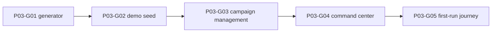

# Phase 3 — Fictional dataset, onboarding and save management

> **Derived from:** `MASTER_PLAN.md` version `1.0.0` (2026-10-19)  
> **Phase IDs:** `P03-G01` … `P03-G05`  
> **Status:** Execution plan. This file does not authorize work outside Phase 3.  
> **Baseline:** Phase 2 is complete. The implementation tip is `69b3dbb2c59cc98ce2fe23a53424368fab6b57cf` (`docs: record phase 2 guide commits`). The shell is still the Phase 1 preview. IndexedDB is not opened by a page load.

---

## 1. Parent plan contract

Authority is `MASTER_PLAN.md` `1.0.0`. On conflict, the master plan wins. This phase plan wins over any `plans/phase3/guide<number>.md` and over implementation.

Relevant master sections:

- **§1** — A visitor opens a fictional demo without an account, an upload, or a network data API. Touchline OS still does not simulate matches.
- **§3.1 and §3.3** — Welcome offers the fictional demo, a new campaign, and a disabled import. Workspace URLs stay `/app/:campaignId/<section>`. A missing campaign is an explicit state. Destructive actions require confirmation.
- **§4** — Campaign isolation, integer cents, unknown versus zero, explicit clock and ids, provenance, determinism. `seed` and `generatorVersion` already exist on `Campaign`.
- **§6.1** — Loader A: 4 leagues × 18 clubs, about 3,000 fictional players, a versioned seed, idempotent batched writes, progress and recovery, and a featured demo that is distinct from a factory reset. Sample finances, offers, and match rows in that section are later phases; see assumption 1.
- **§7.1** — Create, open, switch, rename, archive, and delete. The command center reads saved records and audit events. It does not invent news.
- **§8** — UI reads go through repositories. UI writes go through commands. Components do not call Dexie.
- **§9 Phase 3** — Outcome, guide order, and commit subjects below. Do not reorder, merge, or rename these guides.
- **§10** — Required shape of this file.
- **§12.2 invariant 11** — Same seed and generator version emit the same world. Invariant 10 still holds: every read and write stays inside one campaign.
- **§12.4** — Show progress while the one-time seed runs. Do not promise a wall-clock duration.
- **§14** — Invented names only. No real squads, crests, or hosted datasets. The disclaimer stays visible.

Roadmap entries, in order:

| ID | Deliverable | Commit subject |
| --- | --- | --- |
| `P03-G01` | Deterministic PRNG and league, club, player, wage, value, and rating generators, with seed unit tests | `feat(p03-g01): generate deterministic fictional world` |
| `P03-G02` | Batched idempotent demo seed, featured audit events, progress and recovery | `feat(p03-g02): provision playable demo campaign` |
| `P03-G03` | Create, switch, rename, archive, and confirmed delete and reset | `feat(p03-g03): manage persistent campaigns` |
| `P03-G04` | Command-center summary from local records and audit events | `feat(p03-g04): connect command center to save data` |
| `P03-G05` | Club selection and end-to-end first run, refresh, duplicate-seed, and reset coverage | `test(p03-g05): validate first-run demo journey` |

One guide is one commit. Split a guide only by editing this phase file first.

---

## 2. Phase objective and user-visible outcome

At the end of Phase 3 a reviewer can:

1. Open `/` and read the same pitch and unofficial-companion disclaimer.
2. Choose **Try fictional demo**, watch seeding progress, and then choose one of 72 invented clubs.
3. Land on `/app/demo/command-center` and see that club’s name, a real squad count, a real age summary, and audit activity from this save.
4. Reload the browser and find the same club, the same counts, and no duplicate leagues, clubs, or players.
5. Create a second campaign with one empty club, switch between it and the demo, and see each save’s own squad count.
6. Rename, archive, restore, and delete a campaign. Delete asks for the campaign name and removes that save only.
7. Reset the fictional demo with the confirmation phrase `Reset fictional demo`. The other campaign is still there. The demo is seeded again.
8. Open Squad, Tactics, Finance, and Constitution and still see those sections as previews. Import and backup still do nothing.

Figures this phase cannot know — transfer capacity, weekly wages, registration, bids, and contract expiry — read `Unknown`. They never read `€0.00` or `Preview`.

---

## 3. Prerequisites

Phase 2 exit criteria are met. Required commits, oldest first:

| Guide | Commit | Subject |
| --- | --- | --- |
| `P02-G01` | `0af78a8b90c2b88dd408975632838f0df5039109` | `feat(p02-g01): define canonical domain contracts` |
| `P02-G02` | `4337d647987964cd9cbbeebe2bddd8ee683b71f9` | `feat(p02-g02): add versioned local database` |
| `P02-G03` | `4c04741a774d7061899fa955f16cb14de62c33bf` | `feat(p02-g03): add isolated repository operations` |
| `P02-G04` | `efbd64ee4c61a810b0a6b5733da18a18d09c754e` | `feat(p02-g04): introduce atomic command boundary` |
| `P02-G05` | `cb5b3a5301d833c2deb339e99bac94c638936fb1` | `test(p02-g05): protect persistence invariants` |

The branch tip at planning time also contains `69b3dbb2c59cc98ce2fe23a53424368fab6b57cf`, which records those SHAs in `plans/phase2.md`. Start from that tip.

Inspect before `P03-G01`:

- `MASTER_PLAN.md` §3.1, §3.3, §6.1, §7.1
- `plans/phase2.md` §5 and §10 handoff
- `src/domain/validation/schemas.ts`, `src/domain/validation/limits.ts`, `src/domain/models/positions.ts`
- `src/data/transactions/run-command.ts`
- `src/data/commands/create-campaign.ts`, `rename-campaign.ts`, `add-player.ts`
- `src/data/repositories/campaigns.ts`, `seasons.ts`, `leagues.ts`, `clubs.ts`, `players.ts`
- `src/data/migrations/v1.ts`, `src/data/db.ts`, `src/data/clock.ts`, `src/data/ids.ts`
- `src/app/routes.ts`, `src/app/router.tsx`, `src/app/copy.ts`, `src/app/pages/WelcomePage.tsx`
- `src/app/layout/WorkspaceLayout.tsx`, `src/features/dashboard/CommandCenterPage.tsx`
- `src/components/ui/TopBar.tsx`, `src/components/ui/AppShell.tsx`
- `eslint.config.js`, `src/test/setup.ts`, `e2e/smoke.spec.ts`, `README.md`

`schemaV1` is frozen. Do not edit that object. Do not add `version(2)`. Campaign `status` is a Zod field with no new index, which assumption 4 records.

`pnpm lint`, `pnpm typecheck`, `pnpm test`, `pnpm build`, and `pnpm test:e2e` already exist and must stay green. This phase adds no production dependency. `zod`, `dexie`, and `fake-indexeddb` are already installed.

---

## 4. In scope / out of scope

### In scope

- A pure world generator for generator version `1`.
- One featured campaign, id `demo`, with 4 leagues, 72 clubs, and exactly 3,000 players.
- Batched seed writes through `runCommand` and the existing insert functions, with resume after a partial write.
- Welcome flows for create, open, switch, rename, archive, restore, delete, and demo reset.
- A route guard that treats an unknown campaign id as missing.
- Command-center squad count, age summary, and audit activity for a campaign that exists.
- Club choice for the featured demo, recorded as an audit event.
- Narrower ESLint fences so features can call commands and repository reads.
- README text that the app now opens `touchline-os`.
- Vitest coverage of the generator, seed, campaign commands, and command center, plus one Playwright journey.

### Out of scope (deferred)

| Item | Phase |
| --- | --- |
| Squad table, player editing, search within a squad | Phase 4 |
| SVG crests and the interactive pitch | Phase 4 |
| Constitution presets, `evaluateAction`, ledger capacity, wage commitment | Phase 5 |
| Contract rows, transfer commands, offers, registration | Phase 6 |
| Match records, season rollover, newgens | Phase 7 |
| Charts, archetype scores, insight sentences | Phase 8 |
| CSV/JSON import, backup export and restore | Phase 9 |
| `vite-plugin-pwa`, `navigator.storage.persist()`, quota prompts | Phase 10 |
| A preferences table, saved theme, or saved reduced-motion | Phase 10 |
| `ARCHITECTURE.md` and `DECISIONS.md` | Phase 10 |

Also out of this phase: a second database, editing `schemaV1`, a Dexie version bump, euro amounts on screen, rule verdicts, status pills presented as live verdicts, and a loop of `addPlayer` that writes 3,000 audit rows.

---

## 5. Architecture impact

```text
src/domain/seed/       pure generator, no Dexie and no Math.random
src/data/commands/     seed, archive, delete, reset, select-club
src/data/repositories/ audit reads; campaign status update; scoped deletes
src/app/providers/     the only UI module that may call getDatabase()
src/features/campaigns/
src/features/dashboard/
```

`src/main.tsx` mounts a database provider and still does not import Dexie itself. The provider calls `getDatabase()` when it mounts, so the first visit of this phase creates `touchline-os`. Tests keep using `touchline-os-test`.

```text
Welcome or reset
  → seedDemoCampaign orchestrator
    → generateWorld(seed, version, campaignId)
    → several runCommand batches
      → insertLeague / insertClub / insertSeason / insertCampaign / insertPlayer
      → one seed audit when the counts are complete
    → CommandResult

Command center
  → listPlayersByClub, listAuditEvents
  → render counts and summaries
```

The orchestrator awaits each batch to completion before it starts the next. It does not hold one IndexedDB transaction open across 3,000 players, and it does not await a timer, a prompt, or the network inside a transaction.

### Boundaries

- `src/domain/**` stays free of React, Dexie, and `Math.random`. The generator uses the PRNG in §5 only.
- `src/data/**` stays free of JSX.
- `src/components/**` cannot import `dexie`, `fake-indexeddb`, `src/data/**`, or `src/domain/**`.
- `src/features/**` and `src/app/**` except `src/app/providers/database.tsx` cannot import `dexie`, `fake-indexeddb`, `src/data/db.ts`, or `src/data/migrations/**`.
- `src/app/providers/database.tsx` is the only UI file that may import `getDatabase` from `src/data/db.ts`.
- Feature code receives the database instance from React context and passes `systemClock()` and `createEntityId()` into command inputs at that edge.
- A `CONFLICT` result is shown as a stale save. The screen reloads the campaign. It does not write the rejected input again.

Replace the Phase 2 shell-wide import ban in `eslint.config.js` when `P03-G03` first imports a command from a feature. The message text must no longer say the shell cannot import the domain during Phase 2.

### Featured world, generator version 1

Constants, exact strings:

| Constant | Value |
| --- | --- |
| Featured campaign id | `demo` |
| Featured campaign name | `Fictional demo` |
| Seed | `touchline-demo-v1` |
| Generator version | `1` |
| Season id | `demo-season-1` |
| Season label | `Season 1` |

`generateWorld` accepts `{ seed, generatorVersion, campaignId }` and returns `ParseResult`. A `generatorVersion` other than `1` is `{ ok: false }`. It does not fall through to version 1. `campaignId` must already match the entity-id pattern. Every generated id is prefixed with that campaign id so two campaigns cannot share a primary key.

Shape:

- 4 leagues, ids `${campaignId}-league-1` … `${campaignId}-league-4`, tiers 1 … 4.
- 18 clubs in each league, 72 clubs, ids `${campaignId}-club-01` … `${campaignId}-club-72`.
- Squad size of club index `i` (0-based) is `36 + (i % 9)`. Eight groups of `36+37+…+44` equal 2,880 club players.
- 120 free agents, `clubId` null. Player ids `${campaignId}-player-0001` … `${campaignId}-player-3000`. Players 0001–2880 fill clubs in index order. Players 2881–3000 are free agents.
- Every generated player has `source: 'fictional'`, `isNewgen: false`, `externalSourceId: null`, `birthDate: null`, `reportedAge` from 16 through 38, and `ageReferenceSeasonOrdinal: 1`. The generator never emits a birth date.
- All six attribute keys are present integers inside the position range below. `potential` is an integer 40–95. `marketValueCents` is a nonnegative integer. The draft also carries `weeklyWageCents` for the determinism test. The seed command strips that field before `playerSchema`. No contract row is written.

League names and region codes are fixed, in order. The codes are nationality metadata for a fictional league, not a claim about a real competition:

| Order | Name | `countryCode` | Tier |
| --- | --- | --- | --- |
| 1 | Northwater Premier | `SE` | 1 |
| 2 | Redfen Championship | `PT` | 2 |
| 3 | Calderan League | `NL` | 3 |
| 4 | Ostmark Regional | `AT` | 4 |

Club names do not use the PRNG. Club index `i` uses:

```text
prefixes = Ash, Black, Brine, Castle, East, Ferry, Grey, High, Iron, Kings, Low, North, Port, Red, South, West, White, Wind
suffixes = bridge, dale, ford, gate
name = prefixes[i % 18] + suffixes[floor(i / 18)]
```

`Ashbridge` through `Windgate` are 72 unique names. `shortName` is the first three letters of the name, uppercased. A collision appends `2`, then `3`, and so on (`ASH`, `ASH2`, `ASH3`, `ASH4`). League assignment is clubs 01–18 in league 1, 19–36 in league 2, 37–54 in league 3, and 55–72 in league 4.

### PRNG

Hash and generator, exact:

```ts
function hashSeed(seed: string, generatorVersion: string): number {
  let hash = 0x811c9dc5
  const text = `${generatorVersion}\0${seed}`
  for (let i = 0; i < text.length; i += 1) {
    hash ^= text.charCodeAt(i)
    hash = Math.imul(hash, 0x01000193)
  }
  return hash >>> 0
}

function mulberry32(seed: number): () => number {
  let state = seed >>> 0
  return () => {
    state = (state + 0x6d2b79f5) >>> 0
    let t = Math.imul(state ^ (state >>> 15), state | 1)
    t ^= t + Math.imul(t ^ (t >>> 7), t | 61)
    return ((t ^ (t >>> 14)) >>> 0) / 4294967296
  }
}
```

`nextInt(rng, span)` is `Math.floor(rng() * span)` for `span >= 1`. Call order is part of the contract. League rows consume no random numbers. For each club, in index order, consume: palette index, prestige, academy tier, region index. For each player, in id order, consume: position ticket, nationality index, age, `pace`, `finishing`, `passing`, `dribbling`, `defending`, `physical`, potential, market-value step, wage step, given-name syllable count, given syllables, family syllable.

Draws:

- Colors come from this palette, index `nextInt(rng, 8)`: `#1F2933/#C4A35A`, `#16302A/#D7E2DC`, `#3B1D2A/#E6C07B`, `#102A43/#9FB3C8`, `#3F2A1D/#E8D5C4`, `#1D2B1F/#F2C14E`, `#241E33/#C3B4E0`, `#3A2F2F/#A8DADC`.
- Prestige is `20 + nextInt(rng, 71)` (20–90). Academy tier is `1 + nextInt(rng, 5)`. Region is one of `north`, `south`, `east`, `west`, `coast`, `inland`.
- Position ticket is `nextInt(rng, 28)` mapped in order across weights GK 2, CB 4, LB 2, RB 2, CDM 2, CM 4, CAM 2, LM 1, RM 1, LW 2, RW 2, ST 3, CF 1. `positionGroup` comes from `positionGroupFor`. One position is stored.
- Nationality is one of `SE`, `PT`, `NL`, `AT`, `NO`, `DK`, `FI`, `IE`, `PL`, `CZ`.
- Age is `16 + nextInt(rng, 23)`.
- Attribute bounds, inclusive, by position group:

| Group | pace | finishing | passing | dribbling | defending | physical |
| --- | --- | --- | --- | --- | --- | --- |
| GK | 20–55 | 5–30 | 25–60 | 15–45 | 30–70 | 40–80 |
| DEF | 30–80 | 15–50 | 30–75 | 25–70 | 45–90 | 40–90 |
| MID | 35–85 | 30–80 | 45–90 | 40–90 | 25–80 | 35–85 |
| FWD | 45–95 | 50–95 | 30–80 | 45–90 | 15–50 | 35–85 |

- Potential is `40 + nextInt(rng, 56)`.
- Market value cents are `(2 + nextInt(rng, 799)) * 2_500_000`. That is €50,000 through €20,000,000 in €25,000 steps.
- Weekly wage cents, draft only, are `(1 + nextInt(rng, n)) * 50_000`: age 21 or under uses `n = 16` (€500–€8,000); age 32 or over uses `n = 40` (€1,000–€20,000); every other age uses `n = 157` (€1,000–€78,500). Step size is €500.
- Given name uses 2 syllables when `nextInt(rng, 2) === 0`, otherwise 3. Family name is one syllable. Lists, in order: given `an bel cor dan eli fen gar hal ira jos kel lan mir nia oren pel quin rae sol tae ulf vera wyn yor`; family `beck cairn dold esth falk greve holt isk jorn kell marsh nord ost pell quay rost skar thorn ulm voss wren yarrow`. Capitalize the first letter of each name and join with one space.

A second call with the same arguments returns a deep-equal world. A different `seed` changes the stream. A different `campaignId` changes only the id prefixes and the embedded `campaignId` fields.

### Seed command

`seedDemoCampaign` lives in `src/data/commands/seed-demo.ts`. It refuses a `campaignId` other than `demo` with `VALIDATION`. It refuses an existing `demo` row whose `seed` or `generatorVersion` differs, also with `VALIDATION`, and deletes nothing in that case.

Completion means all of: seed `touchline-demo-v1`, generator version `1`, 4 leagues, 72 clubs, 3,000 players, and one audit whose `actionType` is `campaign.seed`. A completed world returns `{ ok: true }` and does not bump `revision`.

Otherwise it resumes. Inside each batch it reads the deterministic id and skips an id that already exists. It does not `add` an existing id, because a constraint error would abort the batch. Batches:

1. Leagues, all 72 clubs, season ordinal 1, the campaign, and the `campaign.create` audit, when those rows are missing. `managedClubId` is `${campaignId}-club-01`. That assignment is a placeholder, not a club choice.
2. Players in slices of 250.
3. The `campaign.seed` audit, only after the player count is 3,000 and that audit is missing.

Each batch is its own `runCommand`. The orchestrator passes the revision returned by the previous batch. `create` mode is used only when the campaign row does not yet exist. Later batches use `update` mode. On `CONFLICT` or `ABORTED` it stops and returns that result. It does not retry the write.

Progress callback, invoked before each batch and once when already complete:

```ts
type SeedProgress = {
  stage: 'leagues' | 'clubs' | 'players' | 'ready'
  done: number
  total: number
}
```

Totals are 4, 72, and 3,000. `ready` reports `done: 3000` and `total: 3000`.

Audit summaries, exact text:

- `Created campaign Fictional demo` with `actionType` `campaign.create`
- `Seeded fictional world` when `reason` is `create`
- `Reset fictional world` when `reason` is `reset`

`campaign.seed` payload is `{ seed, generatorVersion, leagueCount: 4, clubCount: 72, playerCount: 3000, reason }`. It must stay under the 20_000-character JSON limit. It does not list player names.

`addPlayer` stays the single-player command. The seed uses `insertPlayer` inside `runCommand` so the activity feed is the create event plus one world event, not 3,000 player lines.

### Campaign status, delete, and reset

Add `status: 'active' | 'archived'` to `campaignSchema`. `createCampaign` and the seed writer store `active`. Do not default a missing status at read time. A stored campaign without `status` fails parse with `CORRUPT`. No production database exists yet, so there is no backfill. `schemaV1` stays as committed in `P02-G02`. Listing archived campaigns is a filter over `listCampaigns()`, which is already the one global read.

New audit `actionType` values, added on the guide that first writes them: `campaign.seed`, `campaign.archive`, `campaign.restore`, `campaign.delete`, `campaign.select-club`. Keep `campaign.create`, `campaign.rename`, and `player.add`.

Commands:

| Command | Behavior |
| --- | --- |
| `setCampaignArchived` | Sets `status` to `archived` or `active`. Summaries: `Archived campaign ${name}` and `Restored campaign ${name}`. |
| `deleteCampaign` | Deletes every row whose `campaignId` equals the target, then deletes the campaign row, inside one transaction. Tables: `seasons`, `leagues`, `clubs`, `players`, `contracts`, `constitutions`, `ledgerEntries`, `transfers`, `offers`, `lineups`, `registrations`, `matchRecords`, `appearances`, `shortlistItems`, `scoutingReports`, `developmentPlans`, `auditEvents`, `importReceipts`, `campaigns`. A stale revision returns `CONFLICT` and deletes nothing. |
| `resetDemoCampaign` | Allowed only for id `demo`. Deletes that campaign through the same delete path, then calls `seedDemoCampaign` with `reason: 'reset'`. Other campaign ids are `VALIDATION`. |
| `selectManagedClub` | Sets `managedClubId` to a club in the same campaign. Summary: `Selected ${clubName} as the managed club`. A club from another campaign, or an unknown club, is `VALIDATION` and does not bump revision. |

`deleteCampaign` is the only delete path. Repositories gain scoped delete helpers used by that command. They do not gain a public “delete everything” that skips `runCommand`.

There is still no preferences table. Onboarding is done for the demo when a `campaign.select-club` audit exists. A user-created campaign skips the picker because its `seed` is null: the create form already named its single club.

### Screens

- Welcome lists active campaigns by `updatedAt` descending, then a separate archived list. Import still shows `Import is not available in this build.` and renders no file input. Search and backup copy stay.
- **Create new campaign** asks for campaign name, club name, and short name. Kind is `fictional`, seed and generator version are null, colors are `#1F2933` and `#C4A35A`, prestige is 50, academy tier is 3, and `scoutingRegion` is null. Success navigates to `/app/${id}/command-center`. The submit control is disabled while the command runs.
- **Try fictional demo** runs the seed orchestrator. Visible progress text is `Seeding fictional world. ${stage} ${done} of ${total}.` Ready text is `Fictional world ready.` A failed batch shows `The demo could not be saved. Retry to continue this world.` A missing IndexedDB implementation shows `This browser cannot open a local database.` A seed/version mismatch shows `This demo was built with a different world version. Reset the fictional demo to replace it. Other saves are kept.`
- An archived demo does not unarchive itself when Try demo is clicked. The screen offers Restore and Reset.
- Reset asks the user to type `Reset fictional demo`. The confirm control stays disabled until the field matches. Copy states that the other saves stay.
- Delete asks the user to type the current campaign name. Archive asks for a confirm control and states that the save can be restored. Escape closes either panel without writing.
- `/app/:campaignId/...` for an id that is not in the database renders the missing-campaign state. It does not render preview KPIs. While the read is in flight, the workspace shows `Loading campaign.` and no banner.
- From `P03-G04` on, the command center of a found campaign does not show `Static preview — not save data`. Every other workspace section still shows that banner and its Phase 1 empty copy.
- From `P03-G05` on, a demo that has leagues and no `campaign.select-club` audit opens `/app/demo/choose-club` instead of the command center. The picker lists 72 clubs by league. Choosing one, including club 01, runs `selectManagedClub` and then opens the command center. A reload does not ask again.

Command-center KPIs for a found campaign:

| Label | Value |
| --- | --- |
| Squad | Player count at the managed club. `0` is a real empty squad. |
| Squad age | Median of known `reportedAge` values, lower middle when the count is even, rendered as `${n} years`. No known ages renders `Unknown`. When any age is null, also show `${unknownCount} unknown`. |
| Transfer capacity | `Unknown` |
| Weekly wages | `Unknown` |
| Registration | `Unknown` |

Activity lists up to 20 audits for that campaign, newest `createdAt` first, using the summary string. No other prose is added. The four preview status pills are removed from this screen. The command center does not render player names, market values, or a `€` sign.

The top bar shows the campaign name from the record. The raw id may remain as secondary text. Settings still say preferences are not saved. Help still describes itself as a screen without a roster. Constitution still says `Rules are not active in this build.`

### Assumptions recorded here

1. **Featured events are audit rows.** Master §6.1 also describes sample finances, offers, match records, and a rule scenario. Those entities have no commands yet. Phase 3 does not insert them. Phase 5 owns the ledger and the constitution. Phase 6 owns offers and transfers. Phase 7 owns matches.
2. **Generated wages are tested and not stored.** The roadmap requires a wage generator. Contract persistence is Phase 6. The draft field proves determinism. Weekly wages on screen stay `Unknown`.
3. **Only the featured id is seeded with the 72-club world.** `createCampaign` still creates one club with `leagueId` null. User campaigns are the empty-club case in master §7.1.
4. **Archive is a Zod field, not a new index.** `status` does not change `schemaV1` and does not add Dexie version 2. Campaign lists stay small enough to filter after `listCampaigns()`.
5. **The demo id stays `demo`.** That is the Phase 1 preview URL. After this phase the same URL is a real save once seeding has finished.
6. **Placeholder managed club is club 01.** The campaign schema requires `managedClubId`. Club selection is a later explicit audit, not the first insert.
7. **Bulk seed is one command family, not 3,000 `addPlayer` calls.** Writes still go through `runCommand` and repository inserts. There is no second writer that calls `put`.
8. **A partial seed is kept and resumed.** Recovery is “skip ids that exist,” not a silent delete. Replacing a world of a different version requires Reset.
9. **Reset deletes `demo` and then seeds.** If the process stops after the delete, the next Try demo or Retry starts a new seed. Other campaigns are untouched in either step.
10. **Confirmation UI is an in-page panel** using the existing button and heading patterns. This phase does not add Radix.
11. **The import fence moves in `P03-G03`.** Until that guide, features still cannot import `src/data`. After it, components still cannot import `src/data/db.ts`.
12. **No euro text in this phase’s UI.** Market values exist on player rows for a later screen. Formatting them here would put sample money on screen, which Phase 2 forbade until a screen truly owns finances.
13. **Playwright uses the production generator and a fresh browser context.** The journey is not pointed at a tiny fixture world. `reuseExistingServer` stays false.

---

## 6. Work breakdown and dependency graph



Implement in that order. `P03-G01` and `P03-G02` run `pnpm lint`, `pnpm typecheck`, `pnpm test`, and `pnpm build`. They do not need Playwright. `P03-G03`, `P03-G04`, and `P03-G05` also run `pnpm exec playwright install chromium` and `pnpm test:e2e`, because each one changes the shell the smoke spec walks.

### P03-G01 — Deterministic fictional world

- **Goal:** `generateWorld` emits the version-1 world from explicit inputs, with no database.
- **Depends on:** Phase 2 tip.
- **Blocks:** `P03-G02` through `P03-G05`.

**Inspect:** `src/domain/models/positions.ts`, `src/domain/validation/schemas.ts`, `src/domain/validation/result.ts`, `eslint.config.js`.

**Create:**

- `src/domain/seed/prng.ts` — `hashSeed`, `mulberry32`, `nextInt`
- `src/domain/seed/names.ts` — the prefix, suffix, and syllable lists
- `src/domain/seed/generate-world.ts` — `generateWorld`, `GENERATOR_VERSION`, `FEATURED_SEED`, `FEATURED_CAMPAIGN_ID`
- `src/test/generate-world.test.ts`

**Behavior:** match the generator contract in §5. Export the draft type so `P03-G02` can parse leagues, clubs, and players with the existing Zod schemas after it removes `weeklyWageCents`. Do not import Dexie. Do not write files into `src/data`.

**Tests:**

- Two calls with `touchline-demo-v1`, version `1`, and campaign id `demo` are deep-equal.
- The same call with seed `other-seed` differs in prestige or in the first player’s attributes.
- Version `2` returns `ok: false`.
- Counts are 4, 72, and 3,000. Free agents are 120. Club 01’s squad size is 36. Club index 71’s squad size is 44. Player `demo-player-2881` has `clubId` null. Player `demo-player-0001` belongs to `demo-club-01`.
- Every `birthDate` is null, every `source` is `fictional`, and every `isNewgen` is false.
- Every market value and draft wage is a nonnegative integer. No draft throws on `playerSchema` once `weeklyWageCents` is omitted.
- The module graph does not call `Math.random`.

**Verification:** `pnpm lint`, `pnpm typecheck`, `pnpm test`, `pnpm build`.

**Commit:** `feat(p03-g01): generate deterministic fictional world`

### P03-G02 — Playable demo campaign

- **Goal:** `seedDemoCampaign` writes the featured world in batches, resumes after a partial write, and ignores a second call once the seed audit exists.
- **Depends on:** `P03-G01` generator.
- **Blocks:** `P03-G03`, `P03-G04`, `P03-G05`.

**Inspect:** `generate-world.ts`, `run-command.ts`, repository inserts, `auditEventSchema`, `create-campaign.ts`.

**Create:**

- `src/data/commands/seed-demo.ts`
- `src/data/repositories/audit-events.ts` — `listAuditEvents(campaignId)` using the `[campaignId+createdAt]` index, newest first
- `src/test/seed-demo.test.ts`

**Modify:** `auditEventSchema` so `actionType` also allows `campaign.seed`. Update the schema fixture that parses an audit. Do not edit `schemaV1`.

**Behavior:** match the seed command in §5. The test clock is `2026-10-19T00:00:00.000Z`. Ids for the campaign, season, and audit rows are the featured constants plus `demo-audit-create` and `demo-audit-seed`. Pass those ids in the command input. Do not call `createEntityId()` inside the command. Do not call `addPlayer`.

**Tests, in `touchline-os-test`:**

- A finished seed has 4 leagues, 72 clubs, 3,000 players, revision greater than 0, and one `campaign.seed` audit. A second call writes no extra player and no extra audit, and returns the same revision.
- Stop the orchestrator after the club batch by passing a test double that fails the first player batch with a thrown `Error`. The result is `ABORTED`. Leagues and clubs remain. A later call that is allowed to finish reaches 3,000 players and does not duplicate club 01.
- An existing `demo` campaign with `generatorVersion` `0` returns `VALIDATION`. Its rows remain.
- `seedDemoCampaign` with campaign id `campaign-a` returns `VALIDATION`.
- Progress events include a `players` event whose `done` is greater than 0 and a final `ready` event of 3000/3000.
- A player row’s stored object has no `weeklyWageCents`. `listPlayers('campaign-b')` on a second hand-built campaign stays empty.

Clean up with `deleteDatabaseForTests('touchline-os-test')`.

**Verification:** `pnpm lint`, `pnpm typecheck`, `pnpm test`, `pnpm build`. The welcome screen still says campaigns cannot be saved. This guide does not change the shell.

**Commit:** `feat(p03-g02): provision playable demo campaign`

### P03-G03 — Persistent campaign management

- **Goal:** A person can create, list, rename, archive, restore, delete, and reset saves. Unknown URLs are missing. The workspace body stays a preview.
- **Depends on:** `P03-G02` seed command.
- **Blocks:** `P03-G04`, `P03-G05`.

**Inspect:** `WelcomePage.tsx`, `router.tsx`, `copy.ts`, `eslint.config.js`, `e2e/smoke.spec.ts`, `create-campaign.ts`, `rename-campaign.ts`, campaign fixtures and command tests.

**Create:**

- `src/app/providers/database.tsx` — context, `getDatabase()` on mount, loading and unavailable states
- `src/data/commands/set-campaign-archived.ts`
- `src/data/commands/delete-campaign.ts`
- `src/data/commands/reset-demo.ts`
- `src/features/campaigns/CampaignManager.tsx` — welcome lists, create form, archive, delete, reset, and the seed progress panel
- `src/test/campaign-management.test.ts`
- `src/test/welcome-saves.test.tsx`

**Modify:**

- `campaignSchema` gains `status`. `createCampaign` writes `active`. Fix every fixture and test that builds a campaign so the suite parses.
- Audit enum gains `campaign.archive`, `campaign.restore`, and `campaign.delete`.
- Narrow the ESLint fence as §5 describes.
- `WelcomePage` hosts the manager. The demo control is a button that seeds, not a link that skips the seed. After a completed seed it navigates to `/app/demo/command-center`.
- `WorkspaceLayout` reads the campaign. A missing id renders `MissingCampaignPage` without the preview banner. A pending read shows `Loading campaign.`
- `README.md` replaces the “screens do not open that database” paragraph with: campaigns are stored in IndexedDB as `touchline-os` on this device; create, demo, rename, archive, and delete write there; import, backup, and the other workspace sections are still previews.
- `e2e/smoke.spec.ts` so Try demo is allowed to reach the command center through the seed, while Squad, Tactics, and Constitution assertions stay. The smoke spec does not have to complete club selection; that is `P03-G05`. It must not require `Campaigns cannot be saved in this build.`

**Behavior:**

- Create uses `createCampaign`, `systemClock()`, and new ids from `createEntityId()`. Duplicate submit cannot start a second command.
- Rename uses `renameCampaign`. `CONFLICT` shows `This save changed in another tab. Reload and try again.`
- Archive and restore use `setCampaignArchived`. The active list hides an archived save. Archiving the save that is open returns to `/`.
- Delete is disabled until the typed name matches. After success, that id is absent from `listCampaigns` and `listPlayers` for that id is empty. Another campaign’s player count is unchanged.
- Reset is disabled until the field equals `Reset fictional demo`. After success, `demo` has 3,000 players and the other campaign still exists.
- The command center still shows `Static preview — not save data` and `Preview` for a campaign that exists. `P03-G04` removes those on that screen only.

**Tests:**

- Data tests for archive, restore, stale delete, scoped delete, and reset isolation, using a tiny second campaign created with `createCampaign` rather than a second full world.
- UI test: create form validation rejects an empty name; import still has no file input; archived demo offers Restore and does not call the seed until Reset.
- Playwright smoke still reaches Squad, Tactics, and Constitution and still shows the disclaimer.

**Verification:** `pnpm lint`, `pnpm typecheck`, `pnpm test`, `pnpm build`, `pnpm exec playwright install chromium`, `pnpm test:e2e`.

**Commit:** `feat(p03-g03): manage persistent campaigns`

### P03-G04 — Command center from save data

- **Goal:** The command center of a found campaign shows squad count, age, and audit summaries from IndexedDB.
- **Depends on:** `P03-G03` route guard and database provider.
- **Blocks:** `P03-G05`.

**Inspect:** `CommandCenterPage.tsx`, `KpiRibbon.tsx`, `WorkspaceLayout.tsx`, `listPlayersByClub`, `listAuditEvents`, `e2e/smoke.spec.ts`.

**Create:** `src/features/dashboard/campaign-summary.ts` — pure `squadCount`, `squadAgeSummary`, and `activityLines` — and `src/test/campaign-summary.test.ts`. `src/test/command-center.test.tsx` renders a user campaign and the featured campaign against `touchline-os-test`.

**Modify:** `CommandCenterPage` and the layout banner rule in §5. Update the smoke spec so `/app/demo/command-center` no longer expects four `Preview` values or the words Blocked, Warning, Informational, and Passed. It expects `Unknown` for transfer capacity, weekly wages, and registration, and it expects the preview banner to be absent on that URL and present on `/app/demo/squad`.

**Behavior:**

- Load the managed club’s players with `listPlayersByClub`. Do not `listPlayers` the whole campaign to paint this screen.
- Age rules match §5. The pure tests cover an empty list, one known age, an even count, and a null age beside known ages.
- Activity uses `listAuditEvents` limited to 20. A brand-new user campaign shows `Created campaign ${name}`.
- The screen contains no `€` and no `Preview`.
- Squad, finance, and constitution routes of the same campaign keep their current preview copy.

**Tests:** the pure cases, a rendered empty user campaign, and a rendered demo whose managed club is club 01 and whose squad KPI is `36`. Assert the banner is absent only on the command center.

**Verification:** `pnpm lint`, `pnpm typecheck`, `pnpm test`, `pnpm build`, `pnpm exec playwright install chromium`, `pnpm test:e2e`.

**Commit:** `feat(p03-g04): connect command center to save data`

### P03-G05 — First-run demo journey

- **Goal:** Choosing a club is required, remembered, and covered in the browser together with refresh, a second seed, and reset.
- **Depends on:** `P03-G04` command center.
- **Blocks:** Phase 3 exit.

**Inspect:** `seed-demo.ts`, `CommandCenterPage.tsx`, `router.tsx`, `e2e/smoke.spec.ts`, `playwright.config.ts`.

**Create:**

- `src/data/commands/select-managed-club.ts`
- `src/features/campaigns/ChooseClubPage.tsx`
- `src/test/select-club.test.ts`
- `e2e/demo-journey.spec.ts`

**Modify:** the audit enum with `campaign.select-club`. The demo arrival path redirects to `/app/demo/choose-club` while that audit is missing. A user campaign with a null seed never redirects there. `README.md` gains one sentence: the fictional demo asks for a club once, and reset replaces only that demo.

**Behavior:**

- The chooser groups clubs by the four league names and shows club names and short names. It does not show wages or market values.
- Submit calls `selectManagedClub` and navigates to the command center. The KPI squad count matches that club’s generated squad size.
- Reloading `/app/demo/command-center` stays on the command center.
- A `CONFLICT` on select shows the same stale-save sentence as rename and stays on the chooser.

**Browser journey in `e2e/demo-journey.spec.ts`**, timeout 120 seconds, fresh context, production database name `touchline-os`:

1. Open `/`. Disclaimer is visible. Import has no file input.
2. Start the demo. Wait until the club chooser shows `Northwater Premier` and `Ashbridge`.
3. Choose `Ashdale` (club index 18, the first club of the second league). The command center heading or title text includes `Ashdale`. Squad age matches `\d+ years`. Transfer capacity is `Unknown`.
4. Reload. The URL is `/app/demo/command-center`. The chooser is not shown. Squad count is unchanged.
5. Create a campaign named `Harbor` with club name `Harbor Athletic` and short name `HAR`. Switch to it. Squad is `0`. Switch back. The demo squad count is unchanged.
6. Reset by typing `Reset fictional demo`. Wait for the chooser again. Open `Harbor`. Squad is still `0`.
7. Open Constitution on the demo after choosing a club. `Rules are not active in this build.` is visible.

The Playwright project keeps a fresh context per test so the production database from this journey cannot leak into the smoke spec. Do not add `storageState`.

**Unit tests:** selecting a foreign club id returns `VALIDATION`; a successful select writes one audit and a second select of another club replaces `managedClubId`; the chooser redirect does not fire for a null-seed campaign.

**Verification:** `pnpm lint`, `pnpm typecheck`, `pnpm test`, `pnpm build`, `pnpm exec playwright install chromium`, `pnpm test:e2e`.

**Commit:** `test(p03-g05): validate first-run demo journey`

Do not commit a guide when its verification commands fail.

---

## 7. Acceptance criteria

1. `pnpm lint`, `pnpm typecheck`, `pnpm test`, `pnpm build`, and `pnpm test:e2e` pass on the phase tip.
2. `generateWorld` for seed `touchline-demo-v1`, version `1`, and id `demo` returns 4 leagues, 72 clubs, and 3,000 players, and a second call deep-equals the first.
3. Version `2` does not return that world.
4. After the demo seed, IndexedDB holds those counts, every seeded player’s `birthDate` is null, and `source` is `fictional`. A second seed does not increase the counts or the `campaign.seed` audit count.
5. A player batch that aborts leaves the earlier leagues and clubs in place. A later seed reaches 3,000 players without a duplicate club id.
6. A `demo` row with a different generator version is left in place and the seed returns `VALIDATION`.
7. Creating `Harbor` does not change the demo’s player count. Listing Harbor’s club players does not return a demo player.
8. Reloading the selected demo returns the same managed club and the same squad count.
9. Resetting the demo requires the phrase `Reset fictional demo`, replaces only `demo`, and leaves `Harbor` in the database.
10. Deleting a campaign requires the typed name, removes that campaign’s rows from every v1 table, and leaves every other campaign’s rows.
11. A stale delete or rename returns `CONFLICT` and does not change rows.
12. `/app/missing-campaign/command-center` shows the missing-campaign state and does not show `Preview`.
13. The demo command center shows a numeric squad count, an age in years or `Unknown`, audit summaries, and `Unknown` for transfer capacity, weekly wages, and registration. The page text has no `€` and no `Static preview — not save data`.
14. `/app/demo/squad` and `/app/demo/constitution` still show the preview banner, and constitution still says rules are not active.
15. Import still has no file input. Settings still say preferences are not saved.
16. The disclaimer is on the welcome screen and in the workspace footer.
17. `schemaV1` is byte-for-byte the Phase 2 object, and the database class still declares version 1 only.
18. `src/components/**` does not import `src/data/db.ts` or `dexie`. Domain seed code does not call `Math.random`.

---

## 8. Verification

From a clean install at the phase exit:

```bash
pnpm install --frozen-lockfile
pnpm lint
pnpm typecheck
pnpm test
pnpm build
pnpm exec playwright install chromium
pnpm test:e2e
```

Expected: each command exits 0. `pnpm test` includes the Phase 1 and Phase 2 files plus `generate-world.test.ts`, `seed-demo.test.ts`, `campaign-management.test.ts`, `welcome-saves.test.tsx`, `campaign-summary.test.ts`, `command-center.test.tsx`, and `select-club.test.ts`. `pnpm test:e2e` includes `e2e/smoke.spec.ts` and `e2e/demo-journey.spec.ts`.

### Manual browser pass

1. `pnpm dev`, open `/`. Read the disclaimer. Confirm Import shows the unavailable sentence and no file control.
2. Start the fictional demo. Progress text names leagues, clubs, or players, then the chooser lists `Ashbridge`.
3. Choose `Ashdale`. The command center shows `Ashdale`, a squad count, an age in years, `Unknown` capacity, and an activity summary. It does not show `Preview` or a euro amount.
4. Reload. The chooser does not return. The squad count is the same.
5. In the browser’s application storage panel, the database name is `touchline-os`.
6. Create `Harbor` / `Harbor Athletic` / `HAR`. The command center squad is `0` and the activity line is `Created campaign Harbor`.
7. Switch to the demo and back. Harbor’s squad stays `0`.
8. Open Squad and Constitution on the demo. The preview banner and the inactive-rules sentence are still there.
9. Archive Harbor, find it under the archived list, restore it, then delete it by typing `Harbor`. The demo still opens.
10. Reset the demo by typing `Reset fictional demo`. The chooser returns. After a new choice, reload once more.
11. Open `/app/does-not-exist/command-center` and confirm the missing-campaign state.
12. `pnpm build && pnpm preview`, and repeat steps 2, 3, and 4 on the preview origin.

### Earlier guides

`P03-G01` and `P03-G02` do not change routes. If a page load of those commits creates `touchline-os`, remove that call before committing. `P03-G03` is the first commit that may create the production database, and only when the provider mounts.

---

## 9. Risks, mitigations, rollback

| Risk | Mitigation | Rollback |
| --- | --- | --- |
| A second visit duplicates 3,000 players | Deterministic ids, skip-if-present, and a single `campaign.seed` audit. The double-seed test must pass before `P03-G02` commits. | Revert `P03-G02` |
| A failed batch leaves a half world that the next click treats as finished | Completion requires the full counts and the seed audit. Resume continues missing ids. | Revert `P03-G02` |
| Reset or delete removes the wrong campaign | Reset hard-codes id `demo`. Delete is scoped by the id whose revision was re-read. Isolation tests cover a second campaign. | Revert `P03-G03` |
| Two tabs seed or delete at once | Each batch and each management command checks `expectedRevision` inside the transaction. The UI shows the stale-save sentence and does not replay the write. | Revert the command that skipped the check |
| Archive is stored by editing `schemaV1` or wiping version 1 | `status` is a Zod field only. Acceptance criterion 17. | Restore `migrations/v1.ts` from `4337d647987964cd9cbbeebe2bddd8ee683b71f9` |
| The seed calls `put` or `addPlayer` and floods audit | Seed inserts go through repository `add` helpers inside `runCommand`, with two audit rows for a new world. | Revert `P03-G02` |
| Unknown wages or capacity render as €0 | Those KPIs are the literal `Unknown`. The command-center test forbids `€`. | Revert `P03-G04` |
| Preview copy disappears from screens that are still static | The banner stays on every section except the command center of a found campaign. Smoke covers squad and constitution. | Revert the layout change |
| A component imports Dexie | ESLint after `P03-G03`. Only the provider may import `getDatabase`. | Remove the import before commit |
| The generator calls `Math.random` and the world drifts | Domain syntax ban already exists. Two-call deep-equal test. | Revert `P03-G01` |
| This phase writes a constitution, a ledger, or a match to make the demo “complete” | Assumption 1 and the out-of-scope table. | Remove those writes before commit |
| The 3,000-player browser test times out | The journey spec sets a 120-second timeout. Do not shrink the world to make it pass. | Fix the batch or the wait, then recommit |
| Welcome tests still expect the unsaved-campaign sentence and fail the suite | `P03-G03` updates that copy and the tests in the same commit. | Fix the tests before commit |

User data created by Vitest stays in `touchline-os-test` and is deleted in `afterEach`. Playwright uses a fresh context. Revert a bad guide with `git revert` of that commit. Do not reset published history.

---

## 10. Exit criteria and handoff

Phase 3 is complete when all of the following are true:

- [x] Commits exist, in order, with the five subjects in §1.
- [x] The commands in §8 pass on the phase tip.
- [x] Acceptance criteria in §7 are true.
- [x] `schemaV1` and Dexie version 1 are unchanged.
- [x] README describes `touchline-os` and the demo reset boundary.
- [x] Assumptions in §5 are still accurate, or this file was edited before the code diverged.

### Progress log

Record each guide commit here when it lands. Do not rewrite the subjects.

| Guide | Commit | Checks |
| --- | --- | --- |
| `P03-G01` | `73a70c687d507eab295777de1b515d1cb9b3bc12` | lint, typecheck, test, build |
| `P03-G02` | `0e62afd37706f6f9db77db4804bb84160024be35` | lint, typecheck, test, build |
| `P03-G03` | `8479b4765be01fbb88d2eed56f572289a40ae1d6` | lint, typecheck, test, build, test:e2e |
| `P03-G04` | `d4720a3712e20bed0b57afdebb0252718a511d32` | lint, typecheck, test, build, test:e2e |
| `P03-G05` | `ecafb9078752da09862c2af6816437ee05d87821` | lint, typecheck, test, build, test:e2e |

### Handoff to Phase 4

Phase 4 may assume:

- Campaign id `demo` can exist as a fictional save with 72 clubs and 3,000 players.
- A user-created campaign has one club, no league, and no players until a command adds them.
- `managedClubId` on the demo is the club the user selected. Club 01 is only a placeholder before that audit exists.
- `listPlayersByClub(campaignId, managedClubId)` returns the squad. Ages are `reportedAge` plus reference ordinal 1. Birth dates are null. Source is `fictional` on seeded players.
- `addPlayer` is still the single-player write. Bulk inserts belong inside a command that uses repository inserts and `runCommand`.
- The command center already shows squad count and age. Phase 4 replaces the Squad preview with the real table and may remove `Static preview — not save data` on Squad only. Tactics, finance, and constitution keep their preview copy.
- `CONFLICT` still means the screen must reload. Components still must not import `src/data/db.ts`.

Phase 4 must not add the rule engine, contract rows, transfer commands, match entry, backup import, or the PWA plugin. Crests drawn in Phase 4 use each club’s stored `colors` and invented names. They are not real badges.
