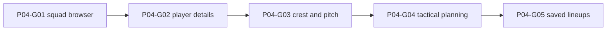

# Phase 4 — Squad workspace and 2D tactics planning

> **Derived from:** `MASTER_PLAN.md` version `1.0.0` (2026-10-19)  
> **Phase IDs:** `P04-G01` … `P04-G05`  
> **Status:** Execution plan. This file does not authorize work outside Phase 4.  
> **Baseline:** Phase 3 is complete. The implementation tip is `e4bf90cb56696c0e9118d0166c2cf44ee02b4b1c` (`done`). Squad and Tactics are still the Phase 1 previews. IndexedDB already holds campaigns, and the command center reads the managed club.

---

## 1. Parent plan contract

Authority is `MASTER_PLAN.md` `1.0.0`. On conflict, the master plan wins. This phase plan wins over any `plans/phase4/guide<number>.md` and over implementation.

Relevant master sections:

- **§1.5** — A 2D tactics planning board is in scope. A match visualizer, animated match engine, and fixture generation are not.
- **§3.2 and §3.3** — SVG pitch, generated crests, keyboard and touch as well as pointer, no status by color alone, reduced motion. Campaign URLs stay `/app/:campaignId/<section>`.
- **§4** — Campaign isolation, unknown versus zero, no synthesized birth date, provenance, determinism. `Lineup` and `DevelopmentPlan` already have Zod schemas and Dexie tables. Duplicate-slot checks were deferred to this phase. They belong in the planner and the save command, not in a schema rewrite.
- **§7.2** — Searchable squad table, known and missing fields, player detail, manual correction, development notes. Wage pyramid, tier caps, and contract commits are later phases; see assumption 1.
- **§7.3** — Preset formations, assign and swap, bench, several named lineups per season, roster checks. No predicted match result.
- **§8** — UI reads go through repositories. UI writes go through commands. Components do not call Dexie and do not import `src/domain`.
- **§9 Phase 4** — Outcome, guide order, and commit subjects below. Do not reorder, merge, or rename these guides.
- **§10** — Required shape of this file.
- **§12.4 and §12.5** — Assignment gives clear feedback. A keyboard-only user can assign a lineup. Do not promise a frame time.
- **§14** — Crests are original SVG geometry from stored colors and invented names. No real badges.

Roadmap entries, in order:

| ID | Deliverable | Commit subject |
| --- | --- | --- |
| `P04-G01` | Searchable, sortable squad table and player selection, with known and missing fields | `feat(p04-g01): build squad browser` |
| `P04-G02` | Player profile, manual corrections with provenance, and development notes | `feat(p04-g02): add player details and notes` |
| `P04-G03` | Procedural SVG crests and an accessible pitch | `feat(p04-g03): render generated clubs and pitch` |
| `P04-G04` | Formation presets and assign, swap, and bench by pointer, touch, and keyboard | `feat(p04-g04): enable interactive tactical planning` |
| `P04-G05` | Several named lineups, roster checks, and a tactics browser journey | `test(p04-g05): persist and validate lineup workflows` |

One guide is one commit. Split a guide only by editing this phase file first.

---

## 2. Phase objective and user-visible outcome

At the end of Phase 4 a reviewer can:

1. Open a saved campaign’s Squad page and see only the managed club’s players.
2. Search by name, filter by position group, and sort by name, position, age, or market value. Missing wage, tier, contract end, minutes, age, and value read `Unknown` or `Missing`, never `0` and never `€0.00`.
3. Select a player, correct identity fields, and save a development note. The player’s `source` stays as stored. The note does not change attributes. Reload shows the correction and the note.
4. See an original crest for the managed club and a labeled pitch. The crest uses that club’s stored colors.
5. Choose `4-3-3`, `4-2-3-1`, `4-4-2`, or `3-5-2`, place and swap players with pointer, touch, and keyboard, and refuse a second copy of the same player.
6. Save more than one named lineup, reload them, switch formation, and delete one lineup without touching another campaign.
7. Open Finance, Constitution, Transfers, and the other remaining sections and still see `Static preview — not save data`. Constitution still says `Rules are not active in this build.`

---

## 3. Prerequisites

Phase 3 exit criteria are met. Required commits, oldest first:

| Guide | Commit | Subject |
| --- | --- | --- |
| `P03-G01` | `73a70c687d507eab295777de1b515d1cb9b3bc12` | `feat(p03-g01): generate deterministic fictional world` |
| `P03-G02` | `0e62afd37706f6f9db77db4804bb84160024be35` | `feat(p03-g02): provision playable demo campaign` |
| `P03-G03` | `8479b4765be01fbb88d2eed56f572289a40ae1d6` | `feat(p03-g03): manage persistent campaigns` |
| `P03-G04` | `d4720a3712e20bed0b57afdebb0252718a511d32` | `feat(p03-g04): connect command center to save data` |
| `P03-G05` | `ecafb9078752da09862c2af6816437ee05d87821` | `test(p03-g05): validate first-run demo journey` |

The branch tip at planning time also contains `e4bf90cb56696c0e9118d0166c2cf44ee02b4b1c`, which adds `plans/phase3.md`. Start from that tip.

Inspect before `P04-G01`:

- `MASTER_PLAN.md` §3.2, §7.2, §7.3
- `plans/phase3.md` §5 and §10 handoff
- `src/domain/validation/schemas.ts` — `playerSchema`, `lineupSchema`, `developmentPlanSchema`, `auditEventSchema`
- `src/domain/validation/limits.ts` — `startersMax` is 11, `benchMax` is 12, `positionsMax` is 5
- `src/domain/models/money.ts`, `src/domain/models/dates.ts`, `src/domain/models/positions.ts`
- `src/domain/seed/prng.ts` — `hashSeed` only. Do not reseed the world.
- `src/data/repositories/players.ts`, `src/data/commands/add-player.ts`, `src/data/transactions/run-command.ts`
- `src/data/migrations/v1.ts` — frozen. Lineup and development-plan indexes already exist.
- `src/features/squad/SquadPage.tsx`, `src/features/tactics/TacticsPage.tsx`
- `src/features/dashboard/CommandCenterPage.tsx`, `src/app/layout/WorkspaceLayout.tsx`, `src/app/copy.ts`
- `src/test/command-center.test.tsx`, `src/test/shell-nav.test.tsx`, `e2e/smoke.spec.ts`
- `eslint.config.js`

`schemaV1` is frozen. Do not edit that object. Do not add `version(2)`.

`pnpm lint`, `pnpm typecheck`, `pnpm test`, `pnpm build`, and `pnpm test:e2e` already exist and must stay green. This phase adds one production dependency, `@tanstack/react-table`, in `P04-G01`. Do not add `@tanstack/react-virtual`, React Hook Form, Radix, Recharts, or Zustand.

---

## 4. In scope / out of scope

### In scope

- Squad table for the managed club: search, position-group filter, sort, selection, and honest missing fields.
- Manual correction of player fields that already exist on `Player`, plus one development note per player per active season.
- Deterministic crest and a static accessible pitch.
- In-memory formation board, then persisted named lineups for the active season.
- Pure placement rules: one place per player, known slots, bench limit, managed-club roster only.
- README text that squad edits and lineups write to `touchline-os`.
- Vitest coverage of display, placement, commands, and the squad and tactics screens, plus one Playwright tactics journey.
- Removal of `Static preview — not save data` on Squad from `P04-G01`, and on Tactics from `P04-G05`.

### Out of scope (deferred)

| Item | Phase |
| --- | --- |
| Wage pyramid, tier caps, wage commitment, contract create or renew | Phase 5 and Phase 6 |
| Constitution presets, `evaluateAction`, ledger capacity | Phase 5 |
| Shortlist, compare, transfer, offer, and registration commands | Phase 6 and Phase 8 |
| Moving a player between clubs | Phase 6 |
| Match entry, minutes totals, season rollover, newgens | Phase 7 |
| Radar charts, archetype scores, insight sentences | Phase 8 |
| Global command-palette search, backup, CSV/JSON import | Phase 8 and Phase 9 |
| `vite-plugin-pwa`, saved preferences | Phase 10 |
| `ARCHITECTURE.md` and `DECISIONS.md` | Phase 10 |

Also out of this phase: a second database, editing `schemaV1`, a Dexie version bump, drag-and-drop as a required gesture, shirt numbers, match animation, and an Add player form. `addPlayer` stays the existing command. This phase does not call it from the Squad page.

---

## 5. Architecture impact

```text
src/domain/player/     display age, squad ordering, lineup placement
src/domain/graphics/   crest spec and formation slots, no React
src/data/commands/     update player, save note, save lineup, delete lineup
src/data/repositories/ player update, development plans, lineups
src/components/graphics/  presentational SVG only
src/features/squad/
src/features/tactics/
```

```text
Squad page
  → listPlayersByClub(campaignId, managedClubId)
  → pure filter and sort
  → select one player

Player save or note
  → updatePlayer or saveDevelopmentNote
    → runCommand
      → revision check, roster check, one audit
    → CommandResult

Tactics
  → same squad list plus listLineups for the active season
  → pure place / bench / clear / switchFormation
  → saveLineup or deleteLineup
```

The Squad page must not call `listPlayers` for the whole campaign. A 3,000-player demo is filtered in IndexedDB by `[campaignId+clubId]` before it reaches the table.

### Boundaries

- `src/domain/**` stays free of React, Dexie, `Math.random`, and `Date`.
- `src/components/**` stays free of `src/domain` and `src/data`. Crest and pitch components receive plain props.
- `src/features/**` may import domain functions, repository reads, and commands. They still must not import `src/data/db.ts` or `src/data/migrations/**`.
- Feature code passes `systemClock()` and `createEntityId()` into command inputs at the UI edge.
- A `CONFLICT` result uses the existing sentence `This save changed in another tab. Reload and try again.` The screen does not write the rejected input again.

### Squad display

Pure functions live in `src/domain/player/squad-view.ts`. They take player fields and the active season. They do not read the clock.

`displayAge(player, season)`:

| Inputs | Result |
| --- | --- |
| `birthDate` and `season.startDate` are both set, and the birth date is on or before `startDate` | `{ kind: 'exact', years }` from `ageInWholeYears` |
| Otherwise `reportedAge` and `ageReferenceSeasonOrdinal` are both set, and `estimateAge` accepts the active season ordinal | `{ kind: 'estimated', years }` |
| Anything else, including a birth date with no season start, or an estimate that would throw | `{ kind: 'unknown' }` |

Rendered text:

- exact: `${years} years`
- estimated: `${years} years, estimated`
- unknown: `Unknown`

The birth-date row is the stored `YYYY-MM-DD` or `No birth date recorded`. The screen never fills a birth date from an age.

Market value uses `formatMoneyUnknown`. Null stays `Unknown`. A known value may show `€` on the Squad page only. The command center still must not show `€`.

Wage, tier, contract end, and minutes are the literal `Unknown` in every row. This phase does not read `contracts` or `appearances` to paint those cells.

Attribute keys, in this order: `pace`, `finishing`, `passing`, `dribbling`, `defending`, `physical`. A present integer is shown as that integer, including `0`. An absent key is `Missing`.

Provenance labels, exact: `Fictional`, `Imported`, `User-entered`, `Estimated`, `Generated`.

Sort comparison lives in `compareSquadRows(left, right, key, direction)`. Keys are `name`, `position`, `age`, `value`. Name uses `localeCompare('en', { numeric: true, sensitivity: 'base' })`. Position compares `positionGroup`, then the first entry of `positions`. Age uses the display years. Value uses `marketValueCents`. Null age and null value sort after every known value in both directions. Default sort is name ascending.

`filterSquad(players, query, group)` keeps a player whose name contains the trimmed query, case-insensitive. An empty query keeps every name. `group` is `all` or a position group, matched against `positionGroup`.

### Player correction

`updatePlayer` lives in `src/data/commands/update-player.ts`. The input is a strict object. It has no `clubId`, `source`, `externalSourceId`, or `isNewgen` field, so a caller cannot move the player or relabel provenance. The command loads the stored player inside the transaction and copies those four fields onto the write.

Editable input: `name`, `positions` (one to five unique codes), `nationalityCode` (`AA` or null), `birthDate` (a real `YYYY-MM-DD` or null), `reportedAge` (integer 0–99 or null), `marketValueCents` (nonnegative integer cents or null), `attributes` (the six optional keys), `potential` (0–100 or null). When `reportedAge` is set, the command writes `ageReferenceSeasonOrdinal` from the active season’s `ordinal`. When `reportedAge` is null, that ordinal is null. The command does not invent a birth date. `positionGroup` is `positionGroupFor` of every supplied position; a mix of groups is `VALIDATION`.

A missing player is `NOT_FOUND`. A stale revision is `CONFLICT`. A Zod failure is `VALIDATION`. None of those write a player or an audit row, and none bump `revision`.

Audit `actionType` is `player.update`. Summary, exact: `Updated player ${name}` using the submitted name. Payload is the parsed input and includes `playerId`.

The profile sentence, exact: `Source stays ${label}. This correction is recorded in activity.`

### Development notes

`saveDevelopmentNote` writes one `DevelopmentPlan` for the active season. The unique index `&[campaignId+playerId+seasonId]` already exists. The command reads that key inside the transaction. An existing row is updated in place. A missing row is inserted with the caller-supplied id. A second id for the same player and season is not inserted.

`status` stored by this screen is `open`. `notes` may be an empty string. `targetRole` is a trimmed string of 1–40 characters, or null. The command does not read or write `player.attributes`.

Audit `actionType` is `player.note`. Summary, exact: `Noted development for ${name}`.

Helper under the textarea, exact: `Notes stay in this companion. They do not change the player's attributes.`

History lists up to 20 campaign audits, newest first, whose payload has `playerId` equal to the selected player. Seed audits do not match. Empty copy, exact: `No individual history for this player.` Contracts copy, exact: `Contracts are not recorded in this build.` There is no compare control and no shortlist control.

### Crests and pitch

`crestSpec(club)` in `src/domain/graphics/crest.ts` uses `hashSeed(club.id, 'crest-v1') % 4`:

| Remainder | Mark |
| --- | --- |
| 0 | `shield` |
| 1 | `stripe` |
| 2 | `chevron` |
| 3 | `monogram` |

`primary` and `secondary` are the club’s stored colors. The monogram is the uppercase first letter of each whitespace-separated word in `name`, at most three letters. A name with no letters uses `?`. The function does not call `mulberry32` or `Math.random`.

`PitchSvg` has `role="img"` and accessible name `Pitch`. It draws touchlines, the halfway line, the center circle, both penalty areas, both six-yard boxes, and both goals as static SVG. It has no animation. Slot buttons sit on top in `P04-G04`; they are not drawn inside the domain module.

`formationSlots(formation)` returns exactly 11 slots. Coordinates are percentages of the pitch: `x` from the left, `y` from the top, with the opponent’s goal at `y` near 20 and the own goalkeeper at `y` 90. Slot ids and groups:

**`4-3-3`:** `gk` GK 50,90; `rb` DEF 82,72; `rcb` DEF 64,76; `lcb` DEF 36,76; `lb` DEF 18,72; `rcm` MID 66,52; `cm` MID 50,58; `lcm` MID 34,52; `rw` FWD 78,28; `st` FWD 50,20; `lw` FWD 22,28.

**`4-2-3-1`:** the same `gk`, `rb`, `rcb`, `lcb`, `lb`; then `rdm` MID 62,62; `ldm` MID 38,62; `rw` FWD 78,40; `cam` MID 50,42; `lw` FWD 22,40; `st` FWD 50,20.

**`4-4-2`:** the same back line; then `rm` MID 82,48; `rcm` MID 62,54; `lcm` MID 38,54; `lm` MID 18,48; `rst` FWD 62,22; `lst` FWD 38,22.

**`3-5-2`:** `gk` GK 50,90; `rcb` DEF 66,74; `cb` DEF 50,78; `lcb` DEF 34,74; `rwb` DEF 86,48; `rcm` MID 62,54; `cm` MID 50,60; `lcm` MID 38,54; `lwb` DEF 14,48; `rst` FWD 62,22; `lst` FWD 38,22.

Labels are the slot ids in uppercase. `4-3-3` is the default for a new draft.

### Placement

Pure functions live in `src/domain/player/lineup-draft.ts`.

```ts
type LineupDraft = {
  name: string
  formation: '4-3-3' | '4-2-3-1' | '4-4-2' | '3-5-2'
  starters: { playerId: string; slot: string; role: string | null }[]
  benchPlayerIds: string[]
}
```

`placeOnSlot` removes that player from every other starter slot and from the bench, then writes the slot. The previous occupant of the destination slot becomes unassigned. They are not pushed onto the bench. `placeOnBench` removes the player from starters. If they are already on the bench, the bench does not gain a second copy. A twelfth new bench player returns `{ ok: false, code: 'BENCH_FULL' }` and the same draft. An unknown slot returns `UNKNOWN_SLOT`. A player id that is not in the supplied roster returns `UNKNOWN_PLAYER`.

`switchFormation` sets the formation, clears `starters`, and keeps `name` and `benchPlayerIds`.

`lineupProblems` reports a duplicate player, a duplicate slot, a slot that is not in the formation, a bench longer than 12, more than 11 starters, or a player id outside the roster. `lineupSchema` stays permissive so a bad stored row still parses. The screen shows `This lineup does not match the current roster.` and disables Save while problems remain.

Fit text, from the player’s `positionGroup` and the slot group, exact: `Position fit`, `Different position`, or `Unknown position` when the player group is `UNKNOWN`. The words are visible. Color may repeat them and must not replace them.

Assignment gestures:

- Pointer and touch: activate a roster button, then activate a slot or `Send to bench`. Activating an occupied slot while holding another player swaps by the `placeOnSlot` rule. `Clear slot` unassigns the selected slot. Drag is not required.
- Keyboard: Enter on a roster button sets holding. The live text is `Holding ${name}`. Enter on a slot places. Enter on `Send to bench` benches. Escape clears holding and does not change the draft.
- Switching the formation select clears starters and shows `Starting slots were cleared.`

Through `P04-G04` the draft is React state. Visible sentence, exact: `This lineup is on this screen only. It is not saved yet.` Reload loses it. `P04-G05` removes that sentence.

### Saved lineups

`saveLineup` inserts or updates one lineup for the active season. It re-checks `lineupProblems` against players whose `clubId` equals `managedClubId`. Failure is `VALIDATION` and writes nothing. A trimmed name of 1–120 characters is required. Another lineup in the same campaign and season with the same trimmed name and a different id is `VALIDATION` with message `A lineup with this name already exists.` Stale revision is `CONFLICT`.

Audit `actionType` is `lineup.save`. Summary, exact: `Saved lineup ${name}`.

`deleteLineup` removes that lineup row only, in the same transaction as its audit and the revision bump. A lineup from another campaign is `NOT_FOUND` and deletes nothing. Audit `actionType` is `lineup.delete`. Summary, exact: `Deleted lineup ${name}`.

The select is labeled `Saved lineups`. `New lineup` clears the draft and does not delete a saved row. Choosing another saved lineup replaces the draft immediately. Sentence, exact: `Choosing another lineup discards unsaved changes.`

On open, if any lineup exists for the active season, the draft loads the one with the latest `updatedAt`, then the greatest `id`. Otherwise the draft is `4-3-3` with an empty name, no starters, and no bench.

Delete uses an in-page panel. The confirm button reads `Delete ${name}` and is a separate control from the button that opens the panel. Escape closes the panel without writing. This phase does not add Radix.

### Banner

`WorkspaceLayout` hides `Static preview — not save data` on the command center, the club chooser, and, from the guide named below, on Squad and Tactics. Every other workspace section keeps the banner.

| Path | Banner |
| --- | --- |
| `/squad` | Hidden from `P04-G01` |
| `/tactics` | Hidden from `P04-G05` |
| finance, constitution, transfers, registration, scouting, matches, seasons | Kept |

A demo that has no `campaign.select-club` audit still redirects Squad and Tactics to `/app/demo/choose-club`, using the same audit check as the command center. A user campaign with a null seed does not redirect.

### Assumptions recorded here

1. **Wage, tier, contract end, and minutes stay `Unknown`.** Those columns remain so the Phase 1 table shape is still there. Contract writes are Phase 6. Minutes are Phase 7. The wage pyramid is Phase 5. Reading empty contract rows to print `Unknown` is unnecessary, so this phase does not query them.
2. **Market value is the first euro figure on screen.** It is a stored player field, formatted with `formatMoneyUnknown`. Null is `Unknown`. The command center test continues to forbid `€` on that page.
3. **The editor saves one position list from one select.** The select defaults to the first stored position. Save writes that single position and the matching group. Seeded players already have one position. Extra positions are not edited in this phase.
4. **A correction does not change `source`.** The audit row is the record of the edit. The profile keeps the stored source label. The user cannot set `imported`.
5. **Notes do not progress attributes.** `saveDevelopmentNote` does not update the player row.
6. **Click and keyboard assign. Drag is not a requirement.** Pointer and touch use the same activate-then-place sequence. The exit criterion is that a player cannot be placed twice and that keyboard assignment works.
7. **Lineup schema stays as committed in Phase 2.** Duplicate players and foreign roster ids fail the command. They do not make `getLineup` throw `CORRUPT`.
8. **No Dexie version bump.** Existing lineup and development-plan indexes are enough. History filters audits in memory. There is no player-id audit index.
9. **TanStack Table is the squad table.** `@tanstack/react-table` is installed in `P04-G01`. Virtualization is not installed. Ordering rules live in the domain function the table calls.
10. **Forms stay native controls plus Zod.** Campaign create already works that way. This phase does not add React Hook Form. The command remains the validation boundary.
11. **Crest geometry is hashed from the club id.** Stored colors are not re-rolled. The squad page shows the managed club’s crest, not 72 crests.
12. **Global Search, Import, and Backup stay unavailable.** The squad search box is not the top-bar search panel.
13. **Command-center age math stays on `reportedAge`.** Squad rows use `displayAge`. They may differ once a birth date and a season start both exist. This phase does not change `campaign-summary.ts`.
14. **The tactics browser test uses the real demo world.** Do not point it at a smaller generator.

---

## 6. Work breakdown and dependency graph



Implement in that order. Every guide runs `pnpm lint`, `pnpm typecheck`, `pnpm test`, `pnpm build`, `pnpm exec playwright install chromium`, and `pnpm test:e2e`, because each one changes a screen the smoke spec walks.

### P04-G01 — Squad browser

- **Goal:** The managed club’s players appear in a searchable, sortable table. Missing fields stay unknown. Selecting a row shows the name. Players are not editable yet.
- **Depends on:** Phase 3 tip.
- **Blocks:** `P04-G02` through `P04-G05`.

**Inspect:** `SquadPage.tsx`, `players.ts`, `money.ts`, `dates.ts`, `WorkspaceLayout.tsx`, `command-center.test.tsx`, `shell-nav.test.tsx`, `e2e/smoke.spec.ts`.

**Create:**

- `src/domain/player/squad-view.ts` — `displayAge`, `filterSquad`, `compareSquadRows`, provenance labels
- `src/test/squad-view.test.ts`
- `src/features/squad/SquadBrowser.tsx`
- `src/test/squad-page.test.tsx`

**Modify:**

- `package.json` and the lockfile for `@tanstack/react-table`.
- `SquadPage.tsx` so it loads the managed club through `listPlayersByClub` and renders `SquadBrowser`.
- `WorkspaceLayout.tsx` so a found campaign’s `/squad` path has no preview banner.
- `src/app/copy.ts` with `Loading squad.` and `This squad could not be loaded. Reload and try again.`
- `src/test/shell-nav.test.tsx` so the banner assertion uses `/app/demo/finance`.
- `src/test/command-center.test.tsx` so the squad visit no longer expects the preview banner. Point that assertion at `/app/demo/finance`.
- `e2e/smoke.spec.ts` so Harbor’s Squad page has the column headers, has no preview banner, has no `This build does not store records.`, and shows `No players at this club.`

**Behavior:**

- Columns, in order: Name, Position, Age, Wage, Value, Tier, Contract end, Minutes, Source. The caption remains `Squad`.
- Name is a button `Select ${name}`. The selected region is labeled `Selected player` and shows the name and the first position. It also shows `This build does not edit players yet.`
- Search input label: `Search players`. Filter label: `Position group`. Options: `All`, `GK`, `DEF`, `MID`, `FWD`, `UNKNOWN`.
- Sort controls are the column header buttons for Name, Position, Age, and Value. `aria-sort` reflects the active column.
- An empty club shows `No players at this club.` A search with no matches shows `No players match this search.`
- A demo without `campaign.select-club` redirects to the chooser. A null-seed campaign does not.
- Filter and sort state reset when `campaignId` changes. They are not written to IndexedDB.
- The page shows no player from another club and no free agent.

**Tests:**

- Estimated age, exact age when both dates exist, unknown age when only a birth date exists, null money as `Unknown`, and a known value formatted with `€`.
- Search and position filter. Unknown value sorts after a known value when sorting value ascending and descending.
- A rendered club with two players does not show a third player from another club. Wage, tier, contract end, and minutes are `Unknown`.
- Harbor-style empty club renders `No players at this club.`

**Verification:** the six commands in the section intro.

**Commit:** `feat(p04-g01): build squad browser`

### P04-G02 — Player details and notes

- **Goal:** The selected player can be corrected and can store one development note. Source and attributes stay honest. Reload keeps both writes.
- **Depends on:** `P04-G01` selection region.
- **Blocks:** `P04-G03`, `P04-G04`, `P04-G05`.

**Inspect:** `add-player.ts`, `playerSchema`, `developmentPlanSchema`, `auditEventSchema`, `SquadBrowser.tsx`.

**Create:**

- `src/data/repositories/development-plans.ts` — `getDevelopmentPlan(campaignId, playerId, seasonId)`
- `src/data/commands/update-player.ts`
- `src/data/commands/save-development-note.ts`
- `src/features/squad/PlayerProfile.tsx`
- `src/test/update-player.test.ts`
- `src/test/player-profile.test.tsx`

**Modify:**

- `src/data/repositories/players.ts` with `updatePlayer`. It uses Dexie `update` after checking the stored `campaignId`. It does not use `put`. A campaign mismatch throws `PersistenceError` `SCOPE`.
- `auditEventSchema` so `actionType` also allows `player.update` and `player.note`. Update the schema fixture that parses an audit. Do not edit `schemaV1`.
- `SquadBrowser` so the selected region renders `PlayerProfile` and no longer says players cannot be edited.

**Behavior:** match the correction and note contracts in §5. The note form is separate from `Save player`. Saving a note does not submit the player form. `Save player` is disabled while that command runs. Success text is `Player updated.` Note success text is `Development note saved.` Nationality that is not two letters or empty shows `Enter a two-letter code or leave nationality blank.` and does not write. Empty market value stores null. The profile lists attributes with `Missing` for absent keys.

**Tests:**

- A correction of the name writes one `player.update` audit, keeps `source` and `clubId`, and bumps revision by 1. A stale revision writes nothing.
- An input object that includes `clubId` fails validation because the schema is strict.
- `birthDate: null` with `reportedAge: 21` stores a null birth date and the active season ordinal.
- A note save does not change attributes. A second note for the same player and season updates the same plan id and adds a second audit. A plan for campaign B is not returned for campaign A.
- The profile shows `Contracts are not recorded in this build.` and does not show a shortlist button.

**Verification:** the six commands in the section intro. Smoke still reaches Constitution.

**Commit:** `feat(p04-g02): add player details and notes`

### P04-G03 — Generated clubs and pitch

- **Goal:** The managed club has a deterministic crest. Tactics shows that crest and a labeled pitch. Lineups are still not interactive and still not saved.
- **Depends on:** `P04-G02`. The crest can land on the squad header without waiting on notes, but the guide order stays as in §1.
- **Blocks:** `P04-G04`, `P04-G05`.

**Inspect:** `TacticsPage.tsx`, `hashSeed`, `e2e/smoke.spec.ts`, `copy.ts` `pitchPreview`.

**Create:**

- `src/domain/graphics/crest.ts`
- `src/domain/graphics/pitch.ts` — `pitchLinePaths()` and `formationSlots`
- `src/components/graphics/CrestSvg.tsx`
- `src/components/graphics/PitchSvg.tsx`
- `src/test/crest-pitch.test.ts`

**Modify:**

- Squad header so it renders `CrestSvg` for the managed club with accessible name `${name} crest`.
- `TacticsPage` so it shows the same crest and `PitchSvg`, and the sentence `Lineups are not saved in this build.`
- Remove the `pitchPreview` sentence from the tactics screen. Delete the export if nothing else imports it, and update the smoke spec to expect the pitch name `Pitch` and the new sentence.
- The tactics preview banner stays.

**Behavior:**

- Two calls with the same club id and colors return the same mark, colors, and monogram. `Harbor Athletic` is `HA`. A different club id may change the mark and must not change another club’s stored colors.
- The pitch graphic contains no player name and no `animate` element.
- Tactics does not yet show a formation select.

**Tests:** the four marks are only `shield`, `stripe`, `chevron`, and `monogram`. Each formation returns 11 slots with unique ids. `pitchLinePaths()` is non-empty and stable across two calls. A rendered crest exposes the accessible name.

**Verification:** the six commands in the section intro.

**Commit:** `feat(p04-g03): render generated clubs and pitch`

### P04-G04 — Interactive tactical planning

- **Goal:** A person can build a lineup on the pitch with pointer and keyboard. Nothing is stored. The same player cannot occupy two places.
- **Depends on:** `P04-G03` pitch and `formationSlots`.
- **Blocks:** `P04-G05`.

**Inspect:** `PitchSvg.tsx`, `formationSlots`, `SquadBrowser` roster loading, `e2e/smoke.spec.ts`.

**Create:**

- `src/domain/player/lineup-draft.ts`
- `src/test/lineup-draft.test.ts`
- `src/features/tactics/TacticsBoard.tsx`
- `src/test/tactics-board.test.tsx`

**Modify:** `TacticsPage.tsx` so it loads the managed squad and renders `TacticsBoard`. Replace `Lineups are not saved in this build.` with `This lineup is on this screen only. It is not saved yet.` Update the smoke spec to that sentence. Keep the tactics banner.

**Behavior:** match the placement contract in §5. The formation control is a labeled select `Formation` whose options are the four formations. The roster is a list of buttons, one per managed-club player, sorted by the default squad sort. Slot controls are buttons whose accessible name includes the slot label and, when occupied, the player name and the fit words. `Send to bench` and `Clear slot` are buttons. There is no Save control in this guide.

**Tests:**

- Placing a player on two slots leaves them only on the second. The first occupant is unassigned.
- Benching a starter removes the starter row. A twelfth new bench player returns `BENCH_FULL` and leaves twelve ids.
- `switchFormation` clears starters and keeps the bench.
- A rendered board: choose a player, activate GK, see `Holding` clear and the GK button name include the player. Press the same player and ST, and assert the GK button no longer includes that player. Escape after holding does not place.
- The board text includes `This lineup is on this screen only. It is not saved yet.` and does not include a euro sign.

**Verification:** the six commands in the section intro.

**Commit:** `feat(p04-g04): enable interactive tactical planning`

### P04-G05 — Persist and validate lineup workflows

- **Goal:** Named lineups survive reload, stay inside one campaign and season, and the browser journey covers place, reload, duplicate prevention, and formation switch.
- **Depends on:** `P04-G04` draft.
- **Blocks:** Phase 4 exit.

**Inspect:** `lineupSchema`, `run-command.ts`, `TacticsBoard.tsx`, `e2e/demo-journey.spec.ts`, `README.md`.

**Create:**

- `src/data/repositories/lineups.ts`
- `src/data/commands/save-lineup.ts`
- `src/data/commands/delete-lineup.ts`
- `src/test/save-lineup.test.ts`
- `e2e/tactics.spec.ts`

**Modify:**

- The audit enum with `lineup.save` and `lineup.delete`. Do not edit `schemaV1`.
- `TacticsBoard` so it loads, saves, and deletes lineups. Remove the not-saved sentence.
- `WorkspaceLayout` so `/tactics` has no preview banner.
- `README.md` local-database paragraph so squad corrections, development notes, and tactics lineups write to `touchline-os`, and finance, constitution, transfers, registration, scouting, matches, seasons, import, and backup remain previews.
- The smoke spec so Tactics no longer expects the not-saved sentence. Constitution still expects the preview banner and `Rules are not active in this build.`

**Behavior:** match the saved-lineup contract in §5. Save is disabled while problems exist or the name is empty, and while a save is in flight. Success text is `Saved lineup ${name}.`

**Data tests, in `touchline-os-test`:**

- Saving `League XI` and `Cup Rotation` returns both from the active season list. A second campaign’s list is empty.
- A starter who plays for another club, or a free agent, returns `VALIDATION` and leaves the lineup count unchanged.
- The same player in two slots returns `VALIDATION`.
- A stale `expectedRevision` returns `CONFLICT` and does not change the stored formation.
- A duplicate name returns `VALIDATION` and does not insert.
- Delete removes that lineup only. The other lineup and the other campaign remain. A second delete of the same id returns `NOT_FOUND`.

**Browser journey in `e2e/tactics.spec.ts`**, timeout 120 seconds, fresh context, production database name `touchline-os`:

1. Open `/`, start the fictional demo, and choose `Ashbridge`.
2. Open Squad. The preview banner is absent. The table has a player button. Wage cells read `Unknown`.
3. Open Tactics. The pitch name `Pitch` is visible. The preview banner is absent.
4. Place the first roster player on GK and the second on the next slot, using the keyboard sequence in §5.
5. Name the lineup `League XI` and save. Reload. The URL is still the tactics section. GK’s accessible name still includes the first player.
6. Place that same player on ST. GK no longer includes them, and ST does.
7. Switch the formation to `4-4-2`. `Starting slots were cleared.` is visible.
8. Open Constitution. `Rules are not active in this build.` and the preview banner are visible.

Do not add `storageState`. Do not shrink the seed.

**Verification:** the six commands in the section intro.

**Commit:** `test(p04-g05): persist and validate lineup workflows`

Do not commit a guide when its verification commands fail.

---

## 7. Acceptance criteria

1. `pnpm lint`, `pnpm typecheck`, `pnpm test`, `pnpm build`, and `pnpm test:e2e` pass on the phase tip.
2. Squad for a found campaign lists only `listPlayersByClub` for `managedClubId`. A player of another club is not in the table.
3. Search, position filter, and sort match §5. Unknown age and unknown value sort last.
4. Wage, tier, contract end, and minutes read `Unknown`. A null market value reads `Unknown`. A known market value uses `formatMoneyUnknown` and may contain `€`. Absent attributes read `Missing`, not `0`.
5. The command center still has no `€` and no preview banner. Finance and constitution still show the preview banner. Constitution still says rules are not active.
6. Saving a player correction keeps `source` and `clubId`, does not invent a birth date, writes one `player.update` audit, and survives reload.
7. A stale player update or lineup save returns `CONFLICT` and does not change rows.
8. A development note does not change attributes. A second save updates the same plan row. Campaign B cannot read campaign A’s note.
9. The same club id and colors always produce the same crest mark and monogram. Crest colors are the stored colors.
10. The pitch has accessible name `Pitch`, has no animation, and does not show a simulated match.
11. Placing a player twice leaves one assignment. A full bench is refused. Switching formation clears starters and keeps the bench.
12. Keyboard assignment can hold a player, place them, and cancel with Escape.
13. Two named lineups survive reload. A lineup that cites a player outside the managed club is not stored. Deleting one lineup leaves the other, and leaves every other campaign.
14. `/app/demo/squad` and `/app/demo/tactics` do not show `Static preview — not save data` after the phase tip. Import still has no file input.
15. `schemaV1` is unchanged, and the database class still declares version 1 only.
16. `src/components/**` does not import `src/domain` or `src/data/db.ts`. Domain graphics code does not call `Math.random`.

---

## 8. Verification

From a clean install at the phase exit:

```bash
pnpm install --frozen-lockfile
pnpm lint
pnpm typecheck
pnpm test
pnpm build
pnpm exec playwright install chromium
pnpm test:e2e
```

Expected: each command exits 0. `pnpm test` includes the Phase 1 through Phase 3 files plus `squad-view.test.ts`, `squad-page.test.tsx`, `update-player.test.ts`, `player-profile.test.tsx`, `crest-pitch.test.ts`, `lineup-draft.test.ts`, `tactics-board.test.tsx`, and `save-lineup.test.ts`. `pnpm test:e2e` includes `e2e/smoke.spec.ts`, `e2e/demo-journey.spec.ts`, and `e2e/tactics.spec.ts`.

### Manual browser pass

1. `pnpm dev`, open `/`, and start the fictional demo. Choose `Ashbridge`.
2. Open Squad. Confirm the crest name, a player row, `Unknown` wage, and a market value that is either `Unknown` or a euro amount. Confirm the preview banner is absent. Search for a name that is on screen, then for `zzzz`, and confirm the empty-search sentence.
3. Select a player. Set the market value field empty and save. Reload. The value cell reads `Unknown`. The source label is still `Fictional`.
4. Save a development note. Reload. The note text is still there. Attribute numbers are unchanged.
5. Open Tactics. Place two players, including with the keyboard. Save `League XI`. Reload and confirm both placements. Move the first player to another slot and confirm the original slot no longer names them.
6. Save `Cup Rotation`, switch between the two names, and delete `Cup Rotation`. Reload. `League XI` remains.
7. Switch to `4-4-2` and confirm the starting slots clear.
8. Open Finance and Constitution. The preview banner is present. Constitution says rules are not active.
9. Create `Harbor` / `Harbor Athletic` / `HAR`. Squad shows `No players at this club.` Harbor has no `League XI`.
10. Open `/app/does-not-exist/squad` and confirm the missing-campaign state.
11. `pnpm build && pnpm preview`, and repeat steps 2, 5, and 8 on the preview origin.

### Earlier guides

`P04-G01` may show euros on Squad and must not show them on the command center. `P04-G04` must not write a lineup row. If a page load of that guide creates a lineup, remove that write before committing. `P04-G05` is the first guide that persists a lineup.

---

## 9. Risks, mitigations, rollback

| Risk | Mitigation | Rollback |
| --- | --- | --- |
| The squad table loads all 3,000 players | The page calls `listPlayersByClub` only. The isolation test uses a second club. | Revert `P04-G01` |
| Unknown wage or value renders as €0 | Those cells use `Unknown` or `formatMoneyUnknown`. The squad test covers null. | Revert `P04-G01` |
| A correction moves a player or relabels `source` | `updatePlayer`’s schema omits `clubId` and `source`. The command copies them from the stored row. | Revert `P04-G02` |
| A note changes attributes or inserts a second plan | The note command does not update the player. The unique index plus an in-transaction read keeps one plan. | Revert `P04-G02` |
| Crests use real badges or `Math.random` | Geometry is a hashed mark plus stored colors. The domain syntax ban already exists. | Revert `P04-G03` |
| The pitch animates a match | No animate element. Copy and tests forbid a simulated result. | Revert `P04-G03` or `P04-G04` |
| One player is stored in two slots | `placeOnSlot` strips the previous place. `saveLineup` repeats `lineupProblems` inside the transaction. | Revert `P04-G04` or `P04-G05` |
| A lineup cites another club’s player | The save command compares `clubId` with `managedClubId` inside the transaction. | Revert `P04-G05` |
| Two tabs save the same revision | `expectedRevision` is checked inside `runCommand`. The UI shows the stale-save sentence. | Revert the command that skipped the check |
| The preview banner disappears from finance or constitution | Smoke and the demo journey still require it there. The banner hide list is only squad, then tactics. | Revert the layout change |
| `schemaV1` or Dexie version 2 is edited to index lineups by name | Name uniqueness is a command check. Acceptance criterion 15. | Restore `migrations/v1.ts` from `4337d647987964cd9cbbeebe2bddd8ee683b71f9` |
| This phase writes a constitution, a contract, or a match | Out-of-scope table and assumption 1. | Remove those writes before commit |
| The tactics browser test times out on the demo seed | The spec sets a 120-second timeout. Do not shrink the world. | Fix the wait, then recommit |

User data created by Vitest stays in `touchline-os-test` and is deleted in `afterEach`. Playwright uses a fresh context. Revert a bad guide with `git revert` of that commit. Do not reset published history.

---

## 10. Exit criteria and handoff

Phase 4 is complete when all of the following are true:

- [x] Commits exist, in order, with the five subjects in §1.
- [x] The commands in §8 pass on the phase tip.
- [x] Acceptance criteria in §7 are true.
- [x] `schemaV1` and Dexie version 1 are unchanged.
- [x] README states that squad corrections, development notes, and lineups write to `touchline-os`.
- [x] Assumptions in §5 are still accurate, or this file was edited before the code diverged.

### Progress log

Record each guide commit here when it lands. Do not rewrite the subjects.

| Guide | Commit | Checks |
| --- | --- | --- |
| `P04-G01` | `f193632b52ffcefa4453d1265b795abaf218022a` | Frozen install, format, lint, typecheck, 171 tests, build, Chromium install, and 2 E2E journeys passed. |
| `P04-G02` | `e26498aa7983ed2e92b543747b55f3dadb8fd973` | Frozen install, format, lint, typecheck, 197 tests, build, Chromium install, 2 E2E journeys, and demo profile acceptance passed. |
| `P04-G03` | `946984f8e26433c37a7174b4403d637c0be5e00a` | Frozen install, format, lint, typecheck, 218 tests, build, Chromium install, 2 E2E journeys, and demo graphics acceptance with visual inspection passed. |
| `P04-G04` | `360b4ad6db437a68223e5b0bafb7ae2602402fbf` | Frozen install, format, lint, typecheck, 234 tests, build, Chromium install, 2 E2E journeys, and pointer, native keyboard, touch, Escape, and reload acceptance with visual inspection passed. |
| `P04-G05` | `e4a76739e02f4d9e487e5b7dffca1c2fa9cb8dfd` | Frozen install, format, lint, typecheck, test (257 passed), build, Chromium install, and test:e2e (3 journeys passed). Unit and browser suites verified separately; full demo phase-exit acceptance and visual inspection passed. |

### Handoff to Phase 5

Phase 5 may assume:

- Squad and Tactics read the managed club. Finance and Constitution still show `Static preview — not save data`.
- Player rows may already contain `marketValueCents`. Wages are not stored. There are still no contract rows and no ledger rows.
- `updatePlayer` does not change `clubId` or `source`. A later contract command must not reuse it to set a wage.
- Development notes and lineups are campaign-scoped and already go through `runCommand`.
- A saved lineup may contain fewer than 11 starters. Slot ids are the formation ids in §5. Duplicate players are rejected at save time.
- The command center still shows transfer capacity, weekly wages, and registration as `Unknown`. Phase 5 replaces the finance and constitution previews. It must not remove the Squad or Tactics behavior to do that.
- Crests are `crestSpec` plus `CrestSvg`. Phase 5 does not need to restyle them.
- `CONFLICT` still means the screen must reload. Components still must not import `src/data/db.ts` or `src/domain`.

Phase 5 must not add transfer commits, match entry, backup import, or the PWA plugin. Rule verdicts belong on the finance and constitution surfaces, and on the later transfer preview, not as a silent rewrite of an already saved lineup.
