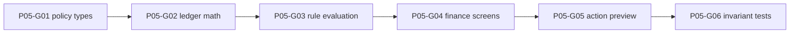

# Phase 5 — Club constitution and finance engine

> **Derived from:** `MASTER_PLAN.md` version `1.0.0` (2026-10-19)  
> **Phase IDs:** `P05-G01` … `P05-G06`  
> **Status:** Complete. All six guides and the phase-exit checks passed. This file does not authorize work outside Phase 5.  
> **Baseline:** Phase 4 is complete. The implementation tip is `63b619699f4a0eefaccafeabe61eec49c41d091f` (`phase 4 done`). Finance and Constitution are still the Phase 1 previews. Squad, Tactics, and the command center already read the save. There is no constitution row, no ledger row, and no contract row.

---

## 1. Parent plan contract

Authority is `MASTER_PLAN.md` `1.0.0`. On conflict, the master plan wins. This phase plan wins over any `plans/phase5/guide<number>.md` and over implementation.

Relevant master sections:

- **§1.5** — The app records a career played elsewhere. It does not simulate a match, an auction, or a transfer market.
- **§4** — Integer cents, unknown versus zero, campaign isolation, explicit clock and ids, one audit path, determinism. Constitution, ledger, and contract shapes already exist. This phase does not rewrite them.
- **§5.1** — `evaluateAction(action, snapshot, constitution, effectiveDate)` is pure. The same inputs return the same report. A later commit uses this function. It does not keep a second copy of the rules in a component.
- **§5.2** — Five rule ids. This phase evaluates sell-to-buy, age, wage tier, and prestige. Registration is stored and explained. It is not enforced until Phase 6.
- **§5.3** — Season-scoped capacity from the opening allocation, completed sales, prize income, and approved carryover, minus completed incoming fees. Wage commitment is the sum of known active wages. It is not subtracted from capacity. Reversals are nonnegative rows with `reversesEntryId`.
- **§5.4** — A preview shows before and after figures, each verdict, and `Preview only — no changes recorded`. A preview is not permission to write. This phase has no transfer commit.
- **§7.1** — The command center may show remaining capacity and weekly wages once those figures exist. Registration stays unknown. Activity stays audit text.
- **§7.2** — The wage pyramid, tier caps, and warning or block words live on Finance. Contract create and renew stay in Phase 6.
- **§8** — UI reads go through repositories. UI writes go through commands. Components do not call Dexie and do not import `src/domain`.
- **§9 Phase 5** — Outcome, guide order, and commit subjects below. Do not reorder, merge, or rename these guides.
- **§10** — Required shape of this file.
- **§12.2 invariants 1, 2, 3, 4, and 6** — 70% of a sale, age 27, a €46,000 key wage, stale spend, and unknown wage. Invariants 5, 7, 8, 9, and 12 belong to later phases.
- **§12.5** — A keyboard user can review a blocker. Severity is a word, not a color alone.

Roadmap entries, in order:

| ID | Deliverable | Commit subject |
| --- | --- | --- |
| `P05-G01` | Constitution presets and the pure rule-report types | `feat(p05-g01): introduce explainable policy engine` |
| `P05-G02` | Integer-cent capacity, wage commitment, ledger post, and reversal | `feat(p05-g02): calculate auditable club finances` |
| `P05-G03` | Sell-to-buy, age, wage-tier, and prestige evaluation | `feat(p05-g03): enforce club constitution rules` |
| `P05-G04` | Finance dashboard, wage pyramid, ledger, and constitution editor | `feat(p05-g04): expose finances and rule settings` |
| `P05-G05` | Before/after action preview with blocker and warning text | `feat(p05-g05): explain rule impacts before commits` |
| `P05-G06` | Invariant tests and a finance browser journey | `test(p05-g06): lock financial policy invariants` |

One guide is one commit. Split a guide only by editing this phase file first.

---

## 2. Phase objective and user-visible outcome

At the end of Phase 5 a reviewer can:

1. Open Constitution on a saved campaign and save **Balanced**, **Strict Moneyball**, or **Custom**. Reload shows that version. A second save stores version 2 and leaves version 1 in the database.
2. See plain-language text for all five rules. Registration says it is saved and not enforced in this build.
3. Open Finance and see the managed club’s remaining transfer capacity and weekly wage commitment for the active season. A campaign with no constitution still shows `Unknown` for capacity. Empty known wages show `€0.00`. An unknown wage does not show as `€0.00`.
4. See a wage pyramid with Key, Rotation, Youth, and Unknown tier, including each cap or `Cap not set`, and the word `Blocked` when a stored active contract breaks an enabled cap.
5. Post prize income, reverse that row, and see capacity move by the configured prize percentage and then return. The opening allocation posts once.
6. Preview a paid signing, a free signing, a wage change, and an offer rejection. The same numbers always produce the same verdicts. The screen says the preview recorded nothing. Reload does not add a transfer, a contract, or a second fee.
7. See transfer capacity and weekly wages on the command center from the same functions Finance uses. Registration stays `Unknown`. Squad wages stay `Unknown`. Transfers, Registration, Scouting, Match Journal, and Seasons still show `Static preview — not save data`.

---

## 3. Prerequisites

Phase 4 exit criteria are met. Required commits, oldest first:

| Guide | Commit | Subject |
| --- | --- | --- |
| `P04-G01` | `f193632b52ffcefa4453d1265b795abaf218022a` | `feat(p04-g01): build squad browser` |
| `P04-G02` | `e26498aa7983ed2e92b543747b55f3dadb8fd973` | `feat(p04-g02): add player details and notes` |
| `P04-G03` | `946984f8e26433c37a7174b4403d637c0be5e00a` | `feat(p04-g03): render generated clubs and pitch` |
| `P04-G04` | `360b4ad6db437a68223e5b0bafb7ae2602402fbf` | `feat(p04-g04): enable interactive tactical planning` |
| `P04-G05` | `e4a76739e02f4d9e487e5b7dffca1c2fa9cb8dfd` | `test(p04-g05): persist and validate lineup workflows` |

The branch tip at planning time also contains `63b619699f4a0eefaccafeabe61eec49c41d091f`, which records those SHAs in `plans/phase4.md`. Start from that tip.

Inspect before `P05-G01`:

- `MASTER_PLAN.md` §5, §7.1, §7.2, §12.2
- `plans/phase4.md` §5 assumptions 1 and 2, and §10 handoff
- `plans/phase2.md` §5 constitution rule fields and ledger kinds
- `src/domain/validation/schemas.ts` — `constitutionSchema`, `ledgerEntrySchema`, `contractSchema`, `auditEventSchema`
- `src/domain/validation/limits.ts` — `signingAgeMin` 15, `signingAgeMax` 50
- `src/domain/models/money.ts` — `parseMoneyCents`, `formatMoneyEuros`, `formatMoneyUnknown`
- `src/domain/player/squad-view.ts` — `displayAge`. The rule engine receives an age. It does not compute one.
- `src/data/transactions/run-command.ts`, `src/data/commands/create-campaign.ts`
- `src/data/migrations/v1.ts` — frozen. Constitution, ledger, and contract indexes already exist.
- `src/features/finance/FinancePage.tsx`, `src/features/constitution/ConstitutionPage.tsx`
- `src/features/dashboard/CommandCenterPage.tsx`, `src/features/dashboard/campaign-summary.ts`
- `src/features/campaigns/CampaignManager.tsx`
- `src/app/layout/WorkspaceLayout.tsx`, `src/app/copy.ts`
- `src/components/ui/StatusPill.tsx`, `src/components/ui/KpiRibbon.tsx`
- `src/test/schemas.test.ts`, `src/test/command-center.test.tsx`
- `e2e/smoke.spec.ts`, `e2e/demo-journey.spec.ts`, `e2e/tactics.spec.ts`
- `README.md` local-database paragraph

`schemaV1` is frozen. Do not edit that object. Do not add `version(2)`.

`pnpm lint`, `pnpm typecheck`, `pnpm test`, `pnpm build`, and `pnpm test:e2e` already exist and must stay green. This phase adds no production dependency and no property-testing library. Do not add `fast-check`, Recharts, React Hook Form, Radix, Zustand, or `@tanstack/react-virtual`.

---

## 4. In scope / out of scope

### In scope

- Pure presets, report types, and `evaluateAction` for the four enforced rules, plus the rollover prestige check the function must already know.
- Pure transfer-capacity and wage-commitment math, including reversal pairs and a second season.
- Commands that save a new constitution version, post an opening allocation or prize income, and reverse one ledger row.
- Optional preset on `createCampaign`, so existing callers that omit it stay valid.
- Finance and Constitution screens, command-center capacity and wage figures, and one action preview that does not write.
- README text that those finance and constitution writes go to `touchline-os`.
- Vitest coverage of the formulas, commands, screens, and the six master invariants this phase owns, plus one Playwright finance journey.

### Out of scope (deferred)

| Item | Phase |
| --- | --- |
| Shortlist, offer inbox, accept, and reject commands | Phase 6 |
| Completed sale, purchase, and free-transfer commands | Phase 6 |
| Ledger kinds `player_sale` and `incoming_fee` written by a user command | Phase 6 |
| Contract create, renew, tier edit, and squad wage cells | Phase 6 |
| `REGISTRATION_QUOTA` evaluation and the registration screen | Phase 6 |
| Match entry, minutes, season rollover, `approved_carryover` posting | Phase 7 |
| Radar charts, insight sentences | Phase 8 |
| CSV/JSON import, backup | Phase 9 |
| `vite-plugin-pwa`, saved preferences | Phase 10 |
| `ARCHITECTURE.md` and `DECISIONS.md` | Phase 10 |

Also out of this phase: a second database, editing `schemaV1`, a Dexie version bump, rewriting a saved lineup, moving a player, and seeding finances inside `seedDemoCampaign`. The featured demo adopts a constitution on the Constitution page. Reset still deletes that save and seeds the world again, which clears the adopted rules.

---

## 5. Architecture impact

```text
src/domain/rules/       presets, report types, evaluateAction
src/domain/finance/     capacity, wage commitment, preview arithmetic
src/data/commands/      save constitution, post ledger, reverse ledger
src/data/repositories/  constitutions, ledger entries, contract reads
src/features/constitution/
src/features/finance/
src/features/dashboard/   capacity and wage KPIs only
```

```text
Constitution save or campaign create with a preset
  → saveConstitution or createCampaign
    → runCommand
      → next version, optional opening allocation, one or two audits
    → CommandResult

Finance
  → list the active constitution, the active season’s ledger, active contracts
  → transferCapacity and wageCommitment
  → postLedgerEntry or reverseLedgerEntry

Preview
  → previewAction (pure)
    → evaluateAction
  → render before, after, and verdicts
  → no command
```

The Finance page reads the managed club and the active season. It does not call `listPlayers` for the whole campaign, and it does not list another club’s ledger.

### Boundaries

- `src/domain/**` stays free of React, Dexie, `Math.random`, and `Date`.
- `src/components/**` stays free of `src/domain` and `src/data`. `StatusPill` and `KpiRibbon` stay presentational.
- `src/features/**` may import domain functions, repository reads, and commands. They still must not import `src/data/db.ts` or `src/data/migrations/**`.
- Feature code passes `systemClock()` and `createEntityId()` into command inputs at the UI edge.
- A `CONFLICT` result uses the existing sentence `This save changed in another tab. Reload and try again.` The screen does not write the rejected input again.

### Presets

`constitutionPreset(name)` in `src/domain/rules/presets.ts` returns the five rules in this order: `SELL_TO_BUY`, `MAX_SIGNING_AGE`, `WAGE_TIER_CAP`, `PRESTIGE_BID_SALE`, `REGISTRATION_QUOTA`. It does not return an id, a campaign id, or a version. Names are `balanced`, `strict`, and `custom`.

| Field | Balanced | Strict | Custom |
| --- | --- | --- | --- |
| Every `enabled` | `true` | `true` | `false` |
| `salesReinvestmentPct` | 70 | 50 | 70 |
| `prizeReinvestmentPct` | 100 | 50 | 100 |
| `carryoverPct` | 0 | 0 | 0 |
| `initialAllocationCents` | 500_000_000 | 200_000_000 | 500_000_000 |
| `maxAge` | 26 | 23 | 26 |
| `freeTransfersExempt` | `true` | `false` | `true` |
| Key / rotation / youth weekly caps | 4_500_000 / 2_000_000 / 500_000 | 2_250_000 / 1_000_000 / 250_000 | same as Balanced |
| Prestige numerator / denominator | 3 / 2 | 2 / 1 | 3 / 2 |
| `requireHigherPrestige` | `true` | `true` | `true` |
| `rosterLimit` | 25 | 20 | 25 |
| `minimumHomegrown` | 8 | 10 | 8 |
| `ageExemptionUnder` | 21 | 21 | 21 |
| `competitionKey` | `league` | `league` | `league` |

500_000_000 cents is €5,000,000.00. 200_000_000 cents is €2,000,000.00. The wage caps are €45,000.00, €20,000.00, and €5,000.00 on Balanced, and half of those euro amounts on Strict. Registration numbers match the disabled sample already stored in `src/test/schemas.test.ts`, with Strict’s roster and homegrown count tightened. The master plan leaves those four registration fields to the preset author. This table is that choice.

Each preset object passes `constitutionRuleSchema` once a campaign id and the other constitution fields are added. Custom keeps the Balanced numbers so a later enable does not invent a parameter.

### Policy types

```ts
type Severity = 'BLOCK' | 'WARN' | 'INFO'

type RuleVerdict = {
  ruleId:
    | 'SELL_TO_BUY'
    | 'MAX_SIGNING_AGE'
    | 'WAGE_TIER_CAP'
    | 'PRESTIGE_BID_SALE'
  severity: Severity
  code: string
  message: string
  evidence: Record<string, number | string | null>
  remedy: string
}

type RuleReport = {
  allowed: boolean
  verdicts: RuleVerdict[]
  snapshotRevision: number
}

type PolicySnapshot = {
  revision: number
  remainingCapacityCents: number | null
}

type PolicyAction =
  | {
      type: 'incoming-transfer'
      feeCents: number
      age: number | null
      isFree: boolean
      weeklyWageCents: number | null
      squadTier: 'key' | 'rotation' | 'youth' | null
    }
  | {
      type: 'wage-change'
      weeklyWageCents: number | null
      squadTier: 'key' | 'rotation' | 'youth' | null
    }
  | {
      type: 'reject-offer'
      feeCents: number
      marketValueCents: number | null
      bidderPrestige: number | null
      sellerPrestige: number | null
    }
  | {
      type: 'season-rollover'
      unresolvedQualifyingOffers: number
    }
```

`allowed` is false when any verdict has severity `BLOCK`. `snapshotRevision` copies `snapshot.revision`. There is no registration action. A parser exported as `parsePolicyAction` rejects `{ type: 'registration' }` and any unknown key.

`effectiveDate` is a `DateOnly` argument. None of the four rules branch on it. Age is already a number or null on the action. The engine does not call `displayAge`, `estimateAge`, or the clock.

### Capacity

`transferCapacity(entries, seasonId, clubId)` lives in `src/domain/finance/capacity.ts`. It returns:

```ts
type CapacityBreakdown = {
  initialAllocationCents: number
  saleCreditCents: number
  prizeCreditCents: number
  carryoverCents: number
  incomingFeesCents: number
  authorizedCents: number
  remainingCents: number
}
```

The percentages are arguments, not a hidden Balanced default: `salesReinvestmentPct` and `prizeReinvestmentPct`, integers 0–100.

Rows that count are those whose `seasonId` and `clubId` match. A reversal and the row named by its `reversesEntryId` are both dropped. The reversal amount is not added and not subtracted. An orphan reversal, whose target is absent from the supplied list, is ignored. Kinds that are not reversed contribute:

| Kind | Bucket |
| --- | --- |
| `initial_allocation` | `initialAllocationCents` |
| `player_sale` | gross sales, then `saleCreditCents = Math.floor(gross * salesReinvestmentPct / 100)` |
| `prize_income` | gross prizes, then the same floor division with `prizeReinvestmentPct` |
| `approved_carryover` | `carryoverCents` |
| `incoming_fee` | `incomingFeesCents` |
| `reversal` | never a bucket |

`authorizedCents` is the sum of the four credit buckets. `remainingCents` is `authorizedCents - incomingFeesCents`. All math uses integers. A one-cent sale at 70% credits 0 cents.

Worked figures the tests must pin:

- Gross sales 1_000_000_000 cents and 70% credit 700_000_000 cents, which is €7,000,000.00, not the full €10,000,000.00.
- The same gross at 100% credits 1_000_000_000. At 0% it credits 0.
- Prize 100_000_000 at 100% credits 100_000_000. At 50% it credits 50_000_000.
- A reversed sale drops that sale’s gross. A reversed incoming fee drops that fee.
- Rows for another season, another club, or another campaign’s ids, when they are simply not in the filtered list, do not move the result. The function filters season and club itself, so a mixed list is safe.

The screen shows `Unknown` for capacity only when no constitution row exists. A stored constitution with no matching ledger rows shows `€0.00`. The adopt path below posts the opening allocation in the same save, so Balanced does not flash zero on first save.

`initialAllocationCents` on the rule is the amount the first post should record. Capacity reads the ledger, not the rule field. When the rule is enabled and the net opening allocation differs from `initialAllocationCents`, Finance shows `Opening allocation does not match the constitution. Capacity uses the ledger.` The screen does not rewrite the row to hide that sentence.

### Wage commitment

`wageCommitment(contracts, clubId)` in `src/domain/finance/wages.ts` keeps rows with `status: 'active'` and the same `clubId`. Ended rows and other clubs are ignored.

```ts
type WageTier = 'key' | 'rotation' | 'youth' | 'unknown'

type WageCommitment = {
  knownCents: number
  unknownCount: number
  byTier: Record<
    WageTier,
    { count: number; knownCents: number; unknownCount: number }
  >
}
```

A null `weeklyWageCents` increments `unknownCount` and is not added as 0. A null `squadTier` counts in `unknown`. `formatWageCommitment` returns:

| Case | Text |
| --- | --- |
| `unknownCount === 0` | `formatMoneyEuros(knownCents)`, including `€0.00` when nothing is active |
| `knownCents === 0` and `unknownCount > 0` | `Unknown` |
| both nonzero | `${euros} · ${unknownCount} unknown` |

The command center and Finance both call this function. Squad does not. The Squad wage column stays the literal `Unknown` even when a contract row exists.

### Ledger commands

`postLedgerEntry` accepts kind `initial_allocation` or `prize_income` only. `player_sale`, `incoming_fee`, `approved_carryover`, and `reversal` return `VALIDATION` and write nothing. Phase 6 and Phase 7 insert those kinds from their own commands, through the same repository helper, so this public command cannot pretend a sale happened.

The command checks, inside the transaction:

- The campaign revision matches `expectedRevision`.
- `seasonId` is the active season.
- `clubId` is `managedClubId`.
- `amountCents` is a nonnegative integer and `effectiveOn` is a real `DateOnly`.
- A second non-reversed `initial_allocation` for that campaign, season, and club returns `VALIDATION` with message `An opening allocation is already posted.`

Prize income may be posted more than once. Note is a trimmed string of 1–4_000 characters, or null.

Audit `actionType` is `ledger.post`. Summaries, exact:

- `Posted opening allocation of ${euros}`
- `Posted prize income of ${euros}`

`reverseLedgerEntry` copies `amountCents`, `seasonId`, and `clubId` from the target. Kind is `reversal`. `reversesEntryId` is the target id. A reversal of a reversal, a second reversal of the same target, a missing target, and a target in another campaign return `VALIDATION` or `NOT_FOUND` and write nothing. The note is required. Stale revision is `CONFLICT`.

Audit `actionType` is `ledger.reverse`. Summary, exact: `Reversed ${label}`, where the label is `opening allocation`, `prize income`, `player sale`, `incoming fee`, or `carryover`, taken from the target kind.

Both commands use `runCommand`. A thrown body returns `ABORTED` and leaves the ledger count and revision unchanged.

### Constitution save

`saveConstitution` inserts a new row. It does not update the previous row. Version is 1 when the campaign has none, otherwise one more than the highest stored version. The unique index `&[campaignId+version]` remains the backstop. The revision check still returns `CONFLICT` first when two tabs share a revision.

The input carries all five rules. A missing id, a repeated id, or a parameter outside the schema is `VALIDATION`. The command does not fill a missing rule from Balanced.

When the campaign has no non-reversed opening allocation, the saved `SELL_TO_BUY` rule is enabled, and the caller supplied a ledger id, the same transaction inserts one `initial_allocation` for the active season and the managed club. The amount is `initialAllocationCents`. `effectiveOn` is the `DateOnly` the caller passed. `sourceActionId` is the constitution action id. A disabled sell-to-buy rule does not post. A later save does not post a second allocation and does not edit the first one.

Audit `actionType` is `constitution.save`. Summary, exact: `Saved constitution version ${n}`. One audit covers the save, including the allocation posted with it. The ledger row is the financial record.

`createCampaign` gains an optional `preset: 'balanced' | 'strict' | 'custom'`. Omitted means the current behavior: no constitution and no ledger row, and the single `campaign.create` audit. When `preset` is present, the input also carries `constitutionId`, `constitutionActionId`, and `ledgerEntryId`. The create transaction then writes the preset and, for Balanced and Strict, the opening allocation. It writes a second audit, `Saved constitution version 1`. Custom writes the constitution and the constitution audit, and no ledger row. Callers that omit `preset` do not need the new ids. Do not generate ids inside the command.

### Evaluation

`evaluateAction(action, snapshot, constitution, effectiveDate)` lives in `src/domain/rules/evaluate-action.ts`. A disabled rule adds no verdict. Verdicts follow the rule order in §5. Passing a check adds no `INFO` row.

Codes, severity, message, and remedy:

| Code | When | Message | Remedy |
| --- | --- | --- | --- |
| `INSUFFICIENT_DATA` | Enabled sell-to-buy, paid fee, and `remainingCapacityCents === null` | `Transfer capacity is unknown, so this fee cannot be checked.` | `Save a constitution that posts an opening allocation.` |
| `FEE_EXCEEDS_CAPACITY` | Enabled sell-to-buy and `feeCents > remainingCapacityCents` | `The fee is above the remaining transfer capacity.` | `Record a completed sale, raise the allocation, or lower the fee.` |
| `INSUFFICIENT_DATA` | Enabled age rule and `age === null` | `Age is unknown, so this signing cannot be checked.` | `Enter a birth date or an estimated age on the player.` |
| `AGE_ABOVE_CAP` | Enabled age rule and `age > maxAge`, unless the free exemption applies | `Age ${age} is above the cap of ${maxAge}.` | `Choose a younger player, use an exempt free transfer, or change the constitution.` |
| `INSUFFICIENT_DATA` | Enabled wage rule and the proposed wage is null | `Weekly wage is unknown, so the tier cap cannot be checked.` | `Enter a weekly wage.` |
| `WAGE_ABOVE_TIER_CAP` | Enabled wage rule, tier is `key`, `rotation`, or `youth`, and the wage is above that cap | `The weekly wage is above the ${tier} cap.` | `Lower the wage, change the tier, or change the constitution.` |
| `INSUFFICIENT_DATA` | Enabled wage rule and `squadTier === null` while the wage is known | `Squad tier is unknown, so the wage cap cannot be checked.` | `Choose Key, Rotation, or Youth.` |
| `UNKNOWN_VALUATION` | Enabled prestige rule on `reject-offer`, and the market value or either prestige is null | `Valuation or prestige is unknown, so this bid needs a manual review.` | `Enter the market value and both prestige figures.` |
| `QUALIFYING_OFFER` | The bid qualifies | `This bid qualifies and cannot be rejected while the rule is on.` | `Accept the bid, or change the constitution in an audited update.` |
| `UNRESOLVED_QUALIFYING_OFFER` | Enabled prestige rule on `season-rollover` and `unresolvedQualifyingOffers > 0` | `A qualifying offer is still unresolved.` | `Accept the qualifying offer, or change the constitution in an audited update.` |

`UNKNOWN_VALUATION` is `WARN`. Every other code in the table is `BLOCK`.

A signing is free only when `isFree` is true and `feeCents` is 0. That case skips the capacity check. A free flag with a nonzero fee is treated as a paid signing. The age exemption applies only when the signing is free and `freeTransfersExempt` is true.

A bid qualifies when the value and both prestige figures are known, the fee meets the rational test, and, when `requireHigherPrestige` is true, bidder prestige is greater than seller prestige. The fee test is `BigInt(feeCents) * BigInt(denominator) >= BigInt(marketValueCents) * BigInt(numerator)`. Equal prestige does not qualify when higher prestige is required. A bid that fails the test produces no prestige verdict.

Which action runs which rules:

| Action | Rules |
| --- | --- |
| `incoming-transfer` | sell-to-buy, age, wage tier |
| `wage-change` | wage tier |
| `reject-offer` | prestige |
| `season-rollover` | prestige, and only the unresolved-offer code |

Evidence includes the numbers named in the message: fee, remaining capacity, age, cap, wage, tier, and the prestige inputs that were known. Unknown inputs are `null` in evidence.

### Preview arithmetic

`previewAction` in `src/domain/finance/preview.ts` calls `evaluateAction` and returns the report plus before and after figures. It does not write.

- Before capacity is `snapshot.remainingCapacityCents`.
- A paid incoming fee subtracts `feeCents` from a known remaining capacity. When the fee is greater than the remaining capacity, the after text is `Short by ${formatMoneyEuros(fee - remaining)}` and no negative money type is introduced. A free signing leaves capacity unchanged.
- Before wages use `formatWageCommitment`. A known proposed wage is added to `knownCents` for the after text. A null proposed wage makes the after text `Unknown`. `reject-offer` and `season-rollover` leave both figures unchanged.

`season-rollover` is tested and is not on the preview form.

### Screens

Constitution, when the campaign has no row:

- Heading `Choose a constitution`.
- A labeled select `Preset` whose options are `Balanced`, `Strict Moneyball`, and `Custom`. The initial value is `Balanced`.
- The selected preset’s description, exact:
  - Balanced: `70% of completed sales, age cap 26, and weekly caps of €45,000.00, €20,000.00, and €5,000.00.`
  - Strict: `50% of completed sales, age cap 23, free transfers count, and lower wage caps.`
  - Custom: `All five rules are saved off. You can turn a rule on before saving.`
- Button `Save constitution`.

Constitution, once a row exists:

- Text `Version ${n}`.
- One group per rule, in the preset order, with that rule id as the heading and a checkbox labeled `Enabled`.
- Descriptions, exact:
  - `Paid signings are limited to the unspent transfer capacity from the opening allocation, a share of completed sales, recorded prize money, and approved carryover.`
  - `A signing older than the age cap is blocked. A free transfer can be exempt when that option is on.`
  - `A known weekly wage above the selected tier cap is blocked. An unknown wage is blocked while this rule is on.`
  - `A qualifying bid from a higher-prestige club cannot be rejected, and a season cannot roll over while one is unresolved.`
  - `Registration checks are saved here and are not enforced in this build.`
- Number and money fields for the parameters in §5. Money fields use `parseMoneyCents`. An invalid field shows `invalidMoneyMessage` and does not call the command.
- Helper: `Saving writes a new version. It does not change lineups, players, or transfers.`
- The sentence `Rules are not active in this build.` is removed from this screen. Delete the `constitutionNote` export when nothing else imports it.

Finance:

- `KpiRibbon` labels `Transfer capacity` and `Weekly wages`, using the same formatters as the command center.
- Pyramid caption `Wage pyramid`. Rows `Key`, `Rotation`, `Youth`, and `Unknown tier`. Each row shows the player count, `formatWageCommitment` for that tier, and either `Cap ${euros}` or `Cap not set`.
- An enabled wage rule shows `StatusPill` tone `blocked` on a tier that has a known wage above its cap, or a null wage. The word `Blocked` is visible. A disabled wage rule shows neither the pill nor a zero wage for a null.
- Empty contracts still render the four rows and the caps. Extra sentence: `No active contracts are recorded.`
- Ledger caption `Ledger`. Columns `Date`, `Kind`, `Amount`, `Note`. Kind labels are the reversal labels in §5, plus `reversal` rendered as `Reversal`. Amounts use `formatMoneyEuros`. Empty copy: `No ledger entries for this season.`
- Prize form labels `Prize amount`, `Effective date`, and `Note`, with button `Post prize income`. Success text: `Posted prize income.`
- The date field may start as the `DateOnly` from `systemClock()`, and the command still receives that explicit value.
- Reverse uses an in-page panel. The button that opens it reads `Reverse ${label}`. The note field is `Reversal note`. The confirm button reads `Reverse entry` and is a separate control. Escape closes the panel without writing. Success text: `Reversed ledger entry.` This phase does not add Radix.

Action preview, added in `P05-G05`, is a region labeled `Action preview` on Finance:

- Select `Action` with `Paid signing`, `Free signing`, `Wage change`, and `Reject offer`.
- Paid signing fields: `Fee`, `Age`, `Weekly wage`, `Tier`.
- Free signing hides `Fee` and submits `feeCents: 0` with `isFree: true`.
- Wage change fields: `Weekly wage`, `Tier`.
- Reject offer fields: `Bid`, `Market value`, `Bidder prestige`. Seller prestige is the managed club’s stored `prestige` and is not a free-typed field.
- Blank age, wage, value, or bidder prestige is null. Tier options are `Key`, `Rotation`, `Youth`, and an empty option that submits null.
- Button `Preview action`.
- Result text includes `Preview only — no changes recorded.`
- Before and after lines are labeled `Before` and `After`.
- Each verdict renders `StatusPill` with `Blocked`, `Warning`, or `Informational`, then the message and the remedy.
- When `allowed` is true and no verdicts exist, the result includes `No rule blocked this action.`
- Button `Record this action` is disabled. Beside it: `Transfers and contracts are not recorded in this build.`
- The preview calls no command. Ledger count and revision stay the same.

Create-campaign panel, from `P05-G04`:

- Labeled select `Constitution`, default `Balanced`, same three options.
- The existing Save control submits that preset. The demo-journey create steps can keep filling only the three name fields.

Command center:

- `Transfer capacity` uses the capacity rule in §5.
- `Weekly wages` uses `formatWageCommitment`.
- `Registration` stays `Unknown`.
- The demo world has no constitution until someone saves one, so the command center of an unadopted demo still shows `Unknown` and still has no `€` until that save.
- A user campaign created with Balanced shows euros. The command center does not render `Blocked`, `Warning`, `Informational`, or `Passed`.

### Banner

`WorkspaceLayout` hides `Static preview — not save data` on the command center, the club chooser, Squad, Tactics, and, from `P05-G04`, on Finance and Constitution.

| Path | Banner |
| --- | --- |
| `/finance` | Hidden from `P05-G04` |
| `/constitution` | Hidden from `P05-G04` |
| transfers, registration, scouting, matches, seasons | Kept |

Smoke, the demo journey, and the tactics journey currently treat Constitution as the page that still has the banner and `Rules are not active in this build.` `P05-G04` moves that banner witness to Transfers.

### Assumptions recorded here

1. **The demo seed does not gain finances.** Completion is still the Phase 3 world plus the seed audit. A constitution on `demo` is an explicit save. Reset removes it because reset deletes the campaign.
2. **`createCampaign` preset is optional.** Existing tests omit it and still write no constitution. The welcome form always sends one. This avoids a second writer in the seed and keeps the Phase 2 command tests valid.
3. **Capacity is the ledger, not the rule field.** The rule’s `initialAllocationCents` is posted once when sell-to-buy is enabled and no opening row exists. Later edits do not silently rewrite that row.
4. **Sale and incoming-fee rows are readable and not postable here.** The pure function counts them. `postLedgerEntry` refuses them. Phase 6 inserts them inside the transfer command.
5. **Registration is stored and not evaluated.** The constitution can enable it. `evaluateAction` has no registration action. The screen says the checks are not enforced in this build.
6. **Rollover is a pure action only.** `season-rollover` is tested. No season screen posts `approved_carryover` or closes a season.
7. **The preview does not select a squad player.** Age, fee, wage, and bidder prestige are typed. Phase 6 can build the same action from a player id. `displayAge` stays the age source for a later caller.
8. **Squad wage cells stay `Unknown`.** The pyramid is the wage surface. Painting the squad column would be the Phase 6 contract workflow.
9. **Known empty wages are `€0.00`.** That is a counted sum of no known wages. A null wage on an active contract is `Unknown` or the mixed sentence, never a silent zero inside the sum.
10. **No new Dexie version.** Name uniqueness for lineups and version uniqueness for constitutions already have indexes. History of constitutions is additional rows, not an in-place update.
11. **Invariant tests are example tests, not a new library.** “Property” in the roadmap means the numbered financial properties. Do not install `fast-check`.
12. **One audit per finance command, two when create also saves a constitution.** The ledger row posted with the first constitution shares that constitution action as `sourceActionId`.
13. **Euro text is allowed on Finance, Constitution, and a command center that has a constitution.** The unadopted demo command center stays free of `€`. Market value on Squad may still contain `€`.
14. **The public post command cannot reverse by using a negative amount.** Amounts stay nonnegative. Direction is the reversal kind.
15. **A preview never enables `Record this action`.** Warnings do not commit in this phase. Phase 6 owns the confirm button’s real command.

---

## 6. Work breakdown and dependency graph



Implement in that order. `P05-G01`, `P05-G02`, and `P05-G03` run `pnpm lint`, `pnpm typecheck`, `pnpm test`, and `pnpm build`. They do not change a screen the smoke spec walks, so they do not need Playwright. `P05-G04`, `P05-G05`, and `P05-G06` also run `pnpm exec playwright install chromium` and `pnpm test:e2e`.

### P05-G01 — Explainable policy engine

- **Goal:** Presets and the report types exist as pure modules. Nothing is stored and no screen changes.
- **Depends on:** Phase 4 tip.
- **Blocks:** `P05-G02` through `P05-G06`.

**Inspect:** `constitutionSchema`, `schemas.test.ts`, `limits.ts`.

**Create:**

- `src/domain/rules/types.ts` — the types and `parsePolicyAction` in §5
- `src/domain/rules/presets.ts` — `constitutionPreset`
- `src/test/constitution-presets.test.ts`

**Behavior:** match the preset table. Do not import Dexie. Do not add `evaluateAction` in this guide. Do not write a constitution from `createCampaign`.

**Tests:**

- Each preset has five unique ids in the stated order, and the Balanced and Strict flags are enabled.
- Balanced allocation is 500_000_000. Strict allocation is 200_000_000. Custom is disabled and still carries 500_000_000.
- A constitution object built from Balanced passes `constitutionSchema`.
- `parsePolicyAction` accepts a paid incoming transfer and rejects `{ type: 'registration' }`.
- The module graph does not call `Math.random`.

**Verification:** `pnpm lint`, `pnpm typecheck`, `pnpm test`, `pnpm build`.

**Commit:** `feat(p05-g01): introduce explainable policy engine`

### P05-G02 — Auditable club finances

- **Goal:** Capacity and wage commitment are pure, and ledger post and reverse commit or write nothing.
- **Depends on:** `P05-G01` types. The calculator itself does not need the presets, but the guide order stays as in §1.
- **Blocks:** `P05-G03` through `P05-G06`.

**Inspect:** `ledgerEntrySchema`, `contractSchema`, `run-command.ts`, `money.ts`, repository insert style in `src/data/repositories/players.ts`.

**Create:**

- `src/domain/finance/capacity.ts`
- `src/domain/finance/wages.ts`
- `src/data/repositories/constitutions.ts` — `getActiveConstitution` returns the highest `version`, or `undefined`
- `src/data/repositories/ledger-entries.ts` — `listLedgerEntries(campaignId, seasonId, clubId)` and `insertLedgerEntry`
- `src/data/repositories/contracts.ts` — `listContractsByClub` only. No insert export.
- `src/data/commands/post-ledger-entry.ts`
- `src/data/commands/reverse-ledger-entry.ts`
- `src/test/capacity.test.ts`
- `src/test/ledger-commands.test.ts`

**Modify:** `auditEventSchema` so `actionType` also allows `ledger.post` and `ledger.reverse`. Update the schema fixture that parses an audit. Do not edit `schemaV1`.

**Behavior:** match the capacity, wage, and command contracts in §5. Tests may insert a `player_sale` or `incoming_fee` with the table API or `insertLedgerEntry` inside the test transaction. The public post command still refuses those kinds.

**Tests:**

- The €10,000,000 at 70% case, the one-cent case, a reversed sale, a reversed fee, and a second season.
- A contract with `weeklyWageCents: null` does not increase `knownCents` and does increase `unknownCount`. An ended contract is ignored. `formatWageCommitment` of that lone null wage is `Unknown`. No contracts formats as `€0.00`.
- Posting an opening allocation writes one ledger row and one audit, and bumps revision by 1. A second opening allocation writes nothing.
- Posting `player_sale` through `postLedgerEntry` returns `VALIDATION`.
- Reversing the prize removes it from a later `transferCapacity` call. Reversing that reversal returns `VALIDATION`. A stale `expectedRevision` returns `CONFLICT` and does not add a row.
- Campaign B’s ledger list does not include campaign A’s row.

**Verification:** `pnpm lint`, `pnpm typecheck`, `pnpm test`, `pnpm build`. Finance still shows the empty ledger preview.

**Commit:** `feat(p05-g02): calculate auditable club finances`

### P05-G03 — Club constitution rules

- **Goal:** The four enforced rules return stable verdicts for fixed fixtures. No screen changes.
- **Depends on:** `P05-G01` types and `P05-G02` capacity figures, which the tests pass in the snapshot.
- **Blocks:** `P05-G04`, `P05-G05`, `P05-G06`.

**Inspect:** `presets.ts`, `types.ts`, `capacity.ts`.

**Create:**

- `src/domain/rules/evaluate-action.ts`
- `src/test/evaluate-action.test.ts`

**Behavior:** match the evaluation table in §5. Use Balanced as the fixture constitution unless a case says the rule is disabled.

**Tests:**

- Two calls with the same action, snapshot, constitution, and `effectiveDate` of `2026-10-19` are deep-equal.
- Remaining capacity 500_000_000 and fee 600_000_000 returns `FEE_EXCEEDS_CAPACITY` and `allowed: false`. Fee 100_000_000 with age 24 and wage 1_000_000 on rotation returns `allowed: true` and no verdicts.
- Fee 0 with `isFree: true` and age 27 returns no age verdict. The same age with `isFree: false` returns `AGE_ABOVE_CAP`. A null age returns `INSUFFICIENT_DATA`.
- Wage 4_600_000 on `key` returns `WAGE_ABOVE_TIER_CAP`. Wage null returns `INSUFFICIENT_DATA` and the evidence wage is null.
- Market value 10_000_000 cents, numerator 3, denominator 2, fee 15_000_000, bidder prestige 80, seller prestige 50 returns `QUALIFYING_OFFER`. Fee 14_999_999 does not. A null market value returns `UNKNOWN_VALUATION` and `allowed: true`.
- `season-rollover` with one unresolved qualifying offer returns `UNRESOLVED_QUALIFYING_OFFER`. With zero, it returns no verdict.
- Disabling `SELL_TO_BUY` removes only the capacity verdict.
- A `{ type: 'registration' }` value never reaches the evaluator through `parsePolicyAction`.

**Verification:** `pnpm lint`, `pnpm typecheck`, `pnpm test`, `pnpm build`.

**Commit:** `feat(p05-g03): enforce club constitution rules`

### P05-G04 — Finances and rule settings

- **Goal:** A person can save a constitution, read capacity and wages, post and reverse prize income, and see the pyramid. The preview form is not on screen yet.
- **Depends on:** `P05-G02` commands and `P05-G03` only in that the saved rules must be the ones that guide will evaluate. The screen does not need to call `evaluateAction` until `P05-G05`.
- **Blocks:** `P05-G05`, `P05-G06`.

**Inspect:** `FinancePage.tsx`, `ConstitutionPage.tsx`, `CommandCenterPage.tsx`, `CampaignManager.tsx`, `create-campaign.ts`, `WorkspaceLayout.tsx`, `copy.ts`, the three e2e specs, `README.md`.

**Create:**

- `src/data/commands/save-constitution.ts`
- `src/features/finance/WagePyramid.tsx`
- `src/features/finance/LedgerTable.tsx`
- `src/test/save-constitution.test.ts`
- `src/test/finance-page.test.tsx`

**Modify:**

- `create-campaign.ts` with the optional preset in §5. Update no existing caller that omits it.
- `CampaignManager.tsx` so the create panel sends `balanced` by default.
- `ConstitutionPage.tsx` and `FinancePage.tsx` to the screen contract. Remove the inactive-rules sentence from Constitution.
- `CommandCenterPage.tsx` so capacity and weekly wages come from the finance functions.
- `auditEventSchema` with `constitution.save`.
- `WorkspaceLayout.tsx` so `/finance` and `/constitution` have no preview banner.
- `e2e/smoke.spec.ts`, `e2e/demo-journey.spec.ts`, and `e2e/tactics.spec.ts` so the preview-banner witness is Transfers. Constitution in those journeys shows `Save constitution` or `Choose a constitution`, and does not show `Rules are not active in this build.`
- `src/test/command-center.test.tsx` so an unadopted demo still has `Unknown` capacity and no `€`. Add one rendered user campaign that was created with `balanced` and shows `€5,000,000.00` and weekly wages `€0.00`.
- `README.md` local-database paragraph. State that creating a campaign, the fictional demo, rename, archive, delete, player corrections, development notes, tactics lineups, constitution saves, opening allocations, prize income, and ledger reversals write to `touchline-os`. Transfers, registration, scouting, matches, seasons, import, and backup remain previews.

**Behavior:** match the screen contract in §5. The first Balanced save on a campaign with no allocation leaves one ledger row of 500_000_000. Custom leaves none. Squad still shows `Unknown` in the wage column after a contract row is inserted through the test database.

**Tests:**

- `saveConstitution` version 1 then version 2. The version 1 row is still readable. A stale revision writes neither row.
- Balanced posts one opening allocation and one `constitution.save` audit. A second save does not post another allocation.
- Custom posts no ledger row.
- `createCampaign` without `preset` still writes one audit and no constitution. With `preset: 'balanced'` it writes the constitution, the allocation, and both audits.
- A rendered finance page with one over-cap contract shows `Blocked` and `€46,000.00` is not required on Squad. Squad wage text stays `Unknown`.
- Harbor-style campaign with no constitution renders capacity `Unknown` on Finance.

**Verification:** the six commands in the section intro. Smoke still reaches Transfers and still shows the preview banner there.

**Commit:** `feat(p05-g04): expose finances and rule settings`

### P05-G05 — Rule impacts before commits

- **Goal:** Finance can preview the four form actions and show before, after, and verdicts. Nothing is recorded.
- **Depends on:** `P05-G03` evaluator and `P05-G04` Finance page.
- **Blocks:** `P05-G06`.

**Inspect:** `evaluate-action.ts`, `FinancePage.tsx`, `StatusPill.tsx`.

**Create:**

- `src/domain/finance/preview.ts`
- `src/features/finance/ActionPreview.tsx`
- `src/test/action-preview.test.tsx`

**Modify:** `FinancePage.tsx` so the preview region is below the ledger.

**Behavior:** match the preview contract in §5. `previewAction` is the only before/after math. The component does not reimplement a percentage.

**Tests:**

- A pure preview of fee 600_000_000 against remaining 500_000_000 returns the block and the after text `Short by €1,000,000.00`.
- A rendered preview click leaves the ledger count and the campaign revision unchanged.
- The result contains `Preview only — no changes recorded.`
- `Record this action` is disabled.
- A qualifying rejection shows `Blocked` and the qualifying message. A null market value shows `Warning` and `allowed` stays true.
- The region contains no transfer id and the page does not call `postLedgerEntry` while previewing.

**Verification:** the six commands in the section intro.

**Commit:** `feat(p05-g05): explain rule impacts before commits`

### P05-G06 — Financial policy invariants

- **Goal:** The master invariants this phase owns are locked in one scenario, and the browser journey covers adopt, block, preview, prize, and reverse.
- **Depends on:** `P05-G05`.
- **Blocks:** Phase 5 exit.

**Inspect:** `capacity.ts`, `evaluate-action.ts`, `post-ledger-entry.ts`, `reverse-ledger-entry.ts`, `e2e/tactics.spec.ts`, `playwright.config.ts`.

**Create:**

- `src/test/finance-invariants.test.ts`
- `e2e/finance.spec.ts`

**Modify:** none of the formulas. If a test can pass only by weakening a rule, stop and fix the implementation in a new commit after editing this phase file. Do not change the expected €7,000,000 result.

**Data scenario, in `touchline-os-test`:**

1. Create campaign A with `preset: 'balanced'` and campaign B with no preset.
2. Capacity on A is 500_000_000. Capacity on B is not a euro figure in the repository sense: B has no constitution.
3. Insert a completed `player_sale` of 1_000_000_000 cents for A’s active season through `insertLedgerEntry` inside `runCommand`, with a test audit. `transferCapacity` credits 700_000_000. Authorized capacity is opening plus that credit.
4. Evaluate a paid signing of age 27 and fee 1 cent. The report contains `AGE_ABOVE_CAP`. A free signing of age 27 with fee 0 does not.
5. Evaluate a key wage of 4_600_000. The report contains `WAGE_ABOVE_TIER_CAP`. A null wage contains `INSUFFICIENT_DATA` and `wageCommitment` does not treat it as zero.
6. Post prize income with the current revision, then post again with the stale revision. The second result is `CONFLICT`. The prize sum counts once.
7. Reverse the sale. The 700_000_000 credit is gone. Reverse the reversal and expect `VALIDATION`.
8. Insert the same shapes for a second season id that is not active, using the table API in a test-only transaction that does not go through `postLedgerEntry`. Season 1’s capacity is unchanged.
9. `listLedgerEntries` and `getActiveConstitution` for B do not return A’s rows.
10. A lineup saved before the constitution save is byte-for-byte the same after it.

**Browser journey in `e2e/finance.spec.ts`**, timeout 120 seconds, fresh context, production database name `touchline-os`:

1. Open `/`, start the fictional demo, and choose `Ashbridge`.
2. On the command center, transfer capacity is `Unknown` and the body has no `€`.
3. Open Constitution. The preview banner is absent. `Rules are not active in this build.` is absent. Save the default Balanced preset.
4. Reload. `Version 1` is visible. The Balanced description or the sell-to-buy fields show 70 and age 26.
5. Open Finance. The preview banner is absent. Transfer capacity is `€5,000,000.00`. The ledger has one opening allocation.
6. Preview a paid signing with fee `6000000`, age `24`, weekly wage `10000`, and tier `Rotation`. `Blocked` and `The fee is above the remaining transfer capacity.` are visible. `Preview only — no changes recorded.` is visible.
7. Preview fee `1000000`, age `27`, wage `10000`, tier `Rotation`. `Age 27 is above the cap of 26.` is visible.
8. Preview fee `1000000`, age `24`, wage `10000`, tier `Rotation`. `No rule blocked this action.` is visible. `Record this action` is disabled.
9. Reload Finance. Capacity is still `€5,000,000.00`. The ledger has no incoming fee.
10. Post prize amount `1000000` and an effective date. Capacity becomes `€6,000,000.00`. Reverse that prize. Capacity returns to `€5,000,000.00`.
11. Open Transfers. The preview banner is visible.
12. Open Squad. The preview banner is absent. A wage cell reads `Unknown`.

Do not add `storageState`. Do not shrink the seed. Do not write a transfer row from the spec.

**Verification:** the six commands in the section intro.

**Commit:** `test(p05-g06): lock financial policy invariants`

Do not commit a guide when its verification commands fail.

---

## 7. Acceptance criteria

1. `pnpm lint`, `pnpm typecheck`, `pnpm test`, `pnpm build`, and `pnpm test:e2e` pass on the phase tip.
2. `constitutionPreset('balanced')` and `constitutionPreset('strict')` match the table in §5, and both can be wrapped into a value `constitutionSchema` accepts.
3. `evaluateAction` is deterministic for the same inputs. Fee 600_000_000 against remaining 500_000_000 is blocked. Age 27 is blocked on a paid signing and exempt on a free signing when Balanced is enabled. A key wage of 4_600_000 is blocked. A null wage is `INSUFFICIENT_DATA` and is not added into `knownCents`.
4. Gross sales of 1_000_000_000 cents at 70% add 700_000_000 cents of capacity. They do not add 1_000_000_000.
5. A reversed sale drops that credit. A second reversal of the same row writes nothing. A stale ledger post writes nothing.
6. Season 2 rows do not change season 1 capacity. Campaign B cannot read campaign A’s constitution or ledger.
7. `postLedgerEntry` refuses `player_sale` and `incoming_fee`. The pure function still counts those kinds when a test supplies the rows.
8. The first enabled constitution save posts one opening allocation. A second save posts no extra allocation and keeps version 1 stored.
9. `createCampaign` without a preset still writes no constitution. The welcome form’s default Balanced preset does.
10. The unadopted demo command center shows `Unknown` for transfer capacity and weekly wages, and its text has no `€`. After Balanced is saved, Finance and the command center show `€5,000,000.00` and weekly wages `€0.00` when no contract exists.
11. Registration on the command center stays `Unknown`. Squad wage cells stay `Unknown`.
12. The wage pyramid shows the four tiers, the cap text, and `Blocked` when an enabled cap is broken. Null wages are not drawn as `€0.00`.
13. The action preview shows before and after text, the severity word, and `Preview only — no changes recorded`. Activating it does not change the ledger count or the revision. `Record this action` stays disabled.
14. A qualifying offer rejection is `Blocked`. Unknown valuation is `Warning` and does not by itself set `allowed` to false.
15. Saving a constitution does not change a stored lineup, a player’s `clubId`, or a player’s `source`.
16. `/app/demo/finance` and `/app/demo/constitution` do not show `Static preview — not save data` after the phase tip. Transfers still shows it. Import still has no file input.
17. `schemaV1` is unchanged, and the database class still declares version 1 only.
18. `src/components/**` does not import `src/domain` or `src/data/db.ts`. Domain rule and finance code does not call `Math.random` or `Date`.

---

## 8. Verification

From a clean install at the phase exit:

```bash
pnpm install --frozen-lockfile
pnpm lint
pnpm typecheck
pnpm test
pnpm build
pnpm exec playwright install chromium
pnpm test:e2e
```

Expected: each command exits 0. `pnpm test` includes the Phase 1 through Phase 4 files plus `constitution-presets.test.ts`, `capacity.test.ts`, `ledger-commands.test.ts`, `evaluate-action.test.ts`, `save-constitution.test.ts`, `finance-page.test.tsx`, `action-preview.test.tsx`, and `finance-invariants.test.ts`. `pnpm test:e2e` includes `e2e/smoke.spec.ts`, `e2e/demo-journey.spec.ts`, `e2e/tactics.spec.ts`, and `e2e/finance.spec.ts`.

### Manual browser pass

1. `pnpm dev`, open `/`, and start the fictional demo. Choose `Ashbridge`. Confirm transfer capacity is `Unknown` and the command center shows no euro sign.
2. Open Constitution. Confirm the preset select, the Balanced description, and the absence of the preview banner and of `Rules are not active in this build.` Save. Reload. Version 1 remains.
3. Open Finance. Confirm `€5,000,000.00`, the wage pyramid, `No active contracts are recorded.`, and one opening allocation. Confirm the preview banner is absent.
4. Preview a €6,000,000 paid signing at age 24. Confirm the blocked fee message and `Preview only — no changes recorded.` Reload. Capacity is unchanged and no incoming fee appears.
5. Preview age 27 at a €1,000,000 fee. Confirm the age message. Preview a blank wage with the wage-change action and confirm the unknown-wage message, not `€0.00`.
6. Post €1,000,000 of prize income. Capacity becomes `€6,000,000.00`. Reverse it. Capacity returns to `€5,000,000.00`.
7. Save the constitution again after turning age off. Reload. Version 2 is current, version 1 is not destroyed, and the opening allocation is still a single row. The command center capacity matches Finance.
8. Open Squad and Tactics. Squad wages say `Unknown`. A saved lineup is unchanged. Transfers, Registration, and Match Journal still show the preview banner.
9. Create `Harbor` / `Harbor Athletic` / `HAR` with the default Balanced preset. Harbor capacity is `€5,000,000.00`. Switch to the demo. The demo capacity is unchanged.
10. Reset the fictional demo with `Reset fictional demo`. After choosing a club, Constitution again offers a preset, and Harbor’s constitution is still version 1 or 2 as saved.
11. Open `/app/does-not-exist/finance` and confirm the missing-campaign state.
12. `pnpm build && pnpm preview`, and repeat steps 2, 4, and 6 on the preview origin.

### Earlier guides

`P05-G01` through `P05-G03` must not open `touchline-os` from a page load and must not remove the finance or constitution preview banner. If a page load of those guides writes a constitution, remove that write before committing. `P05-G04` is the first guide that persists a constitution. `P05-G05` is the first guide that renders a verdict, and it still must not persist the preview.

---

## 9. Risks, mitigations, rollback

| Risk | Mitigation | Rollback |
| --- | --- | --- |
| 70% of a sale is implemented as the full fee | The integer floor test pins 700_000_000 cents. | Revert `P05-G02` |
| Unknown wage becomes €0 and passes the cap | Null increments `unknownCount` and the wage rule returns `INSUFFICIENT_DATA`. | Revert `P05-G02` or `P05-G03` |
| A preview click posts a fee or a contract | `P05-G05` asserts the ledger count and revision. The record button stays disabled. | Revert `P05-G05` |
| Two tabs post the same opening allocation | `expectedRevision` is checked inside `runCommand`, and a second non-reversed allocation is `VALIDATION`. | Revert `P05-G02` |
| Editing the constitution rewrites a posted allocation | Later saves do not update ledger rows. The mismatch sentence stays visible. | Revert `P05-G04` |
| The finance command accepts `player_sale` and fabricates a transfer | The public command allows only opening allocation and prize income. | Revert `P05-G02` |
| Registration looks enforced because the rule is enabled | The constitution copy says it is not enforced, and there is no registration action. | Revert `P05-G04` |
| The demo seed starts writing constitutions and the command-center euro ban fails | Assumption 1. The seed command stays untouched. | Revert the seed edit before commit |
| `createCampaign` preset breaks Phase 2 tests | The field is optional. Tests that omit it keep one audit and no constitution. | Revert the schema change |
| Squad wage cells start reading contracts | `P05-G04` renders a contract and still expects `Unknown` on Squad. | Revert the squad change |
| A constitution save rewrites a lineup | The invariant scenario compares the lineup row. | Revert `P05-G04` |
| The preview banner disappears from Transfers | Smoke, the demo journey, and the tactics journey witness Transfers. | Revert the layout change |
| `schemaV1` or Dexie version 2 is edited to store preset names | Preset names are an input, not a column. The stored shape is the existing constitution row. | Restore `migrations/v1.ts` from `4337d647987964cd9cbbeebe2bddd8ee683b71f9` |
| A guide installs Recharts or a property-testing library | Assumptions 11 and the dependency note in §3. | Remove the dependency before commit |
| The finance browser test times out on the demo seed | The spec sets a 120-second timeout. Do not shrink the world. | Fix the wait, then recommit |

User data created by Vitest stays in `touchline-os-test` and is deleted in `afterEach`. Playwright uses a fresh context. Revert a bad guide with `git revert` of that commit. Do not reset published history.

---

## 10. Exit criteria and handoff

Phase 5 is complete when all of the following are true:

- [x] Commits exist, in order, with the six subjects in §1.
- [x] The commands in §8 pass on the phase tip.
- [x] Acceptance criteria in §7 are true.
- [x] `schemaV1` and Dexie version 1 are unchanged.
- [x] README states that constitution saves and ledger posts write to `touchline-os`.
- [x] Assumptions in §5 are still accurate, or this file was edited before the code diverged.

### Progress log

Record each guide commit here when it lands. Do not rewrite the subjects.

| Guide | Commit | Checks |
| --- | --- | --- |
| `P05-G01` | `99ea5ebc6ea113401b836db8b5f0808a883d7c13` | `pnpm format:check`, `pnpm lint`, `pnpm typecheck`, `pnpm test --maxWorkers=2` (304 passed), `pnpm build` passed. Default test run hit existing UI/seed timeouts under concurrent checks. |
| `P05-G02` | `fce72a49a7a49b4901df382ff90769db1abe1434` | `pnpm format:check`, `pnpm lint`, `pnpm typecheck`, `pnpm test` (352 passed), `pnpm build` passed. |
| `P05-G03` | `d7b4b58bc80798324eadb7842bfab0d2bfabcd4b` | `pnpm format:check`, `pnpm lint`, `pnpm typecheck`, `pnpm test` (382 passed), `pnpm build` passed. |
| `P05-G04` | `ab46eb18927f0bebc84887b3db6e4e65fe1bac25` | `pnpm format:check`, `pnpm lint`, `pnpm typecheck`, `pnpm test` (405 passed), `pnpm build`, `pnpm exec playwright install chromium`, `pnpm test:e2e` (3 passed), and the browser acceptance flow passed. The final browser run needed its preview-server process tree stopped during teardown, then exited 0. |
| `P05-G05` | `076a4040537142661fc6664537596f83160e2676` | `pnpm format:check`, `pnpm lint`, `pnpm typecheck`, `pnpm test` (428 passed), `pnpm build`, `pnpm exec playwright install chromium`, `pnpm test:e2e` (3 passed), and the keyboard/browser acceptance flow passed. Playwright checks ran outside the sandbox after the sandboxed browser-availability check stalled. |
| `P05-G06` | `8a4c949d67e4fff36135b4708e651a745cfee8e3` | `pnpm install --frozen-lockfile`, `pnpm format:check`, `pnpm lint`, `pnpm typecheck`, `pnpm test` (430 passed), `pnpm build`, `pnpm exec playwright install chromium`, and `pnpm test:e2e` (4 passed). All 12 browser-pass steps passed on development and production preview, including keyboard review, version history, lineup/player preservation, campaign isolation, and demo reset. No implementation fix was needed. |

### Handoff to Phase 6

Phase 6 may assume:

- `evaluateAction` and `previewAction` are the verdict path. A transfer or contract command calls `evaluateAction` again inside the transaction. It does not copy the threshold checks into the component.
- `transferCapacity` already counts `player_sale` and `incoming_fee`. Phase 6 inserts those kinds with `insertLedgerEntry` inside the transfer command. It does not teach `postLedgerEntry` to accept them.
- A blocked report writes no player move, no contract, and no ledger row. A warning may commit only through the Phase 6 command, after a fresh evaluation.
- `Record this action` is disabled on purpose. Phase 6 can enable it when that screen has a real command.
- Wages live on `Contract`. `updatePlayer` still must not gain `weeklyWageCents`. Squad cells stay `Unknown` until the contract workflow paints them.
- `REGISTRATION_QUOTA` is already stored on the constitution. Phase 6 adds the registration action and the registration screen. It does not need a new constitution schema.
- `season-rollover` already blocks unresolved qualifying offers. Phase 6 records offers. Phase 7 performs the rollover and posts `approved_carryover`.
- Constitution history is one row per version. The active row is the highest version. A rule change is `constitution.save`.
- The command center shows capacity and weekly wages when a constitution exists, and `Unknown` when it does not. Registration stays `Unknown` until Phase 6 has a real figure.
- `CONFLICT` still means the screen must reload. Components still must not import `src/data/db.ts` or `src/domain`.

Phase 6 must not add match entry, season rollover, backup import, or the PWA plugin. It must not silently switch a rule off inside a transfer modal. Turning a rule off stays on Constitution and writes a new version.
