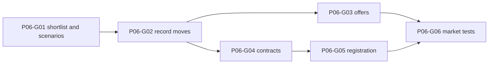

# Phase 6 — Transfers, contracts, registration

> **Derived from:** `MASTER_PLAN.md` version `1.0.0` (2026-10-19)  
> **Phase IDs:** `P06-G01` … `P06-G06`  
> **Status:** Guides are written. Product code starts by executing `plans/phase6/guide1.md`. Do not start a later guide before the earlier guide is committed. This file does not authorize work outside Phase 6.  
> **Baseline:** Phase 5 is complete. The implementation tip is `db03504c69ade519944797642be18fba63c8774f` (`phase 5 done`). Transfers and Registration are still the Phase 1 previews. Squad wages, tier, and contract end still render `Unknown`. Finance can preview a signing and cannot record one.

---

## 1. Parent plan contract

Authority is `MASTER_PLAN.md` `1.0.0`. On conflict, the master plan wins. This phase plan wins over any `plans/phase6/guide<number>.md` and over implementation.

Relevant master sections:

- **§1.5** — The app records a career played elsewhere. It does not simulate a match, an auction, or a transfer market. A rule does not move a player by itself.
- **§4** — Integer cents, unknown versus zero, campaign isolation, explicit dates and ids, one audit path, determinism. Transfer, offer, contract, registration, and shortlist shapes already exist. This phase does not rewrite them.
- **§4.4** — UI writes go through commands. A commit loads fresh data, runs the policy engine, and writes every affected record in one Dexie transaction.
- **§5.1** — `evaluateAction` is the only verdict path. A component must not keep a second copy of a threshold.
- **§5.2** — Sell-to-buy, age, wage tier, and prestige already evaluate. This phase enforces registration. It does not change the four existing rule messages.
- **§5.3** — Capacity already counts `player_sale` and `incoming_fee`. A free signing has no fee. Wage commitment is not subtracted from capacity.
- **§5.4** — A preview is not permission to write. The commit reads again and evaluates again. Warnings may be recorded only after that fresh evaluation. A blocker writes nothing.
- **§5.5** — A required unknown is `INSUFFICIENT_DATA`. Registration presets are the user's challenge rules, not a certified competition.
- **§7.1** — The command center may show active bids once offers exist, and a registration figure once registration exists.
- **§7.2** — Squad wage, tier, and contract end come from the active contract. Minutes stay unknown. One active contract per club and player.
- **§7.4** — Shortlist, scenario, offer, and completed transfer stay separate states.
- **§7.5** — Registration is one competition at a time, over the selected list, with manual eligibility and a visible provenance.
- **§8** — UI reads go through repositories. Components do not call Dexie and do not import `src/domain`.
- **§9 Phase 6** — Outcome, guide order, and commit subjects below. Do not reorder, merge, or rename these guides.
- **§10** — Required shape of this file.
- **§12.2 invariants 4, 5, 6, and 10** — Stale spend, no partial transfer write, unknown wage, and campaign scope. Invariants 1, 2, and 3 already have Phase 5 tests; this phase must not weaken them. Invariants 7, 8, 9, and 12 belong to later phases.
- **§12.5** — A keyboard user can review a blocker. Severity is a word, not a color alone.

Roadmap entries, in order:

| ID | Deliverable | Commit subject |
| --- | --- | --- |
| `P06-G01` | Shortlist and unsaved transfer scenarios | `feat(p06-g01): plan transfer scenarios` |
| `P06-G02` | Atomic sale, purchase, and free-transfer commands | `feat(p06-g02): record completed player moves` |
| `P06-G03` | Offer inbox, accept, and reject | `feat(p06-g03): manage external transfer offers` |
| `P06-G04` | Contract create, renew, and tier edit | `feat(p06-g04): govern contract decisions` |
| `P06-G05` | Registration quota check and eligibility screen | `feat(p06-g05): validate squad registration` |
| `P06-G06` | Market-workflow invariants and a browser journey | `test(p06-g06): verify controlled market workflows` |

One guide is one commit. Split a guide only by editing this phase file first.

---

## 2. Phase objective and user-visible outcome

At the end of Phase 6 a reviewer can:

1. Search the campaign's player pool, shortlist a player, reload, and see that shortlist. The player's club does not change.
2. Preview an incoming purchase, an incoming free signing, and an outgoing sale. The preview says it recorded nothing. The same numbers produce the same verdicts Finance already shows.
3. Record a completed sale, a completed purchase, and a free signing. A blocked purchase writes no player move, no contract, no ledger row, and no audit. Reload shows a completed deal once, and the capacity math includes 70% of a sale and the full incoming fee.
4. Record a bid from another club, reject a non-qualifying bid, and fail to reject a qualifying bid. The qualifying offer stays open. Accepting an open offer completes the sale in the same save.
5. Save a wage, tier, and contract end for a player at the managed club. Squad shows those cells. An unknown wage stays `Unknown`. A €46,000 Key wage is blocked while the Balanced cap is on. Minutes stay `Unknown`.
6. Mark eligibility, confirm a registration list, and see a quota blocker when the list is short, too large, or missing a required flag. Supplying the flag allows the confirm. The command center shows a registration count. Transfers and Registration no longer say `Static preview — not save data`.

---

## 3. Prerequisites

Phase 5 exit criteria are met. Required commits, oldest first:

| Guide | Commit | Subject |
| --- | --- | --- |
| `P05-G01` | `99ea5ebc6ea113401b836db8b5f0808a883d7c13` | `feat(p05-g01): introduce explainable policy engine` |
| `P05-G02` | `fce72a49a7a49b4901df382ff90769db1abe1434` | `feat(p05-g02): calculate auditable club finances` |
| `P05-G03` | `d7b4b58bc80798324eadb7842bfab0d2bfabcd4b` | `feat(p05-g03): enforce club constitution rules` |
| `P05-G04` | `ab46eb18927f0bebc84887b3db6e4e65fe1bac25` | `feat(p05-g04): expose finances and rule settings` |
| `P05-G05` | `076a4040537142661fc6664537596f83160e2676` | `feat(p05-g05): explain rule impacts before commits` |
| `P05-G06` | `8a4c949d67e4fff36135b4708e651a745cfee8e3` | `test(p05-g06): lock financial policy invariants` |

The branch tip at planning time also contains `db03504c69ade519944797642be18fba63c8774f`, which records that Phase 5 is done. Start from that tip.

Inspect before `P06-G01`:

- `MASTER_PLAN.md` §5, §7.1, §7.2, §7.4, §7.5, §12.2
- `plans/phase5.md` §5 and §10 handoff
- `src/domain/validation/schemas.ts` — `transferSchema`, `offerSchema`, `contractSchema`, `registrationSchema`, `shortlistItemSchema`, `auditEventSchema`
- `src/domain/rules/types.ts`, `src/domain/rules/evaluate-action.ts`, `src/domain/rules/presets.ts`
- `src/domain/finance/capacity.ts`, `src/domain/finance/wages.ts`, `src/domain/finance/preview.ts`
- `src/domain/player/squad-view.ts` — `displayAge`
- `src/data/transactions/run-command.ts`, `src/data/errors.ts`
- `src/data/commands/post-ledger-entry.ts`, `src/data/commands/update-player.ts`
- `src/data/repositories/ledger-entries.ts` — `insertLedgerEntry`
- `src/data/repositories/contracts.ts`, `src/data/repositories/players.ts`, `src/data/repositories/lineups.ts`
- `src/data/migrations/v1.ts` — frozen. Transfer, offer, registration, shortlist, and contract indexes already exist.
- `src/data/db.ts` — `DATABASE_VERSION` is `1`
- `src/features/transfers/TransfersPage.tsx`, `src/features/registration/RegistrationPage.tsx`
- `src/features/finance/ActionPreview.tsx`, `src/features/squad/SquadBrowser.tsx`, `src/features/squad/PlayerProfile.tsx`
- `src/features/dashboard/CommandCenterPage.tsx`, `src/features/constitution/ConstitutionPage.tsx`
- `src/app/layout/WorkspaceLayout.tsx`, `src/app/copy.ts`
- `src/test/shell-nav.test.tsx`, `src/test/constitution-presets.test.ts`, `src/test/evaluate-action.test.ts`
- `e2e/smoke.spec.ts`, `e2e/demo-journey.spec.ts`, `e2e/tactics.spec.ts`, `e2e/finance.spec.ts`
- `README.md` local-database paragraph

`schemaV1` is frozen. Do not edit that object. Do not add `version(2)`. Do not change `DATABASE_VERSION`.

`pnpm lint`, `pnpm typecheck`, `pnpm test`, `pnpm build`, and `pnpm test:e2e` already exist and must stay green. This phase adds no production dependency. Do not add `fast-check`, Recharts, React Hook Form, Radix, Zustand, or `@tanstack/react-virtual`.

---

## 4. In scope / out of scope

### In scope

- A stored shortlist, and an unsaved scenario preview that does not move a player.
- Commands for a completed purchase, sale, free signing, and free departure, including the ledger row, the roster move, the managed-club contract, the lineup cleanup, and one audit.
- Offer record, reject, and accept. Accept performs the sale.
- Contract create, renew, and tier edit, then squad wage, tier, and contract-end cells.
- Registration evaluation, the registration screen, and a command-center registration figure.
- Active-bid and expiring-contract figures on the command center.
- README text that these writes go to `touchline-os`.
- Vitest coverage of the commands and the master invariants this phase owns, plus one Playwright market journey.

### Out of scope (deferred)

| Item | Phase |
| --- | --- |
| Match entry, minutes, appearance totals | Phase 7 |
| Season rollover and posting `approved_carryover` | Phase 7 |
| Counting an expiring contract against a season end date | Phase 7 |
| Radar charts, compare view, insight sentences | Phase 8 |
| CSV/JSON import, backup | Phase 9 |
| `vite-plugin-pwa`, saved preferences | Phase 10 |
| `ARCHITECTURE.md` and `DECISIONS.md` | Phase 10 |

Also out of this phase: a second database, editing `schemaV1`, a Dexie version bump, a stored proposal table, an auction, seeding offers or transfers inside `seedDemoCampaign`, matchday selection on the tactics board, and a control that disables a rule inside a transfer, offer, contract, or registration form. Turning a rule off stays on Constitution and writes a new version.

---

## 5. Architecture impact

```text
src/domain/finance/       scenario preview for a sale
src/domain/rules/         registration action, added in P06-G05
src/data/commands/        shortlist, transfer, offer, contract, registration
src/data/repositories/    those five stores, plus contract updates
src/features/transfers/
src/features/registration/
src/features/squad/       wage, tier, and contract end; contract form
src/features/dashboard/   bids, expiring contracts, registration figure
```

```text
Scenario
  → previewAction or previewOutgoingSale
  → render before, after, and verdicts
  → no command until Record is enabled in P06-G02

Record transfer or accept offer
  → runCommand
    → fresh campaign, player, ledger, contracts, constitution
    → evaluateAction
    → on BLOCK or an unacknowledged warning: throw, write nothing
    → otherwise player, contract, lineup, transfer, ledger, audit
  → CommandResult

Registration confirm
  → evaluateAction with type registration
  → one transaction for the selected rows
```

The Transfers page reads the active season and the managed club. A scenario does not call `postLedgerEntry`. Completed fees use `insertLedgerEntry`.

### Boundaries

- `src/domain/**` stays free of React, Dexie, `Math.random`, and `Date`.
- `src/components/**` stays free of `src/domain` and `src/data`.
- `src/features/**` may import domain functions, repository reads, and commands. They still must not import `src/data/db.ts` or `src/data/migrations/**`.
- Feature code passes `systemClock()` and `createEntityId()` into command inputs at the UI edge. Commands do not generate ids and do not read the clock.
- A `CONFLICT` result uses the existing sentence `This save changed in another tab. Reload and try again.`
- A rule failure uses `PersistenceError('SCOPE', message)` inside the transaction, which `runCommand` already maps to `VALIDATION` and rolls back. The message is the verdict message. Do not add a new failure code.
- A blocked command writes no audit. An audit means the action was stored.

### What is stored

| User idea | Stored as | When |
| --- | --- | --- |
| Shortlist | `ShortlistItem` | `P06-G01` |
| Scenario / proposal | Nothing. It is component state | `P06-G01` |
| Completed move | `Transfer`, and a ledger row when money moved | `P06-G02` |
| Bid | `Offer` | `P06-G03` |
| Wage and tier | `Contract` | `P06-G04`, and also the incoming half of a transfer |
| Eligibility list | `Registration` | `P06-G05` |

There is no proposal table. Adding one would require a Dexie version, which this phase does not open.

### Shortlist

`saveShortlistItem` inserts or updates one row. The unique index is `&[campaignId+playerId]`, so a player has one row. Closing does not delete it.

The input carries `itemId`, `playerId`, `priority` from 1 to 5, `notes` (trimmed, 1–4,000 characters, or null), `status: 'open' | 'closed'`, `expectedRevision`, `now`, `auditEventId`, and `actionId`.

- A player id from another campaign, or a missing player, is `NOT_FOUND` or `VALIDATION`, and writes nothing.
- A second id for a player who already has a row is `VALIDATION` with message `This player is already on the shortlist.` The screen must reuse the stored id.
- Audit `actionType` is `shortlist.save`. Summary, exact: `Shortlisted ${playerName}`.
- `closeShortlistItem` sets `status` to `closed` on the stored row. Audit `actionType` is `shortlist.close`. Summary, exact: `Closed shortlist entry for ${playerName}`.
- Neither command changes `player.clubId`, a contract, a ledger row, a lineup, or a transfer.

### Scenario preview

The scenario region is labeled `Scenario`. It is not saved. Reload clears it.

Choices:

| Choice | Preview |
| --- | --- |
| `Incoming purchase` | Existing `previewAction` with `type: 'incoming-transfer'`, `isFree: false`, and the typed fee |
| `Incoming free signing` | The same action with `feeCents: 0` and `isFree: true` |
| `Outgoing sale` | `previewOutgoingSale` below |

Age comes from `displayAge` for the selected player and the active season. `unknown` becomes null. The form does not have an age field. Fee, weekly wage, and tier are typed. Blank wage or tier is null. Seller prestige is the managed club's stored `prestige`.

`previewOutgoingSale` lives in `src/domain/finance/preview.ts`. It does not write and it does not add a policy action.

- Before capacity and before wages use the same formatters as `previewAction`.
- A known remaining capacity and a constitution produce an after-capacity of `remaining + Math.floor(feeCents * salesReinvestmentPct / 100)`. The percent is the stored `SELL_TO_BUY` percent, including when that rule is disabled, because posted sales already use that percent in `transferCapacity`.
- No constitution makes the after capacity `Unknown`.
- A known active wage for that player at the managed club is subtracted from `knownCents`. A null active wage, or no active contract, makes the after wages `Unknown`.
- The report is `{ allowed: true, verdicts: [], snapshotRevision }` copied from the snapshot. A sale is not blocked by age, wage, or capacity.

Every scenario result includes `Preview only — no changes recorded.` `P06-G01` keeps `Record this transfer` disabled. `P06-G02` enables it only when the latest preview has no `BLOCK`.

The Finance `Record this action` button stays disabled. That form has no player id. `P06-G02` replaces the sentence beside it with `Choose a player on Transfers to record a move.`

### Completed transfer

`recordTransfer` is the only command that inserts `player_sale` or `incoming_fee`. `postLedgerEntry` still refuses both kinds.

Directions:

| Direction | `Transfer.kind` | Ledger | Player `clubId` after | Contract |
| --- | --- | --- | --- | --- |
| `purchase` | `purchase` | `incoming_fee` for `feeCents` | Managed club | New active contract |
| `free-in` | `free` | None | Managed club | New active contract |
| `sale` | `sale` | `player_sale` for `feeCents` | `destinationClubId` | End the managed-club active contract |
| `free-out` | `free` | None | `null` | End the managed-club active contract |

Rules for the input:

- `purchase` and `sale` require `feeCents > 0`. `free-in` and `free-out` require `feeCents === 0`.
- The player is currently at the managed club for `sale` and `free-out`, and is not at the managed club for `purchase` and `free-in`. Otherwise `VALIDATION` with message `That player cannot take this move.`
- `sale` requires `destinationClubId` to be another club in this campaign. `free-out` stores `toClubId: null`. Incoming `toClubId` is the managed club. Incoming `fromClubId` is the player's stored `clubId`, including null for a free agent.
- `purchase` and `free-in` require `contractId`. `sale` and `free-out` require `ledgerEntryId` only for `sale`, and `contractId` null. `purchase` requires `ledgerEntryId`. `free-in` and `free-out` require `ledgerEntryId` null.
- The command recomputes age with `displayAge` inside the transaction. It does not accept an age field.
- `purchase` and `free-in` build an `incoming-transfer` action from the stored age, the typed fee, and the typed wage and tier, then call `evaluateAction`. The snapshot's `remainingCapacityCents` comes from `transferCapacity` on the rows read inside the transaction, or null when no constitution exists.
- No constitution means no verdicts. The move may still be stored. Capacity on screen stays `Unknown` until a constitution exists.
- A `BLOCK` throws the verdict message and writes nothing.
- A `WARN` with `acknowledgedWarnings: false` throws `Acknowledge the warning before recording.` The current incoming rules do not warn. The flag is still part of the input.
- `acknowledgedWarnings: true` does not override a `BLOCK`.

On success, in the same transaction:

- Insert the transfer. `sourceActionId` is the action id. `effectiveOn` is the caller's `DateOnly`.
- Insert the ledger row when the table above requires one. `amountCents` is the gross fee, never 70% of it. `note` is the player name. `reversesEntryId` is null.
- Incoming: insert the new active contract. `startsOn` is the caller's date or null. `expiresOn` and `weeklyWageCents` and `squadTier` are the caller's values, null when omitted and the wage rule is off.
- Outgoing: if one active contract exists for this player and the managed club, set its `status` to `ended`. If more than one active row exists, `VALIDATION` with message `More than one active contract exists for this player.` and write nothing.
- Outgoing: remove that player id from `starters` and `benchPlayerIds` on every lineup in the active season. Do not delete the lineup. Do not write a `lineup.save` audit. Set `updatedAt` to the command's `now`.
- Do not change `player.source`, `isNewgen`, market value, or any other club's contract. Do not close shortlist rows or offers.
- Update the campaign revision once.
- One audit, `actionType` `transfer.record`. Summaries, exact:
  - `Recorded purchase of ${playerName} for ${euros}`
  - `Recorded free signing of ${playerName}`
  - `Recorded sale of ${playerName} for ${euros}`
  - `Recorded free departure of ${playerName}`

A thrown body returns `ABORTED` only for an unexpected failure. The ledger count, the player `clubId`, and the revision stay as they were.

### Offers

`recordOffer` inserts one open offer. `receivedOn` is the caller's date. `resolvedOn` is null. The player must be at the managed club. `bidderClubId` must be another club in this campaign. A second open offer for the same player, bidder, and active season is `VALIDATION` with message `That club already has an open offer for this player.` Resolved history may remain. There is no unique index for that rule; the command checks it.

Audit `actionType` is `offer.record`. Summary, exact: `Recorded offer for ${playerName}`. No ledger row and no player move.

`rejectOffer` loads the offer, the player, the bidder, and the managed club inside the transaction. It builds `reject-offer` from the stored market value, bidder prestige, and seller prestige, then calls `evaluateAction`.

- A missing or already resolved offer is `NOT_FOUND` or `VALIDATION` and writes nothing.
- `QUALIFYING_OFFER` writes nothing. Status stays `open`. `resolvedOn` stays null.
- `UNKNOWN_VALUATION` commits only when `acknowledgedWarnings` is true.
- A bid that does not qualify has no prestige verdict and may be rejected.
- Success sets `status` to `rejected` and `resolvedOn` to the caller's date. Audit `actionType` is `offer.reject`. Summary, exact: `Rejected offer for ${playerName}`.

`acceptOffer` is allowed for a qualifying bid and for a non-qualifying bid. It does not call the reject rule. It performs the `sale` effects of `recordTransfer` for that offer's fee and bidder, in the same transaction, then sets the offer to `accepted` with `resolvedOn`. One audit, not two. `actionType` is `offer.accept`. Summary, exact: `Accepted offer for ${playerName}`. The transfer's `sourceActionId` and the ledger's `sourceActionId` are that same action id.

Other open offers for the same player stay open. Accepting fails once the player has left, with `That player cannot take this move.` The leftover qualifying offer is cleared by accepting it while the player is still at the club, or by an audited constitution change that disables `PRESTIGE_BID_SALE`. This phase does not add a third escape.

`offerQualifies` in `src/domain/rules/qualify-offer.ts` returns `'qualifies' | 'does-not-qualify' | 'unknown'` using the same fee test as `evaluateAction`. `countUnresolvedQualifyingOffers` counts open offers in the supplied list that return `'qualifies'`. `'unknown'` is not qualifying. No screen in this phase calls the count. Phase 7 may pass it as `unresolvedQualifyingOffers`.

### Contracts

`saveContract` is the wage, tier, and end-date command for a player who is already at the managed club. A player at another club is `VALIDATION` with message `That player is not at the managed club.`

The command builds `wage-change` from the typed wage and tier and calls `evaluateAction`. A block writes nothing. The incoming half of `recordTransfer` is the signing path; this command is the renew and tier-edit path.

On success:

- If one active contract exists for this player and club, set it to `ended`.
- If more than one exists, `VALIDATION` with the duplicate message above and write nothing.
- Insert a new active contract. Do not edit the old row's wage in place.
- Do not write a ledger row and do not change `clubId`.
- One audit, `actionType` `contract.save`. Summary, exact: `Saved contract for ${playerName}`.

`updatePlayer` does not gain `weeklyWageCents`, `squadTier`, or `clubId`.

Squad cells, from the active managed-club contract:

| Column | Text |
| --- | --- |
| Wage | `formatMoneyUnknown(weeklyWageCents)`, or `Unknown` when no active contract exists |
| Tier | `Key`, `Rotation`, `Youth`, or `Unknown` |
| Contract end | The `expiresOn` date, or `Unknown` |
| Minutes | `Unknown` |

A null wage is `Unknown`, never `€0.00`. A stored `0` is `€0.00`.

The player profile lists active and ended contracts for that player, newest `startsOn` first, and offers the save form. Remove `Contracts are not recorded in this build.` The profile gains `Add to shortlist` in `P06-G01`, before the contract form exists.

### Registration

`P06-G05` adds this policy action. `parsePolicyAction` then accepts it. The Phase 5 tests that require `{ type: 'registration' }` to fail are updated in that guide, not before.

```ts
type RegistrationDraft = {
  playerId: string
  status: 'registered' | 'ineligible' | 'unknown'
  homegrownClub: boolean | null
  homegrownNation: boolean | null
  ageExempt: boolean | null
  age: number | null
}

// added to PolicyAction
{
  type: 'registration'
  competitionKey: string
  players: RegistrationDraft[]
}
```

`RuleVerdict.ruleId` also allows `REGISTRATION_QUOTA`. Disabled rule, or a competition key other than the rule's `competitionKey`, adds no verdict. The command rejects a key other than the active rule's key with `VALIDATION` message `Registration uses the constitution competition.` When the rule is missing or disabled, the command may still store the rows.

A player is age-exempt only when `ageExempt === true`, or when `ageExempt` is null and `age` is known and `ageExemptionUnder` is non-null and `age < ageExemptionUnder`. `ageExempt: false` is not exempt, even when the player is young. Age 21 is not exempt when the threshold is 21.

Codes, all `BLOCK`, in this order, for each registered player and then the list:

| Code | When | Message | Remedy |
| --- | --- | --- | --- |
| `DUPLICATE_PLAYER` | The same player id appears twice | `This registration list names a player twice.` | `Remove the duplicate player.` |
| `INSUFFICIENT_DATA` | Status is `unknown` | `Registration status is unknown.` | `Choose Registered or Ineligible.` |
| `INSUFFICIENT_DATA` | Status is `registered`, exemption cannot be decided | `Age is unknown, so this registration cannot be checked.` | `Enter a birth date or an estimated age, or set the age exemption.` |
| `INSUFFICIENT_DATA` | A non-exempt registered player has neither homegrown flag true, and either flag is null | `Homegrown eligibility is unknown.` | `Set the club and nation homegrown flags.` |
| `ROSTER_ABOVE_LIMIT` | Non-exempt registered count is above `rosterLimit` | `The registered list is above the roster limit of ${rosterLimit}.` | `Remove a registered player or change the constitution.` |
| `HOMEGROWN_BELOW_MINIMUM` | Homegrown count among non-exempt registered players is below `minimumHomegrown` | `Homegrown players are below the minimum of ${minimumHomegrown}.` | `Mark more homegrown players or change the constitution.` |

`ineligible` does not count. A flag that is `true` on either homegrown field counts as homegrown. `false` on both is a known non-homegrown player.

`saveRegistration` checks that every player in the list is at the managed club, recomputes each age with `displayAge`, evaluates, and only then writes. The payload is the selected list, not an implicit full squad. Players left off the list are not a blocker.

Writes, in one transaction:

- Upsert one registration per selected player for the active season and the competition key. Reuse the stored id when that unique key already exists. A new id for an existing key is `DUPLICATE`.
- For a registration already stored for this season and competition whose player is still at the managed club and is absent from the selection, set `status` to `ineligible`.
- `provenance` is `user-entered`.
- One audit, `actionType` `registration.save`. Summary, exact: `Saved registration for ${competitionKey}`.

The read model counts `registered` rows whose player is still at the managed club. A sold player's old row does not count.

Command-center `Registration`:

| Case | Value |
| --- | --- |
| No constitution, or the registration rule is disabled | `Unknown` |
| Rule enabled | `${count} / ${rosterLimit}`, including `0 / 25` on Balanced before the first confirm |

The command center still does not render `Blocked`, `Warning`, `Informational`, or `Passed`.

Constitution copy for `REGISTRATION_QUOTA` changes in `P06-G05` from `Registration checks are saved here and are not enforced in this build.` to `Registration checks run on the Registration screen when this rule is on.`

Screen sentence, exact: `These checks are your saved challenge rules. They do not certify a real competition.` Button: `Confirm registration`.

### Command center figures added before registration

| Guide | Label | Value |
| --- | --- | --- |
| `P06-G03` | `Active bids` | Count of `open` offers for the active season whose player is at the managed club, including `0` |
| `P06-G04` | `Expiring contracts` | Count of active managed-club contracts with a non-null `expiresOn`, including `0` |

`Expiring` in this phase means an end date is stored. It does not use the wall clock or `season.endDate`. Harbor's create path has no contracts, so the value is `0` and the smoke test's two `Unknown` cells stay two until `P06-G05`.

### Banner

`WorkspaceLayout` hides `Static preview — not save data` on Transfers from `P06-G01`, and on Registration from `P06-G05`.

| Path | Banner |
| --- | --- |
| `/transfers` | Hidden from `P06-G01` |
| `/registration` | Hidden from `P06-G05` |
| scouting, matches, seasons | Kept |

From `P06-G01`, smoke, the demo journey, the tactics journey, the finance journey, and `shell-nav.test.tsx` witness the banner on Registration. From `P06-G05`, they witness it on Scouting.

### Screens

Transfers, from `P06-G01`:

- Search label `Player search`. Fewer than 2 characters shows `Search the player pool to plan a move.` and no result list.
- At 2 or more characters, filter `listPlayers` by name, case-insensitive, and show at most 50 rows. When more match, show `Showing 50 matches. Narrow the search.`
- Each row shows the player name and the club name, or `Free agent`.
- Button `Add to shortlist`. An open row disables it and shows `On the shortlist`.
- Region `Shortlist`, with priority, notes, and `Close shortlist entry`. Empty copy: `No players are shortlisted.`
- The scenario fields and the disabled record button described above.

Transfers, from `P06-G02`: the record button calls `recordTransfer`. Success text: `Recorded the transfer.` A blocker disables the button and shows `StatusPill` `Blocked`, the message, and the remedy. The button label is `Record this transfer`.

Transfers, from `P06-G03`:

- Region `Offers`. Empty copy: `No offers are recorded.`
- Form labels `Player`, `Bidding club`, `Fee`, `Received on`, button `Record offer`.
- Each open offer has `Reject offer` and `Accept offer`.
- A warning shows a checkbox `I have reviewed this warning.` Reject stays disabled until it is checked.
- Success text: `Recorded the offer.`, `Rejected the offer.`, or `Accepted the offer.`
- Region `Completed deals`. Columns `Date`, `Player`, `Kind`, `Fee`. Empty copy: `No completed deals for this season.`

Profile, from `P06-G04`:

- Labels `Weekly wage`, `Tier`, `Starts on`, `Expires on`, button `Save contract`.
- Success text: `Saved the contract.`
- Invalid money uses `invalidMoneyMessage` and does not call the command.

Registration, from `P06-G05`:

- Lists the managed squad only.
- Each row has status `Registered`, `Ineligible`, or `Unknown`, and the two homegrown fields plus age exemption.
- The confirm button is disabled while the latest preview has a `BLOCK`.
- Success text: `Saved registration.`
- Link text `Change a rule on Constitution.` goes to the constitution route. It is not a rule toggle.

### Assumptions recorded here

1. **A scenario is not a row.** The master plan's proposal state is the unsaved Scenario region. Shortlist, offer, and transfer stay the three stored states. No Dexie version is opened for a proposal store.
2. **The demo seed still writes no contracts, offers, transfers, shortlist rows, or registrations.** Reset still removes them by deleting the campaign.
3. **`postLedgerEntry` does not learn sale or fee kinds.** `recordTransfer` and `acceptOffer` call `insertLedgerEntry`. The ledger amount is the gross fee.
4. **Finance Record stays disabled.** The commit button that names a player is on Transfers. The finance form remains a calculator.
5. **Age is read from the player, not typed on the deal.** The existing player correction screen is how a missing age gets supplied. The deal form does not invent a date of birth.
6. **No constitution means the move is not rule-checked.** The rows may still be stored. Capacity stays `Unknown` until a constitution exists.
7. **A disabled sell-to-buy rule still has a percent.** Sale preview and later capacity use that stored percent, matching Finance today.
8. **Outgoing does not create a contract at the buying club.** The managed club's active contract ends so wage commitment drops.
9. **The previous club's contract stays active** when a player arrives. Wage commitment is filtered by club.
10. **Lineup slots lose a departing player inside the transfer transaction.** The lineup row remains. There is no second audit.
11. **Other open offers stay open after a sale.** A later accept fails because the player has left. Disabling the prestige rule stays on Constitution.
12. **Unknown valuation is not a qualifying offer.** Rejection warns. Rollover counting, later, uses `countUnresolvedQualifyingOffers` and ignores `'unknown'`.
13. **`updatePlayer` still cannot set a wage or a club.** Those writes are `saveContract` and `recordTransfer`.
14. **Registration selection is explicit.** Players left off the list are not blockers. A later confirm marks a dropped, still-rostered player `ineligible`.
15. **User-supplied exemption and homegrown flags win when they are booleans.** Age is consulted only when `ageExempt` is null.
16. **The registration figure is a count, not a verdict word.** `0 / 25` is a real figure. The command center stays free of `Blocked`.
17. **Expiring contracts are dated contracts.** The season window waits until Phase 7 has a reason to close a season.
18. **Search is one campaign query and a 50-row cap.** This phase does not add a virtualization dependency.
19. **One audit per successful command.** Accepting an offer is one audit for the offer and the sale together.
20. **Euro text on Transfers is allowed** for fees and wages. The unadopted demo command center stays free of `€` until a constitution exists, which is unchanged from Phase 5.

---

## 6. Work breakdown and dependency graph



Implement in numeric order. `P06-G04` may follow `P06-G02` before `P06-G03` only if this file is edited first. As written, `P06-G03` comes first because the roadmap order is the commit order.

Every guide runs `pnpm lint`, `pnpm typecheck`, `pnpm test`, `pnpm build`, `pnpm exec playwright install chromium`, and `pnpm test:e2e`. Each one changes a screen the existing browser specs visit, or the banner those specs witness.

### P06-G01 — Plan transfer scenarios

- **Goal:** A person can shortlist a player and preview a move. Reload keeps the shortlist and drops the scenario. The roster does not change.
- **Depends on:** Phase 5 tip.
- **Blocks:** `P06-G02` through `P06-G06`.

**Inspect:** `shortlistItemSchema`, `TransfersPage.tsx`, `preview.ts`, `displayAge`, `WorkspaceLayout.tsx`, the four e2e specs, `shell-nav.test.tsx`.

**Create:**

- `src/data/repositories/shortlist.ts` — `listShortlist`, `insertShortlistItem`, `updateShortlistItem`
- `src/data/commands/save-shortlist-item.ts`
- `src/data/commands/close-shortlist-item.ts`
- `src/features/transfers/PlayerSearch.tsx`
- `src/features/transfers/ScenarioPreview.tsx`
- `src/test/shortlist.test.ts`
- `src/test/transfer-scenario.test.tsx`

**Modify:**

- `preview.ts` with `previewOutgoingSale`.
- `auditEventSchema` with `shortlist.save` and `shortlist.close`.
- `TransfersPage.tsx` and `PlayerProfile.tsx` for `Add to shortlist`.
- `WorkspaceLayout.tsx` so `/transfers` has no preview banner.
- The e2e specs and `shell-nav.test.tsx` so the banner witness is Registration.
- `README.md` so shortlist writes are named, and so Transfers is no longer called a preview. Registration remains a preview.

**Behavior:** match the shortlist and scenario contracts in §5. `Record this transfer` is disabled. No transfer, offer, contract, or ledger repository insert is exported from this guide's commands.

**Tests:**

- Saving a shortlist writes one row and one audit, and leaves `clubId` and the ledger count unchanged.
- A second id for the same player writes nothing.
- Closing sets `status` to `closed` and keeps the row.
- Campaign B's list does not include campaign A's row.
- A rendered search under 2 characters shows the empty sentence and no player button.
- An outgoing preview of fee 1_000_000_000 at 70% against remaining 500_000_000 shows after capacity `€12,000,000.00` and `Preview only — no changes recorded.`
- An incoming preview of fee 600_000_000 against remaining 500_000_000 shows `Blocked` and `The fee is above the remaining transfer capacity.`
- The record button is disabled. A stale revision on the shortlist command returns `CONFLICT`.

**Verification:** the six commands in the section intro. Smoke still passes, with the banner on Registration.

**Commit:** `feat(p06-g01): plan transfer scenarios`

### P06-G02 — Record completed player moves

- **Goal:** Purchase, sale, free signing, and free departure each commit atomically or write nothing.
- **Depends on:** `P06-G01` scenario screen.
- **Blocks:** `P06-G03`, `P06-G04`, `P06-G05`, `P06-G06`.

**Inspect:** `transferSchema`, `insertLedgerEntry`, `post-ledger-entry.ts`, `updateStoredPlayer`, `updateLineup`, `evaluate-action.ts`, `ActionPreview.tsx`.

**Create:**

- `src/data/repositories/transfers.ts` — `listTransfers`, `insertTransfer`
- `src/data/commands/record-transfer.ts`
- `src/test/record-transfer.test.ts`

**Modify:**

- `auditEventSchema` with `transfer.record`.
- `contracts.ts` with `updateContract` if the guide needs it. No public insert until this command uses an internal insert.
- `ScenarioPreview.tsx` so `Record this transfer` calls `recordTransfer` when the preview has no `BLOCK`.
- `ActionPreview.tsx` sentence only. The button stays disabled.
- `README.md` so completed transfers are named.

**Behavior:** match the completed-transfer contract in §5. A 1_000_000_000 cent sale credits 700_000_000 through the existing `transferCapacity`. The stored ledger amount stays 1_000_000_000.

**Tests:**

- A purchase writes one transfer, one `incoming_fee`, one active contract, one audit, and the new `clubId`. Revision increases by 1.
- The same purchase with fee 600_000_000 and remaining 500_000_000 returns `VALIDATION`, and the player, ledger, contract, and revision are unchanged.
- A sale writes `player_sale` for the gross fee, ends the one managed contract, moves `clubId`, and removes the player from a stored lineup. A second lineup audit is absent.
- A free signing writes no ledger row, writes a contract, and does not treat the fee as a wage.
- A second tab with the stale revision returns `CONFLICT` and does not insert a second fee.
- `postLedgerEntry` with `player_sale` still returns `VALIDATION`.
- Two active managed contracts for that player make a sale write nothing.
- Campaign B cannot read campaign A's transfer.

**Verification:** the six commands in the section intro.

**Commit:** `feat(p06-g02): record completed player moves`

### P06-G03 — External transfer offers

- **Goal:** A person can record a bid, reject one that does not qualify, and fail to reject one that does. Accepting completes the sale.
- **Depends on:** `P06-G02` sale effects.
- **Blocks:** `P06-G06`.

**Inspect:** `offerSchema`, `evaluate-action.ts` prestige branch, `record-transfer.ts`.

**Create:**

- `src/domain/rules/qualify-offer.ts`
- `src/data/repositories/offers.ts`
- `src/data/commands/record-offer.ts`
- `src/data/commands/reject-offer.ts`
- `src/data/commands/accept-offer.ts`
- `src/features/transfers/OfferInbox.tsx`
- `src/test/offers.test.ts`

**Modify:**

- `auditEventSchema` with `offer.record`, `offer.accept`, and `offer.reject`.
- `TransfersPage.tsx` for the inbox and completed-deals list.
- `CommandCenterPage.tsx` for `Active bids`.
- `README.md` so offers are named.

**Behavior:** match the offer contract in §5. Accept reuses the sale writes. It does not call `recordTransfer` as a second transaction.

**Tests:**

- Market value 10_000_000 cents, numerator 3, denominator 2, fee 15_000_000, bidder prestige 80, seller prestige 50: reject writes nothing and the offer stays `open`.
- Fee 14_999_999 rejects, sets `resolvedOn`, and does not insert a transfer.
- A null market value with `acknowledgedWarnings: false` writes nothing. With `true`, it rejects.
- Accept writes the sale, the `player_sale` row, the accepted offer, and one audit. The player has left the managed club.
- A second open offer from the same bidder writes nothing.
- `countUnresolvedQualifyingOffers` counts the qualifying open offer and ignores an unknown-value offer.
- The command center shows `Active bids` `0` before any offer, and the unadopted demo body still has no `€`.

**Verification:** the six commands in the section intro.

**Commit:** `feat(p06-g03): manage external transfer offers`

### P06-G04 — Contract decisions

- **Goal:** A person can save a wage, tier, and end date. Squad shows them. A wage above the cap writes nothing.
- **Depends on:** `P06-G02` contract insert helper used by purchases. The guide may extract that helper if `P06-G02` left it private.
- **Blocks:** `P06-G05`, `P06-G06`.

**Inspect:** `contractSchema`, `SquadBrowser.tsx`, `PlayerProfile.tsx`, `update-player.ts`, `wages.ts`.

**Create:**

- `src/data/commands/save-contract.ts`
- `src/test/save-contract.test.ts`

**Modify:**

- `auditEventSchema` with `contract.save`.
- `SquadBrowser.tsx` and `PlayerProfile.tsx`.
- `CommandCenterPage.tsx` for `Expiring contracts`.
- The profile and squad tests that expect `Contracts are not recorded in this build.`
- `README.md` so contract saves are named.

**Behavior:** match the contract contract in §5. Minutes stay `Unknown`. A key wage of 4_600_000 against the Balanced cap writes nothing. A null wage with the rule enabled writes nothing and is not stored as 0.

**Tests:**

- The first save inserts one active contract and one audit.
- A second save ends the first and inserts a new active row. Wage commitment uses only the new wage.
- A player at another club writes nothing.
- Two active rows already stored write nothing.
- A rendered squad row with weekly wage 1_000_000 shows `€10,000.00`, tier `Rotation`, and minutes `Unknown`.
- A rendered null wage shows `Unknown`, not `€0.00`.
- `updatePlayer` input still rejects `weeklyWageCents` and `clubId`.
- Harbor's command center shows `Expiring contracts` `0` and still has exactly two `Unknown` values.

**Verification:** the six commands in the section intro. The finance journey's untouched demo squad may still show `Unknown` in the wage column, because the seed still writes no contracts.

**Commit:** `feat(p06-g04): govern contract decisions`

### P06-G05 — Squad registration

- **Goal:** Confirming a list either stores the eligibility rows or writes nothing. The command center shows the quota figure.
- **Depends on:** `P06-G04` only so the commit order stays numeric. The registration command does not require a contract row.
- **Blocks:** `P06-G06`.

**Inspect:** `registrationSchema`, `registrationQuotaRuleSchema`, `types.ts`, `evaluate-action.ts`, `ConstitutionPage.tsx`, `CommandCenterPage.tsx`, `constitution-presets.test.ts`, `evaluate-action.test.ts`, `finance-page.test.tsx`.

**Create:**

- `src/data/repositories/registrations.ts`
- `src/data/commands/save-registration.ts`
- `src/features/registration/RegistrationList.tsx`
- `src/test/registration.test.ts`

**Modify:**

- `types.ts` and `evaluate-action.ts` with the registration action and the six codes in §5.
- `auditEventSchema` with `registration.save`.
- `RegistrationPage.tsx`, `ConstitutionPage.tsx`, `CommandCenterPage.tsx`, `WorkspaceLayout.tsx`.
- The tests that still expect registration to be rejected or not enforced.
- The e2e specs and `shell-nav.test.tsx` so the banner witness is Scouting.
- Smoke's Harbor command center: `Unknown` count becomes 1, and `0 / 25` is visible.
- `README.md` so registration saves are named. Scouting, matches, seasons, import, and backup remain previews.

**Behavior:** match the registration contract in §5. Do not change sell-to-buy, age, wage, or prestige messages.

**Tests:**

- Eight homegrown non-exempt registered players, roster limit 25, minimum 8: `allowed` is true and one confirm writes eight rows and one audit.
- A ninth non-exempt player over a limit of 8 returns `ROSTER_ABOVE_LIMIT` and writes nothing.
- Seven homegrown players against a minimum of 8 returns `HOMEGROWN_BELOW_MINIMUM` and writes nothing.
- A null homegrown pair on a non-exempt registered player returns `INSUFFICIENT_DATA`. Setting `homegrownClub: true` then allows the confirm.
- Age 20 is exempt when the threshold is 21 and `ageExempt` is null. Age 21 counts. `ageExempt: false` counts even at age 18.
- A disabled rule stores the rows and adds no verdict.
- A sold player's old `registered` row does not increase the command-center count.
- `{ type: 'registration' }` parses. The four older action fixtures still parse.
- `/app/demo/registration` does not show the preview banner. `/app/demo/scouting` does.

**Verification:** the six commands in the section intro.

**Commit:** `feat(p06-g05): validate squad registration`

### P06-G06 — Controlled market workflows

- **Goal:** The failed signing, the sale-then-buy, the rejected qualifying bid, and the eligibility correction are locked in one scenario, and a browser journey crosses those screens.
- **Depends on:** `P06-G03` and `P06-G05`.
- **Blocks:** Phase 6 exit.

**Inspect:** `record-transfer.ts`, `reject-offer.ts`, `save-registration.ts`, `e2e/finance.spec.ts`, `playwright.config.ts`.

**Create:**

- `src/test/market-workflows.test.ts`
- `e2e/transfers.spec.ts`

**Modify:** none of the rule thresholds. If a test can pass only by weakening a rule, stop and fix the implementation in a new commit after editing this phase file. Do not change the expected €7,000,000 credit or the €45,000 cap.

**Data scenario, in `touchline-os-test`:**

1. Create campaign A with `preset: 'balanced'` and campaign B with no preset. Add two clubs and three players in A: one at the managed club, one at the other club, one free agent.
2. Record a purchase of the other club's player for 600_000_000 cents, age 24, rotation wage 1_000_000. The result is `VALIDATION`. `clubId`, ledger count, and revision are unchanged.
3. Record a sale of the managed player for 1_000_000_000 cents. `transferCapacity` credits 700_000_000. The player `clubId` is the buyer. The managed contract is `ended`. One lineup that named the player no longer names the player.
4. Record the purchase from step 2 again with a fresh revision. It succeeds. A second call with the old revision is `CONFLICT` and does not add a second `incoming_fee`.
5. Record a qualifying offer and reject it. Status stays `open`. Accept it on a player who is back at the club, or on the remaining managed player, and observe one sale plus one accepted offer.
6. Save a key wage of 4_600_000. Nothing is written. Save 1_000_000 on rotation. Squad text for that player is `€10,000.00`.
7. Confirm a registration list with a null homegrown flag. Nothing is written. Set the flag and confirm. The row is `user-entered`.
8. Campaign B's transfer, offer, contract, and registration lists do not include A's rows.
9. A thrown command body leaves the revision unchanged.

**Browser journey in `e2e/transfers.spec.ts`**, timeout 120 seconds, fresh context, production database name `touchline-os`:

1. Open `/`, start the fictional demo, and choose `Ashbridge`.
2. Open Transfers. The preview banner is absent. Search with one character and see `Search the player pool to plan a move.`
3. Search with at least two characters, add one player who is not at Ashbridge to the shortlist, and reload. `On the shortlist` is visible.
4. Open that player's scenario as an incoming purchase with fee `6000000` and a rotation wage. `Blocked` and `Preview only — no changes recorded` are visible if no constitution is saved yet, or the capacity block is visible after step 5. Do not hardcode a generated player name.
5. Save Balanced on Constitution. Return to Transfers. Record stays disabled while the preview is blocked.
6. Open Squad, record nothing, and confirm minutes still read `Unknown`.
7. Open Registration. The preview banner is absent. The challenge-rules sentence is visible. Confirming an empty or unknown selection shows a blocker and does not show success text.
8. Reload Transfers. The shortlist row is still there. The completed-deals empty copy is still there if no deal was recorded.
9. Open Scouting. The preview banner is visible.

The journey does not have to complete a 70% sale in the browser. The Vitest scenario owns that figure. The browser owns the blocked preview, the shortlist reload, and the registration blocker.

Do not add `storageState`. Do not shrink the seed. Do not turn a rule off inside the transfer page.

**Verification:** the six commands in the section intro.

**Commit:** `test(p06-g06): verify controlled market workflows`

Do not commit a guide when its verification commands fail.

---

## 7. Acceptance criteria

1. `pnpm lint`, `pnpm typecheck`, `pnpm test`, `pnpm build`, and `pnpm test:e2e` pass on the phase tip.
2. A shortlist survives reload and does not change `clubId`. A scenario does not survive reload and does not insert a transfer.
3. Fee 600_000_000 against remaining 500_000_000 records nothing. A later sale of 1_000_000_000 cents makes a fresh purchase of 600_000_000 succeed once.
4. That sale stores 1_000_000_000 cents and authorizes 700_000_000 cents of capacity. It does not store 700_000_000 as the ledger amount.
5. A free signing stores no fee row and can still be blocked by age or wage. Fee 0 is not a wage of 0.
6. A stale second purchase writes no second fee. A thrown command writes nothing.
7. A qualifying offer cannot be rejected. A non-qualifying offer can. Accepting writes the sale and the accepted offer together.
8. An unknown wage is not stored as `€0.00` and does not pass an enabled wage cap. A key wage of 4_600_000 writes nothing. Squad minutes stay `Unknown`.
9. `updatePlayer` still rejects a wage and a club id. `postLedgerEntry` still rejects `player_sale` and `incoming_fee`.
10. A registration confirm with a missing required flag writes nothing. The same list with the flag supplied writes rows whose provenance is `user-entered`.
11. The command center shows `0 / 25` after Balanced is saved and before any registration row exists. It shows `Unknown` when no constitution exists. It does not show `Blocked`.
12. A sold player disappears from the managed wage total and from lineup slots, and that player's old registration row does not count.
13. Campaign B cannot read campaign A's shortlist, transfers, offers, contracts, or registrations.
14. Transfers and Registration do not show `Static preview — not save data`. Scouting does. The finance Record button stays disabled.
15. No transfer, offer, contract, or registration screen contains a control that disables a constitution rule.
16. `schemaV1` is unchanged, and the database class still declares version 1 only.
17. `src/components/**` does not import `src/domain` or `src/data/db.ts`. Domain rule and finance code does not call `Math.random` or `Date`.

---

## 8. Verification

From a clean install at the phase exit:

```bash
pnpm install --frozen-lockfile
pnpm lint
pnpm typecheck
pnpm test
pnpm build
pnpm exec playwright install chromium
pnpm test:e2e
```

Expected: each command exits 0. `pnpm test` includes the Phase 1 through Phase 5 files plus `shortlist.test.ts`, `transfer-scenario.test.tsx`, `record-transfer.test.ts`, `offers.test.ts`, `save-contract.test.ts`, `registration.test.ts`, and `market-workflows.test.ts`. `pnpm test:e2e` includes the existing four specs plus `e2e/transfers.spec.ts`.

### Manual browser pass

1. `pnpm dev`, open `/`, and start the fictional demo. Choose `Ashbridge`. Confirm the command center still has no euro sign before a constitution save.
2. Open Transfers. Confirm the preview banner is gone. Search one letter and confirm the pool sentence. Search two letters, shortlist a player from another club, and reload. The shortlist remains and Squad still shows that player at the other club.
3. Preview an incoming purchase above the remaining capacity after saving Balanced. Confirm the blocked fee message, the remedy, and `Preview only — no changes recorded.` Confirm Record is disabled. Reload. No completed deal appears.
4. Save a contract on a managed player with a blank wage while the wage rule is on. Confirm the unknown-wage message and that Squad still shows `Unknown` for that player. Save a rotation wage of `10000`. Confirm Squad shows `€10,000.00` and minutes `Unknown`.
5. Record an offer from another club. Reject it when it does not qualify, and confirm it leaves the open list. Build a qualifying bid and confirm Reject does not remove it.
6. Open Registration. Confirm the challenge-rules sentence. Leave a selected player unknown and confirm the blocker. Set the status and homegrown flags until the preview has no blocker, then confirm. Reload and confirm the command center registration figure changed.
7. Open Constitution and confirm the registration sentence no longer says the checks are absent. Confirm there is no rule toggle on Transfers.
8. Open Scouting and confirm the preview banner. Open Finance and confirm `Record this action` is disabled.
9. Create `Harbor` / `Harbor Athletic` / `HAR` with the default Balanced preset. Confirm `Active bids` `0`, `Expiring contracts` `0`, and registration `0 / 25`. Switch to the demo. The demo shortlist is unchanged.
10. Reset the fictional demo. After choosing a club, the shortlist is empty. Harbor's shortlist, if one was added, is still there.
11. Open `/app/does-not-exist/transfers` and confirm the missing-campaign state.
12. `pnpm build && pnpm preview`, and repeat steps 2, 3, and 6 on the preview origin.

### Earlier guides

`P06-G01` must not enable Record and must not insert a transfer. If a page load writes a transfer, remove that write before committing. `P06-G02` is the first guide that moves a player. `P06-G05` is the first guide that parses a registration action.

---

## 9. Risks, mitigations, rollback

| Risk | Mitigation | Rollback |
| --- | --- | --- |
| A blocked purchase still moves the player | The command throws before every write. The test pins `clubId` and the ledger count. | Revert `P06-G02` |
| The ledger stores 70% instead of the gross fee | The sale test requires the row amount 1_000_000_000 and the credit 700_000_000. | Revert `P06-G02` |
| `postLedgerEntry` starts accepting a sale | The Phase 5 refusal test stays, and `P06-G02` repeats it. | Revert the command edit |
| Two tabs spend the same capacity | `expectedRevision` is checked inside `runCommand`, and capacity is read again in that transaction. | Revert `P06-G02` |
| A qualifying bid is rejected from the inbox | Reject calls `evaluateAction` and writes nothing on `QUALIFYING_OFFER`. | Revert `P06-G03` |
| The transfer form gains a rule toggle | Acceptance criterion 15. The only constitution write remains `saveConstitution`. | Revert the screen |
| Unknown wage becomes €0 on Squad | Null uses `formatMoneyUnknown`. The cap path never receives a substituted 0. | Revert `P06-G04` |
| Registration looks like a real competition rule | The screen sentence says it is a challenge rule. | Revert `P06-G05` |
| An empty confirm writes a partial squad list | Evaluation runs before any registration write, and the writes share one transaction. | Revert `P06-G05` |
| The banner disappears from every remaining preview | Scouting is the witness from `P06-G05`. | Revert the layout change |
| Smoke's `Unknown` count drifts when registration becomes `0 / 25` | `P06-G05` updates that count from 2 to 1 in the same commit. | Revert `P06-G05` |
| `schemaV1` or Dexie version 2 is edited to store scenarios | Scenarios are component state. The stored shapes already have tables. | Restore `migrations/v1.ts` from `4337d647987964cd9cbbeebe2bddd8ee683b71f9` |
| A guide installs a table or form library | The dependency note in §3. | Remove the dependency before commit |
| The browser journey times out on the demo seed | The spec sets a 120-second timeout. Do not shrink the world. | Fix the wait, then recommit |

User data created by Vitest stays in `touchline-os-test` and is deleted in `afterEach`. Playwright uses a fresh context. Revert a bad guide with `git revert` of that commit. Do not reset published history.

---

## 10. Exit criteria and handoff

Phase 6 is complete when all of the following are true:

- [ ] Commits exist, in order, with the six subjects in §1.
- [ ] The commands in §8 pass on the phase tip.
- [ ] Acceptance criteria in §7 are true.
- [ ] `schemaV1` and Dexie version 1 are unchanged.
- [ ] README states that shortlist, transfer, offer, contract, and registration writes go to `touchline-os`.
- [ ] Assumptions in §5 are still accurate, or this file was edited before the code diverged.

### Progress log

Record each guide commit here when it lands. Do not rewrite the subjects.

| Guide | Commit | Checks |
| --- | --- | --- |
| `P06-G01` | `6588d3119f637c688c833b6ecc2570c15796d889` | `pnpm format:check`, `pnpm lint`, `pnpm typecheck`, `pnpm test` (442 passed), `pnpm build`, `pnpm exec playwright install chromium`, and `pnpm test:e2e` (4 passed). Browser pass: shortlist survived reload, scenario preview recorded nothing, and the preview banner stayed on Registration. |
| `P06-G02` | `4b1158f172c42bf0f7abca526b4b09199089ee51` | `pnpm format:check`, `pnpm lint`, `pnpm typecheck`, `pnpm test` (449 passed), `pnpm build`, `pnpm exec playwright install chromium`, and `pnpm test:e2e` (4 passed). Browser pass: a blocked €6,000,000 purchase left the player and ledger unchanged, and Finance Record stayed disabled. |
| `P06-G03` | `4bcdbc1648765350b8c654732aca87a1262fd05d` | `pnpm format:check`, `pnpm lint`, `pnpm typecheck`, `pnpm test` (460 passed), `pnpm build`, `pnpm exec playwright install chromium`, and `pnpm test:e2e` (4 passed). Browser pass: a non-qualifying bid left the open list, a qualifying bid stayed open after reject and reload, and accept wrote one sale with one accept summary. Active bids stayed a number and the command center did not show Blocked. |
| `P06-G04` | `1d4afffe9182081ddacae1349a9f488b8939500f` | `pnpm format:check`, `pnpm lint`, `pnpm typecheck`, `pnpm test` (470 passed), `pnpm build`, `pnpm exec playwright install chromium`, and `pnpm test:e2e` (4 passed). Browser pass: a blank wage stayed Unknown, €10,000 Rotation was stored, €46,000 Key wrote nothing, and capacity did not fall. Expiring contracts was a number and the command center did not show Blocked. |
| `P06-G05` | `c99c0add42f3fec04c907ae3fb7e4e321d813d59` | `pnpm format:check`, `pnpm lint`, `pnpm typecheck`, `pnpm test` (489 passed), `pnpm build`, `pnpm exec playwright install chromium`, and `pnpm test:e2e` (4 passed). Browser pass: Harbor Registration was `0 / 25` with no Blocked, an empty preview blocked the homegrown minimum and left Confirm disabled, Constitution kept version 1, the preview banner stayed on Scouting, and Transfers had no control that turns a rule off. |
| `P06-G06` | `bd4b6003d70a0b7c826ddaad859db41e7180c6a9` | `pnpm format:check`, `pnpm lint`, `pnpm typecheck`, `pnpm test` (490 passed), `pnpm build`, `pnpm exec playwright install chromium`, and `pnpm test:e2e` (5 passed). Browser journey: a non-Ashbridge player stayed shortlisted after reload, the €6,000,000 purchase preview was blocked after Balanced, an unknown registration showed a blocker, Scouting kept the preview banner, and Finance Record stayed disabled. |

### Handoff to Phase 7

Phase 7 may assume:

- `evaluateAction` still covers the four Phase 5 actions, plus `registration`. Match entry is a new command, not a new verdict inside registration.
- `countUnresolvedQualifyingOffers` is the number Phase 7 should pass as `unresolvedQualifyingOffers`. It ignores unknown valuations. Phase 7 performs rollover and posts `approved_carryover`. Phase 6 does not.
- `postLedgerEntry` still refuses `player_sale`, `incoming_fee`, `approved_carryover`, and `reversal`. Rollover uses `insertLedgerEntry` from its own command.
- A blocked transfer, offer, contract, or registration writes nothing. The commit path already re-reads and re-evaluates.
- Squad minutes stay `Unknown` until appearances exist. Contract end and wages are real once a contract exists.
- Registration rows are challenge-rule records. A matchday lineup does not yet have to be a subset of them.
- An open qualifying offer survives a sale of that player to someone else. Rollover keeps blocking until the offer is accepted while the player is still at the club, or the prestige rule is disabled on Constitution.
- The command center registration value is `n / rosterLimit` when the rule is enabled, and `Unknown` otherwise. `Expiring contracts` counts stored end dates only.
- `CONFLICT` still means the screen must reload. Components still must not import `src/data/db.ts` or `src/domain`.

Phase 7 must not add backup import, scouting charts, or the PWA plugin. It must not silently switch a rule off inside a match or rollover modal.
