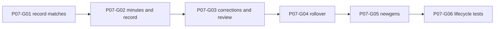

# Phase 7 — Match journal, seasons and optional newgens

> **Derived from:** `MASTER_PLAN.md` version `1.0.0` (2026-10-19)  
> **Phase IDs:** `P07-G01` … `P07-G06`  
> **Status:** Guides are written. Product code starts by executing `plans/phase7/guide1.md`. Do not start a later guide before the earlier guide is committed. This file does not authorize work outside Phase 7.  
> **Baseline:** Phase 6 is complete. The implementation tip is `bd4b6003d70a0b7c826ddaad859db41e7180c6a9` (`test(p06-g06): verify controlled market workflows`). Match Journal and Seasons are still the Phase 1 previews. Squad minutes still render `Unknown`. Season rollover is evaluated and is not yet a command. `approved_carryover` is counted by `transferCapacity` and is still refused by `postLedgerEntry`.

---

## 1. Parent plan contract

Authority is `MASTER_PLAN.md` `1.0.0`. On conflict, the master plan wins. This phase plan wins over any `plans/phase7/guide<number>.md` and over implementation.

Relevant master sections:

- **§1.5** — The app records a career played elsewhere. It does not simulate a match, generate a fixture list, or move a player because a season ended.
- **§4** — Integer cents, unknown versus zero, campaign isolation, explicit dates and ids, one audit path, determinism. Match, appearance, and season shapes already exist. This phase does not rewrite them.
- **§4.4** — UI writes go through commands. A commit loads fresh data and writes every affected record in one Dexie transaction.
- **§5.1** — `evaluateAction` is the only verdict path. Rollover already has a `season-rollover` action. This phase calls it. It does not add a match verdict.
- **§5.2** — An unresolved qualifying offer blocks rollover while `PRESTIGE_BID_SALE` is enabled. Unknown valuation is not a qualifying offer.
- **§5.3** — `approvedCarryover` is season scoped. It is `floor` of the previous season's nonnegative remaining capacity times `carryoverPct`. It is not a fresh opening allocation.
- **§6.3** — Youth generation is opt-in at rollover, seeded, small, and labeled fictional. Prospects are planning candidates, not an automatic squad insert.
- **§7.2** — Minutes come from recorded appearances. Unknown minutes stay unknown.
- **§7.6** — Manual match entry, optional xG, aggregated minutes, an audited correction, a season review, and Review → Preview rollover → Confirm rollover.
- **§8** — UI reads go through repositories. Components do not call Dexie and do not import `src/domain`.
- **§9 Phase 7** — Outcome, guide order, and commit subjects below. Do not reorder, merge, or rename these guides.
- **§10** — Required shape of this file.
- **§12.2 invariants 7 and 8** — A duplicate appearance does not double-count minutes. Rollover cannot close the same season twice, and carryover is posted once. Invariants 1 through 6 and 10 already have tests; this phase must not weaken them. Invariants 9 and 12 belong to later phases.
- **§12.5** — A keyboard user can review a blocker. Severity is a word, not a color alone.

Roadmap entries, in order:

| ID | Deliverable | Commit subject |
| --- | --- | --- |
| `P07-G01` | Match form, optional xG, result, and appearance validation | `feat(p07-g01): record played matches` |
| `P07-G02` | Appearance totals, player minutes, and the season record | `feat(p07-g02): derive season performance from logs` |
| `P07-G03` | Audited match corrections, season review, and timeline | `feat(p07-g03): review and correct season history` |
| `P07-G04` | Rollover preview and one atomic season advance | `feat(p07-g04): advance campaign seasons explicitly` |
| `P07-G05` | Opt-in seeded academy prospects | `feat(p07-g05): support optional academy newgens` |
| `P07-G06` | Lifecycle invariants and a browser journey | `test(p07-g06): secure season lifecycle` |

One guide is one commit. Split a guide only by editing this phase file first.

---

## 2. Phase objective and user-visible outcome

At the end of Phase 7 a reviewer can:

1. Record a played match on the active season with opponent, date, home or away, score, optional competition, notes, and optional xG. Reload shows that match once. No second match is invented.
2. Attach appearances for managed-club players, including by filling the sheet from a saved lineup in one click. That fill sets each starter to 90 minutes. A substitute stays off the sheet until toggled. The same player cannot be listed twice. A player at another club is refused. Squad minutes become the sum of recorded minutes, and a player with no appearance stays `Unknown`.
3. Correct that match. The previous appearance rows for that match are replaced. Minutes become the corrected total, not the sum of both versions.
4. Open Seasons and read played, wins, draws, losses, goals, appearance count, and transfers for a season. The Match Journal and Seasons pages no longer say `Static preview — not save data`.
5. Preview a rollover, see that it recorded nothing, and confirm it once. The old season is `Closed`, the new season is the only active season, and a second close of the old season is impossible.
6. See carryover posted once, as `floor` of the nonnegative remaining capacity times the stored percent. A zero percent posts no carryover row. A retry does not post a second row. The new season does not receive a fresh opening allocation from the rollover itself.
7. On a fictional campaign, leave planning candidates selected and see generated prospects who are not on the squad. On an imported campaign, the same box starts unchecked and generates nobody until it is checked. A birth date is not invented. A reported age is not rewritten.
8. Still open Scouting and see `Static preview — not save data`.

---

## 3. Prerequisites

Phase 6 exit criteria are met. Required commits, oldest first:

| Guide | Commit | Subject |
| --- | --- | --- |
| `P06-G01` | `6588d3119f637c688c833b6ecc2570c15796d889` | `feat(p06-g01): plan transfer scenarios` |
| `P06-G02` | `4b1158f172c42bf0f7abca526b4b09199089ee51` | `feat(p06-g02): record completed player moves` |
| `P06-G03` | `4bcdbc1648765350b8c654732aca87a1262fd05d` | `feat(p06-g03): manage external transfer offers` |
| `P06-G04` | `1d4afffe9182081ddacae1349a9f488b8939500f` | `feat(p06-g04): govern contract decisions` |
| `P06-G05` | `c99c0add42f3fec04c907ae3fb7e4e321d813d59` | `feat(p06-g05): validate squad registration` |
| `P06-G06` | `bd4b6003d70a0b7c826ddaad859db41e7180c6a9` | `test(p06-g06): verify controlled market workflows` |

Start from that tip.

Inspect before `P07-G01`:

- `MASTER_PLAN.md` §4.2, §5.3, §6.3, §7.6, §12.2
- `plans/phase6.md` §5 assumptions 12, 16, and 17, and §10 handoff
- `src/domain/validation/schemas.ts` — `matchRecordSchema`, `appearanceSchema`, `seasonSchema`, `auditEventSchema`, `playerSchema`
- `src/domain/validation/limits.ts` — `minutesMax` 200, `goalsMax` 99, `xgMilliMax` 20_000, `seasonLabelMax` 40
- `src/domain/rules/types.ts`, `src/domain/rules/evaluate-action.ts`, `src/domain/rules/qualify-offer.ts`
- `src/domain/finance/capacity.ts` — `approved_carryover` is already a credit
- `src/domain/player/squad-view.ts` — `displayAge`, `estimateAge` in `src/domain/models/dates.ts`
- `src/domain/seed/prng.ts`, `src/domain/seed/names.ts`, `src/domain/seed/generate-world.ts` — `GENERATOR_VERSION`
- `src/data/transactions/run-command.ts`, `src/data/errors.ts`
- `src/data/repositories/seasons.ts` — `insertSeason` refuses a second active season and a repeated ordinal
- `src/data/repositories/players.ts` — `insertPlayer` allows `clubId: null`
- `src/data/repositories/ledger-entries.ts` — `insertLedgerEntry`
- `src/data/commands/post-ledger-entry.ts` — refuses `approved_carryover`
- `src/data/migrations/v1.ts` — frozen. Match and appearance indexes already exist, including `&[matchId+playerId]`
- `src/data/db.ts` — `DATABASE_VERSION` is `1`
- `src/features/matches/MatchJournalPage.tsx`, `src/features/seasons/SeasonsPage.tsx`
- `src/features/squad/SquadBrowser.tsx` — the minutes cell is the constant `Unknown`
- `src/features/dashboard/CommandCenterPage.tsx` — expiring contracts are any active contract with `expiresOn !== null`
- `src/app/layout/WorkspaceLayout.tsx`, `src/app/copy.ts`
- `src/test/shell-nav.test.tsx`, `e2e/smoke.spec.ts`, `e2e/transfers.spec.ts`
- `README.md` local-database paragraph

`schemaV1` is frozen. Do not edit that object. Do not add `version(2)`. Do not change `DATABASE_VERSION`. Match, appearance, and season indexes are already sufficient.

`pnpm lint`, `pnpm typecheck`, `pnpm test`, `pnpm build`, and `pnpm test:e2e` already exist and must stay green. This phase adds no production dependency. Do not add `fast-check`, Recharts, React Hook Form, Radix, Zustand, or `@tanstack/react-virtual`.

---

## 4. In scope / out of scope

### In scope

- A command that stores one match and its appearances, with optional xG in milli-units.
- Pure season totals and squad minutes from those rows.
- An audited correction that replaces that match's appearances.
- A season timeline and a read-only review of a closed or active season.
- A pure rollover preview and one `advanceSeason` command: close, open, carryover, and the qualifying-offer block.
- Opt-in newgens inside that same command, seeded from the campaign and the new ordinal.
- README text that match, correction, rollover, and newgen writes go to `touchline-os`.
- Vitest coverage of invariants 7 and 8, plus one Playwright season journey.

### Out of scope (deferred)

| Item | Phase |
| --- | --- |
| Radar charts, compare view, insight sentences, age/minutes scatter | Phase 8 |
| CSV/JSON import, backup, real `imported` campaign creation | Phase 9 |
| `vite-plugin-pwa`, saved preferences | Phase 10 |
| `ARCHITECTURE.md`, `DECISIONS.md`, authored demo sample matches | Phase 10 |

Also out of this phase: a second database, editing `schemaV1`, a Dexie version bump, a match simulator, a generated fixture list, a stored result column, copying lineups or registrations into the next season, ending contracts because a date passed, adding a newgen to the squad, a control that disables a constitution rule, and seeding matches inside `seedDemoCampaign`.

---

## 5. Architecture impact

```text
src/domain/matches/     result, xG milli-units, season totals, minute sums
src/domain/finance/     carryover amount only; capacity math stays
src/domain/seed/        generateNewgens
src/data/commands/      record match, correct match, advance season
src/data/repositories/  matches, appearances, season update
src/features/matches/
src/features/seasons/
src/features/squad/     minutes cell
```

```text
Record match
  → runCommand
    → active season, managed squad
    → validate the payload
    → one match, its appearances, one audit
  → CommandResult

Correct match
  → replace that match's appearance rows in the same transaction
  → one audit
  → no second match

Preview rollover
  → previewSeasonRollover
  → render carryover and verdicts
  → no command

Confirm rollover
  → advanceSeason
    → evaluateAction season-rollover
    → close the active season, insert the next, set activeSeasonId
    → insert approved_carryover when the amount is positive
    → optional newgens in P07-G05
    → one audit
```

### Boundaries

- `src/domain/**` stays free of React, Dexie, `Math.random`, and `Date`. Newgen draws use `mulberry32` from `src/domain/seed/prng.ts`. They do not call `Math.random`.
- `src/components/**` stays free of `src/domain` and `src/data`.
- `src/features/**` may import domain functions, repository reads, and commands. They still must not import `src/data/db.ts` or `src/data/migrations/**`.
- Feature code passes `systemClock()` and `createEntityId()` into command inputs at the UI edge. Commands do not generate ids and do not read the clock.
- A `CONFLICT` result uses the existing sentence `This save changed in another tab. Reload and try again.`
- A rule failure uses `PersistenceError('SCOPE', message)` inside the transaction, which `runCommand` already maps to `VALIDATION` and rolls back. The message is the verdict message. Do not add a new failure code.
- A blocked command writes no audit. An audit means the action was stored.

### What is stored

| User idea | Stored as | When |
| --- | --- | --- |
| Played match | `MatchRecord` plus zero or more `Appearance` rows | `P07-G01` |
| xG | `xgFor` and `xgAgainst` integers, milli-units, or null | `P07-G01` |
| Result | Nothing. Win, draw, and loss are derived from the score | `P07-G01` |
| Season totals and minutes | Nothing. They are reads | `P07-G02` |
| Correction | The same match id, with that match's appearances replaced | `P07-G03` |
| Next season | The closed row, one new active `Season`, and the campaign's `activeSeasonId` | `P07-G04` |
| Carryover | One `approved_carryover` ledger row on the new season, only when the amount is positive | `P07-G04` |
| Planning candidate | A `Player` with `clubId: null`, `source: 'generated'`, `isNewgen: true`, `birthDate: null` | `P07-G05` |

There is no result column and no newgen table. Adding either would require a Dexie version, which this phase does not open.

### Match record

`recordMatch` inserts one match for the active season and the appearances named in that same input.

The input carries `matchId`, `date`, `opponent` (trimmed, 1–120 characters), `homeAway: 'home' | 'away'`, `goalsFor`, `goalsAgainst`, `competition` (trimmed, 1–40 characters, or null), `notes` (trimmed, 1–4,000 characters, or null), `xgFor` and `xgAgainst` as milli-unit integers or null, `appearances`, `expectedRevision`, `now`, `auditEventId`, and `actionId`. Each appearance carries `appearanceId`, `playerId`, `minutes`, `started` (`boolean | null`), `goals` (`number | null`), and `assists` (`number | null`). Rating stays null. This phase does not collect a rating.

Rules:

- The match date is the caller's `DateOnly`. It does not select a season. The active season owns the row even when the date sits outside `startDate` and `endDate`.
- Goals are integers from 0 to 99. Minutes are integers from 0 to 200. A value outside that range is `VALIDATION` with message `Command input is not valid.`
- A player id that is not on the managed club now is `VALIDATION` with message `That player is not at the managed club.`
- The same player id twice in one payload is `VALIDATION` with message `This match lists a player twice.` Nothing is written.
- Opponent text is not required to match a club row.
- Player goals are not required to add up to `goalsFor`. The score and the appearance goals are separate records.
- Zero appearances are allowed. That match is an incomplete log. Missing minutes are not stored as zero.
- `competition` null and a blank form field are the same stored null. The same is true for notes and either xG field.
- Do not write a lineup, a registration, a ledger row, or a player change.

On success, in the same transaction: insert the match, insert each appearance, update the campaign revision once, and write one audit. `actionType` is `match.record`. Summary, exact: `Recorded match against ${opponent}`.

The screen derives the result word after the row exists:

| Score | Word |
| --- | --- |
| goals for greater than goals against | `Win` |
| equal | `Draw` |
| goals for less than goals against | `Loss` |

xG in the form is a decimal of at most three places from 0 to 20, or blank. `parseXgMilli` stores `1.840` as `1840`, `1.8` as `1800`, and `1` as `1000`. Blank stays null. More than three decimal places, or a value above 20, does not call the command. The field message is `Enter xG as a number from 0 to 20 with at most three decimal places.` `formatXg` renders a stored integer with three decimal places. These two functions live in `src/domain/matches/xg.ts` and use integer arithmetic only.

Journal, from `P07-G01`:

- The preview banner is gone.
- Empty copy: `No matches are recorded.`
- Form labels: `Date`, `Opponent`, `Home or away`, `Goals for`, `Goals against`, `Competition`, `Notes`, `xG for`, `xG against`, `Player`, `Minutes`, `Started`, `Goals`, `Assists`.
- `Home or away` options are `Home` and `Away`. `Started` is a checkbox. An unchecked box stores `started: false` when the appearance is included. A player row that was never added stores nothing.
- Buttons: `Add appearance`, `Fill from lineup`, `Record match`.
- `Record match` stays disabled until date, opponent, home or away, and both goal fields parse, and until every included appearance has minutes.
- Success text: `Recorded the match.`
- Each stored row shows the date, the opponent, `Home` or `Away`, the score as `${goalsFor}–${goalsAgainst}`, and the result word.

`Fill from lineup` is draft state. It does not insert a match, an appearance, or a lineup. It does not change the date, the opponent, the score, the competition, the notes, or either xG field.

The select is labeled `Lineup`. Its options are the active season's saved lineups, by name, such as `League XI` or `Cup Rotation`. When that season has no lineup, the select is absent and the form shows `Save a lineup on Tactics to fill a match from it.` The button stays disabled until a lineup is selected.

`appearancesFromLineup` lives in `src/domain/matches/from-lineup.ts`. It is pure. It takes the lineup's `starters` and `benchPlayerIds`, plus the set of player ids currently at the managed club.

| Lineup role | Draft |
| --- | --- |
| Starter still at the managed club | Included, `started` true, minutes `90` |
| Bench player still at the managed club | Listed, not included, `started` false, minutes blank |
| Anyone no longer at the managed club | Left off |
| Bench id that is already a starter | Left off the bench list |

Starters stay in lineup order, then bench players in lineup order. The function does not invent players to reach 11. A lineup with 10 starters fills 10 rows at 90.

One click replaces the whole appearance draft. A later click replaces it again. `Add appearance` still appends a player who was not on that lineup. The player select omits anyone already on the draft.

A bench row has a checkbox `Played`. Checking it includes that player and leaves minutes blank. Unchecking it removes that player from the payload. Record does not send the row, and does not store `0`, while minutes are blank. The row shows `Enter minutes for this substitute.` A starter's `90` can be edited before record, for example when that starter was replaced.

When one or more lineup players were left off, the form shows `Some players on this lineup are no longer at the club and were left off.`

Goals and assists on a filled row start blank. Blank stores null.

### Minutes and the season record

`seasonRecord` and `minutesByPlayer` live in `src/domain/matches/season-record.ts`. They do not read the clock and they do not write.

```ts
type SeasonRecord = {
  played: number
  wins: number
  draws: number
  losses: number
  goalsFor: number
  goalsAgainst: number
  incompleteMatches: number
}
```

`played` is the match count. `incompleteMatches` is the count of matches with zero appearances. `minutesByPlayer` returns a map of player id to the sum of that player's appearance minutes. A player with no row is absent from the map. The caller renders an absent player as `Unknown`. A present player renders the integer sum, including `0` when a stored appearance has zero minutes. Do not add a missing match as zero.

Squad's minutes cell uses that map for the active season only. A closed season's appearances do not add into the active squad column.

The journal, from `P07-G02`, shows `Played`, `Wins`, `Draws`, `Losses`, `Goals for`, and `Goals against`. When `incompleteMatches` is greater than zero it shows `Incomplete logs: ${incompleteMatches}`. When it is zero and `played` is greater than zero it shows `Every recorded match has an appearance log.` Zero matches keep the empty copy and do not show that sentence.

The player profile lists that player's active-season appearances, newest date first: date, opponent, and minutes. Empty copy: `No appearances are recorded.`

A duplicate stored pair cannot be inserted twice. The unique index `&[matchId+playerId]` plus the payload check are the invariant. A correction that replaces rows must delete the old rows for that match before inserting the new ones, so the sum cannot see both.

### Correction and review

`correctMatch` loads the match. A missing match is `NOT_FOUND`. A match whose season is not the active season is `VALIDATION` with message `That season is closed.` A closed season cannot receive `recordMatch` either; both commands require the active season.

The replacement payload uses the same appearance rules as `recordMatch`, with one extra allowance: a player who already has an appearance on this match may stay on the corrected sheet after leaving the managed club. A player who is neither at the managed club nor already on this match is `That player is not at the managed club.`

Writes, in one transaction:

- Update the match fields in place. Keep the match id. Do not insert a second match.
- Delete every appearance whose `matchId` is this match, then insert the new set.
- Do not touch appearances of any other match.
- One audit, `actionType` `match.correct`. Summary, exact: `Corrected match against ${opponent}`. The opponent in the summary is the stored opponent after the correction.

The journal button is `Correct match`. The form is the same match form, including `Fill from lineup`, and it is filled from the stored row. Filling from a lineup replaces that draft and still writes only when `Save correction` succeeds. Success text: `Corrected the match.`

Seasons, from `P07-G03`:

- The preview banner is gone.
- A timeline lists every season in the campaign, highest ordinal first. Each row shows the label, `Active` or `Closed`, and the match count.
- The selected season's review shows `Played`, `Wins`, `Draws`, `Losses`, `Goals for`, `Goals against`, `Appearances`, `Transfers`, and `Incomplete logs` when that count is positive.
- `Appearances` is the row count. `Transfers` is the transfer row count for that season id.
- `Contract decisions` is the count of `contract.save` audits whose `seasonId` is the selected season, including `0`.
- `Wage change` is the text `Unknown`. This phase does not invent a euro delta from contract versions.
- The active season also shows `Current weekly wages` from `wageCommitment`. A closed season does not show that figure.
- Activity lists audit summaries for that `seasonId`, newest first, at most 20. Empty copy: `No activity is recorded for this season.`
- Empty timeline copy cannot occur for a campaign that has the created season. A missing season selection shows the active season.

`recordMatch` and `correctMatch` are not offered for a closed season. The review of a closed season is read only.

### Rollover

`previewSeasonRollover` lives in `src/domain/finance/carryover.ts`. It does not write.

```ts
type RolloverPreview = {
  carryoverCents: number | null
  initialAllocationCents: null
  report: RuleReport
}
```

- No constitution: `carryoverCents` is null and the report has no verdicts. `snapshotRevision` is the campaign revision passed in.
- A constitution: remaining capacity is the caller's already-computed `remainingCents`. The amount is `Math.floor(Math.max(0, remainingCents) * carryoverPct / 100)` using the stored `SELL_TO_BUY` percent, including when that rule is disabled.
- `initialAllocationCents` on the preview is always null. Rollover does not grant a new opening allocation.
- The report is `evaluateAction` with `{ type: 'season-rollover', unresolvedQualifyingOffers }`. The caller passes `countUnresolvedQualifyingOffers` for open offers in the active season. `'unknown'` does not count. A disabled or missing prestige rule passes `0`.
- The existing block message stays `A qualifying offer is still unresolved.`
- Offers stay in the count even when the player has since left the managed club. That is the Phase 6 escape: accept the offer while the player is still at the club, or disable the rule on Constitution.

The preview region is labeled `Rollover`. It includes `Preview only — no changes recorded.` Confirm stays disabled while the latest preview has a `BLOCK`.

`advanceSeason` performs the close only when the fresh evaluation allows it.

Input: `closingSeasonId`, `newSeasonId`, `label` (trimmed, 1–40 characters), `startDate`, `endDate` (the closing season's end date, or null to leave the stored end date), `carryoverEntryId` (required when the computed amount is positive, otherwise null), `expectedRevision`, `now`, `auditEventId`, `actionId`. `P07-G04` does not accept a newgen flag. `P07-G05` adds one.

Rules:

- `closingSeasonId` must be the active season and `campaign.activeSeasonId`. Otherwise `VALIDATION` with message `That season is not the active season.`
- The new ordinal is the closing ordinal plus 1. A colliding ordinal or a colliding id is `DUPLICATE` and writes nothing.
- `startDate` is required and becomes the new season's `startDate`. The new season's `endDate` is null. `openedAt` is `now`. `closedAt` is null. Status is `active`.
- The closing season's `status` becomes `closed` and `closedAt` becomes `now`. `endDate` is replaced only when the input's `endDate` is non-null.
- Close the old row before inserting the new one. `insertSeason` already rejects a second active season.
- Set `campaign.activeSeasonId` to the new id. Revision increases by 1.
- Do not copy lineups, registrations, offers, matches, appearances, shortlist rows, or contracts. Do not change `clubId`, `birthDate`, `reportedAge`, `ageReferenceSeasonOrdinal`, or `source`.
- Ledger: when the computed carryover is positive, insert one `approved_carryover` on the **new** season for that amount. `note` is `Carryover`. `reversesEntryId` is null. The amount is the credit, not the raw remaining capacity. A zero amount inserts no ledger row, and a non-null `carryoverEntryId` in that case is `VALIDATION` with message `Command input is not valid.` A positive amount with a null id is the same error.
- No constitution inserts no ledger row.
- Do not insert `initial_allocation`. `postLedgerEntry` still refuses `approved_carryover`. This command calls `insertLedgerEntry`.
- A `BLOCK` throws the verdict message and writes nothing, including no closed season and no carryover.
- One audit, `actionType` `season.advance`. Summary, exact: `Advanced to ${label}`.

A second confirm against the same closing season fails because that season is no longer active. A stale revision returns `CONFLICT` and does not insert a second carryover. Advancing the new active season later is a new boundary and needs its own preview. It is not a second close of the first season.

Screen, from `P07-G04`:

- The review from `P07-G03` stays. Below it, the rollover form labels are `Next season`, `Starts on`, and `Season ended on`.
- Buttons: `Preview rollover`, then `Confirm rollover`.
- `Preview rollover` does not write. `Confirm rollover` calls `advanceSeason` only after a preview of the current revision with no `BLOCK`.
- A blocker shows `StatusPill` `Blocked`, the message, and the remedy. The confirm button is disabled.
- Success text: `Advanced the season.`
- The timeline then shows the closed season and the new active season.
- There is no rule toggle on this form. Turning `PRESTIGE_BID_SALE` off stays on Constitution.

Command-center `Expiring contracts`, from `P07-G04`:

| Active season `endDate` | Count |
| --- | --- |
| null | Active managed contracts with a non-null `expiresOn`, including `0`. This keeps Harbor's current figure. |
| non-null | Those contracts whose `expiresOn` is on or before that end date |

`expiresOn` null never counts. The figure stays a number. The command center still does not render `Blocked`.

Age display follows the new season without a player write. `estimateAge` adds the ordinal gap. A birth date is aged from the new `startDate` by the existing `displayAge`. Historical appearances keep the old season id and the old minutes.

### Newgens

`generateNewgens` lives in `src/domain/seed/newgens.ts`. It is pure. It calls `mulberry32(hashSeed(...))` and `nextInt`. It does not call `generateWorld`.

The seed text is `${seed}:newgen:${ordinal}` where `seed` is the campaign seed, or the campaign id when the seed is null. The generator version is `GENERATOR_VERSION` (`'1'`). A different version returns no players. The same seed, version, ordinal, academy tier, and id list return the same players.

Batch length is the managed club's `academyTier`, an integer from 1 to 5. Each prospect:

| Field | Value |
| --- | --- |
| `id` | The caller's id, in order |
| `clubId` | `null` |
| `source` | `'generated'` |
| `isNewgen` | `true` |
| `birthDate` | `null` |
| `reportedAge` | 16, 17, or 18 |
| `ageReferenceSeasonOrdinal` | the new season ordinal |
| `marketValueCents` | `null` |
| `externalSourceId` | `null` |
| `positions` | one position from the existing position list |
| `nationalityCode` | one code from `nationalities` |
| name | built from `givenSyllables` and `familySyllables` |
| attributes and potential | integers 0–100, present so the row validates |

`P07-G05` adds `generateNewgens: boolean` and `prospectIds: string[]` to `advanceSeason`.

- `false` requires `prospectIds` to be empty and inserts nobody.
- `true` requires `prospectIds.length === academyTier`. Any other length is `VALIDATION` with message `Command input is not valid.`
- The command generates the rows inside the transaction. It does not trust names from the client.
- Inserts go through `insertPlayer`. No existing player is updated. An imported player is never rewritten.
- The checkbox `Generate planning candidates` defaults to checked when `campaign.kind === 'fictional'` and unchecked when `kind === 'imported'`.
- An imported campaign that leaves the box unchecked generates nobody. Checking it is the explicit opt-in and is allowed.
- The audit payload records `generatedNewgens` as the inserted count. A second advance is a later season and a later ordinal. The same closing season cannot generate twice, because it cannot close twice.
- There is no later button that generates for a season the user already advanced. A missed opt-in waits for a future rollover. This phase does not add that button.
- Prospects are not given a contract, a registration, or a lineup. Squad queries that filter by the managed club do not list them.

Seasons, from `P07-G05`, shows region `Planning candidates` for the active season. Empty copy: `No planning candidates were generated.` Each row shows the name, the age text from `displayAge`, and `Generated`. The sentence, exact: `These prospects are planning candidates. They are not on the squad.` There is no `Add to squad` button.

The preview sentence, when the box is checked: `This rollover will add ${academyTier} planning candidates.` When unchecked: `This rollover will not add planning candidates.` The preview still records nothing.

### Banner

| Path | Banner |
| --- | --- |
| `/matches` | Hidden from `P07-G01` |
| `/seasons` | Hidden from `P07-G03` |
| scouting | Kept |

Smoke, the demo journey, the tactics journey, the finance journey, and the transfers journey already witness Scouting. Leave that witness in place.

### Assumptions recorded here

1. **The result is not a column.** Win, draw, and loss are words derived from the two goal fields. The stored shape stays `matchRecordSchema`.
2. **xG is an integer count of thousandths.** The form accepts a decimal. The row stores milli-units. Blank is null, never zero.
3. **A match with no appearances is an incomplete log.** Omitted players are unknown, not zero minutes. A stored `0` is zero minutes.
4. **The active season owns the match.** The date does not move the row into another season, and the wall clock does not choose the season.
5. **Player goals need not equal the score.** The journal does not invent the missing scorers.
6. **Correction replaces one match's appearances.** It deletes those rows and inserts the new set. Other matches stay. The minute sum cannot see both versions.
7. **A sold player can remain on a match they already appeared in.** They cannot be added to a match they were not on.
8. **Closed seasons are read only.** Record and correct both refuse them.
9. **Wage change stays `Unknown`.** Contract rows are not a season snapshot. The review counts `contract.save` audits instead of inventing a euro delta.
10. **Rollover does not post `initial_allocation`.** Carryover is the only ledger row this command may insert. A constitution whose ledger opening then differs shows the existing Finance sentence. The user posts a new opening allocation with the existing Finance command.
11. **A disabled sell-to-buy rule still has a carryover percent.** The preview and the command use that stored percent. Zero posts no row. Negative remaining posts no row.
12. **No constitution still advances the season.** Capacity on the new season stays `Unknown`. No ledger row is written.
13. **Qualifying offers block even after the player has left.** Unknown valuations do not. Disabling the rule stays on Constitution.
14. **Lineups, registrations, and offers are not copied forward.** The new season starts without them. Contracts stay, because they are not season rows. Players do not move.
15. **Reported age and birth date are not rewritten.** The new ordinal and the new start date change `displayAge` only.
16. **A missing season end date keeps the Phase 6 expiring count.** A stored end date narrows that count to contracts ending on or before it. Harbor's `0` stays `0`.
17. **Newgens are free agents with source `generated`.** They are not squad members. The batch size is the managed club's academy tier. Market value stays null.
18. **The opt-in is the rollover checkbox only.** Fictional campaigns start checked. Imported campaigns start unchecked. There is no second generate button in this phase.
19. **The demo seed still writes no matches, appearances, or newgens.** Existing browser journeys that expect `Unknown` minutes on the first squad row keep passing.
20. **One audit per successful command.** Newgen inserts share the `season.advance` audit. They do not add a second event.
21. **`postLedgerEntry` does not learn `approved_carryover`.** `advanceSeason` calls `insertLedgerEntry`.
22. **A lineup fill is a draft, not a match.** Starters start at 90 minutes. A substitute is stored only after `Played` is checked and minutes are entered. The fill does not invent a substitute's minutes, and it does not store a blank as zero.

---

## 6. Work breakdown and dependency graph



Implement in numeric order. Every guide runs `pnpm lint`, `pnpm typecheck`, `pnpm test`, `pnpm build`, `pnpm exec playwright install chromium`, and `pnpm test:e2e`. `P07-G01` and `P07-G03` change screens the existing specs can open. The Scouting banner witness stays.

### P07-G01 — Record played matches

- **Goal:** A person can save a match and its appearances, and can fill the sheet from a saved lineup so the starters start at 90 minutes. Reload shows the match once. The roster does not change.
- **Depends on:** Phase 6 tip.
- **Blocks:** `P07-G02` through `P07-G06`.

**Inspect:** `matchRecordSchema`, `appearanceSchema`, `lineupSchema`, `src/data/repositories/lineups.ts`, `MatchJournalPage.tsx`, `WorkspaceLayout.tsx`. `insertPlayer` is not used here.

**Create:**

- `src/domain/matches/xg.ts`
- `src/domain/matches/result.ts`
- `src/domain/matches/from-lineup.ts`
- `src/data/repositories/matches.ts`
- `src/data/repositories/appearances.ts`
- `src/data/commands/record-match.ts`
- `src/features/matches/MatchForm.tsx`
- `src/test/record-match.test.ts`

**Modify:**

- `auditEventSchema` with `match.record`.
- `MatchJournalPage.tsx`.
- `WorkspaceLayout.tsx` so `/matches` has no preview banner.
- `README.md` so match writes are named. Seasons remain a preview.

**Behavior:** match the match-record contract in §5. Squad minutes stay `Unknown`. Do not add `seasonRecord` yet.

**Tests:**

- A match with two appearances writes one match, two appearances, and one audit. Revision increases by 1. `clubId` values are unchanged.
- The same player twice writes nothing.
- A player at another club writes nothing.
- Blank xG stores null. `1.840` stores `1840`. A fourth decimal place does not call the command in the rendered form test.
- Goals 2 and 1 render `Win` and `2–1`. Equal goals render `Draw`.
- `appearancesFromLineup` with two managed starters and one managed bench player returns the starters at 90 minutes, included and started, and the bench player excluded with blank minutes. A starter who has left the club is omitted. A bench id that duplicates a starter appears once.
- A rendered `Fill from lineup` replaces the draft with those 90-minute starters and does not insert a match. Recording after a score, with the bench `Played` box unchecked, stores the starters only.
- A stale revision returns `CONFLICT` and does not insert a second match.
- Campaign B's match list does not include campaign A's row.
- `/app/demo/matches` does not show the preview banner. `/app/demo/seasons` does.

**Verification:** the six commands in the section intro.

**Commit:** `feat(p07-g01): record played matches`

### P07-G02 — Season performance from logs

- **Goal:** Squad minutes and the journal totals come from stored appearances. A player with no row stays `Unknown`.
- **Depends on:** `P07-G01`.
- **Blocks:** `P07-G03` through `P07-G06`.

**Inspect:** `SquadBrowser.tsx`, `PlayerProfile.tsx`, `record-match.ts`, `e2e/transfers.spec.ts` minutes assertion.

**Create:**

- `src/domain/matches/season-record.ts`
- `src/test/season-record.test.ts`

**Modify:**

- `MatchJournalPage.tsx` for the six totals and the incomplete sentence.
- `SquadBrowser.tsx` so the minutes cell reads the map.
- `PlayerProfile.tsx` for the appearance list.
- `README.md` only if a sentence still says minutes are unknown forever. Do not claim minutes are simulated.

**Behavior:** match the minutes contract in §5. Do not enable correction or rollover. The demo seed still has no appearances, so the first squad row in `e2e/transfers.spec.ts` stays `Unknown`.

**Tests:**

- Appearances of 90 and 45 for one player sum to 135. A second player with no row is absent from the map.
- One match with no appearances sets `incompleteMatches` to 1. A match with a row does not.
- Two matches, 2–1 and 0–0, produce one win, one draw, goals for 2, goals against 1.
- A rendered squad row with a summed 90 shows `90`. A rendered row with no appearances shows `Unknown`, not `0`.
- An appearance in another season does not change the active map.
- Campaign B's appearances are not summed into campaign A.

**Verification:** the six commands in the section intro.

**Commit:** `feat(p07-g02): derive season performance from logs`

### P07-G03 — Season history

- **Goal:** A person can correct a match without double-counting, and can read a season review.
- **Depends on:** `P07-G02`.
- **Blocks:** `P07-G04`, `P07-G05`, `P07-G06`.

**Inspect:** `record-match.ts`, `SeasonsPage.tsx`, `wageCommitment`, audit list helpers.

**Create:**

- `src/data/commands/correct-match.ts`
- `src/features/seasons/SeasonReview.tsx`
- `src/test/correct-match.test.ts`

**Modify:**

- `auditEventSchema` with `match.correct`.
- `MatchJournalPage.tsx` for `Correct match`.
- `SeasonsPage.tsx` and `WorkspaceLayout.tsx` so `/seasons` has no preview banner.
- `README.md` so corrections and season review reads are named. Rollover is still not a write.

**Behavior:** match the correction and review contracts in §5. Do not close a season in this guide.

**Tests:**

- A 90-minute appearance corrected to 45 leaves one appearance and a sum of 45, not 135.
- A player who has left but already appeared can remain. A different player at another club writes nothing, and the old minutes remain.
- A match in a closed season writes nothing. The test marks that season `closed` with the table update already used in `src/test/save-lineup.test.ts`. It does not call `advanceSeason`, and this guide does not add a second close command.
- The review for two matches shows the season record, the appearance count, and `Wage change` `Unknown`.
- `/app/demo/seasons` does not show the preview banner. `/app/demo/scouting` does.

**Verification:** the six commands in the section intro.

**Commit:** `feat(p07-g03): review and correct season history`

### P07-G04 — Advance a season

- **Goal:** Preview, then confirm, closes one season and opens the next. Carryover is posted once. A qualifying offer blocks the whole write.
- **Depends on:** `P07-G03` review screen.
- **Blocks:** `P07-G05`, `P07-G06`.

**Inspect:** `evaluate-action.ts` rollover branch, `qualify-offer.ts`, `capacity.ts`, `post-ledger-entry.ts`, `insertSeason`, `CommandCenterPage.tsx`.

**Create:**

- `src/domain/finance/carryover.ts`
- `src/data/commands/advance-season.ts`
- `src/features/seasons/RolloverForm.tsx`
- `src/test/advance-season.test.ts`

**Modify:**

- `auditEventSchema` with `season.advance`.
- `SeasonsPage.tsx`.
- `CommandCenterPage.tsx` for the end-date expiring count.
- `README.md` so season advances are named.

**Behavior:** match the rollover contract in §5. Do not add the newgen checkbox. Do not call `postLedgerEntry` for carryover.

**Tests:**

- Remaining 500_000_000 and `carryoverPct` 40 insert one `approved_carryover` of 200_000_000 on the new season. The old season's ledger is unchanged. The new season has no `initial_allocation`.
- `carryoverPct` 0 inserts no ledger row. A negative remaining inserts no ledger row.
- No constitution advances the season and inserts no ledger row.
- One unresolved qualifying offer returns `VALIDATION`, and the old season stays `active`. No carryover row exists.
- An unknown market value does not block.
- A second call with the closing season id returns `VALIDATION`. A stale revision returns `CONFLICT` and does not insert a second carryover.
- `postLedgerEntry` with `approved_carryover` still returns `VALIDATION`.
- A player with `reportedAge` 20 and reference ordinal 1 still has those stored fields. `displayAge` against ordinal 2 is 21 estimated.
- A birth date is unchanged.
- With `endDate` null, a contract that has an end date still counts. With `endDate` `2027-06-30`, a contract that ends `2027-07-01` does not count and one that ends `2027-06-30` does.
- Campaign B cannot read campaign A's new season.

**Verification:** the six commands in the section intro.

**Commit:** `feat(p07-g04): advance campaign seasons explicitly`

### P07-G05 — Optional academy newgens

- **Goal:** A checked rollover adds a seeded batch of planning candidates. An unchecked rollover adds none. Nobody is placed on the squad.
- **Depends on:** `P07-G04` `advanceSeason`.
- **Blocks:** `P07-G06`.

**Inspect:** `prng.ts`, `names.ts`, `generate-world.ts`, `advance-season.ts`, `playerSchema`.

**Create:**

- `src/domain/seed/newgens.ts`
- `src/test/newgens.test.ts`

**Modify:**

- `advance-season.ts` with the flag and the id list.
- `RolloverForm.tsx` with the checkbox and the two preview sentences.
- `SeasonReview.tsx` or `SeasonsPage.tsx` for the candidate list.
- The advance-season tests that construct the input, so the new field is explicit.
- `README.md` so newgen writes are named. Scouting, import, and backup remain previews.

**Behavior:** match the newgen contract in §5. Do not add a roster command.

**Tests:**

- The same seed, version, ordinal, tier 3, and three ids return deep-equal players, with ages 16–18, `birthDate` null, `clubId` null, `source` `'generated'`, and `isNewgen` true.
- A fictional advance with the flag set and tier 2 inserts two players and leaves the managed squad count unchanged.
- An imported campaign with the flag false inserts nobody.
- A second close of that season still writes nothing, so the batch is not duplicated.
- A rendered seasons page shows `These prospects are planning candidates. They are not on the squad.` and does not show `Add to squad`.

**Verification:** the six commands in the section intro.

**Commit:** `feat(p07-g05): support optional academy newgens`

### P07-G06 — Season lifecycle

- **Goal:** Minutes, the single carryover, the age display, and the newgen boundary are locked in one scenario, and a browser journey crosses the journal and the timeline.
- **Depends on:** `P07-G05`.
- **Blocks:** Phase 7 exit.

**Inspect:** `record-match.ts`, `correct-match.ts`, `advance-season.ts`, `e2e/transfers.spec.ts`, `playwright.config.ts`.

**Create:**

- `src/test/season-lifecycle.test.ts`
- `e2e/seasons.spec.ts`

**Modify:** none of the carryover formula, the qualifying-offer message, or the minute sum. If a test can pass only by weakening a rule, stop and fix the implementation in a new commit after editing this phase file. Do not change the expected 200_000_000 carryover or the 45-minute correction.

**Data scenario, in `touchline-os-test`:**

1. Create campaign A with `preset: 'balanced'` and then save a constitution version whose `carryoverPct` is 40 and whose `PRESTIGE_BID_SALE` rule stays enabled. Create campaign B with no preset. Add a managed club of academy tier 2 and two managed players in A.
2. Record a match with one appearance of 90 minutes. Correct it to 45. The stored sum is 45. A second appearance row for that pair does not exist.
3. Record a second match with no appearances. `incompleteMatches` is 1. The first player's minutes stay 45.
4. Record a qualifying offer and attempt rollover. Nothing about the season status or the ledger changes.
5. Leave that offer open. Save a new constitution version that disables `PRESTIGE_BID_SALE` and sets `carryoverPct` to 40. Do not accept the offer. An acceptance would post a sale and move the remaining capacity off 500_000_000. Do not disable the rule inside the rollover command.
6. Advance with a fresh revision. One `approved_carryover` of 200_000_000 lands on the new season. The old season's remaining capacity stays 500_000_000. No `initial_allocation` is on the new season.
7. Call advance again with the old season id. The result is `VALIDATION`. The carryover count is still 1.
8. The reported-age player still stores 20 and reference ordinal 1. `displayAge` on the new season is 21 estimated. The season-1 appearance still says 45.
9. With `generateNewgens: true` on that successful advance, two prospects exist, both off the squad. Campaign B's player list does not include them.
10. A thrown command body leaves the revision unchanged.

**Browser journey in `e2e/seasons.spec.ts`**, timeout 120 seconds, fresh context, production database name `touchline-os`:

1. Open `/`, start the fictional demo, and choose `Ashbridge`.
2. Open Match Journal. The preview banner is absent. Record a match against opponent `Calder Reserve`, home, score `2` to `1`, with one squad player's minutes `90`. Do not hardcode a generated player name. Choose the first player in the player select.
3. Reload. `2–1` and `Win` are visible. Open Squad. That player's minutes read `90`.
4. Correct the minutes to `45`. Reload Squad. The minutes read `45`.
5. Open Seasons. The preview banner is absent. `Wage change` reads `Unknown`.
6. Preview the rollover. `Preview only — no changes recorded.` is visible. The planning-candidate sentence for a checked box is visible.
7. Confirm. `Advanced the season.` is visible. The timeline shows a closed season and an active season.
8. The planning-candidate sentence says they are not on the squad. Squad does not list that candidate as a club player. Do not press `Add to squad`, because that button is absent.
9. Open Scouting. The preview banner is visible.
10. Open Finance. `Record this action` stays disabled.

The journey does not have to post a 40% carryover in the browser. The demo has no constitution until the user saves one, and the Vitest scenario owns the 200_000_000 figure. The browser owns the minute correction, the single advance, and the newgen label.

Do not add `storageState`. Do not shrink the seed. Do not turn a rule off inside the rollover page. Do not record a simulated result.

**Verification:** the six commands in the section intro.

**Commit:** `test(p07-g06): secure season lifecycle`

Do not commit a guide when its verification commands fail.

---

## 7. Acceptance criteria

1. `pnpm lint`, `pnpm typecheck`, `pnpm test`, `pnpm build`, and `pnpm test:e2e` pass on the phase tip.
2. A recorded match survives reload once. A second copy is not created by opening the page.
3. xG `1.840` is stored as `1840`. Blank xG is null. The result word comes from the score.
4. The same player twice, or a player off the managed club, writes no match and no appearance.
5. Minutes of 90 corrected to 45 display as `45`. They do not display as `135`. A player with no appearance displays `Unknown`, not `0`.
6. A match with no appearances counts as an incomplete log and does not add zero-minute rows.
7. A closed season refuses record and correct.
8. Rollover with remaining 500_000_000 and carryover 40% stores 200_000_000 as `approved_carryover` on the new season only. It does not store 500_000_000, and it does not store an `initial_allocation`.
9. Carryover 0% and a negative remaining store no carryover row. No constitution stores no ledger row and still opens the next season.
10. The same season cannot be closed twice. A stale confirm does not write a second carryover. A qualifying offer writes nothing. An unknown valuation does not block by itself.
11. `postLedgerEntry` still refuses `approved_carryover`, `player_sale`, `incoming_fee`, and `reversal`.
12. `reportedAge`, `ageReferenceSeasonOrdinal`, and `birthDate` are unchanged by rollover. `displayAge` on the next ordinal shows the older estimated age.
13. A fictional opt-in inserts `academyTier` players with `source` `'generated'`, `isNewgen` true, `clubId` null, and `birthDate` null. An imported opt-out inserts none. The same seed and ordinal repeat the same names.
14. Those prospects are not on the managed squad. No screen offers `Add to squad` in this phase.
15. Campaign B cannot read campaign A's matches, appearances, seasons, or prospects.
16. Match Journal and Seasons do not show `Static preview — not save data`. Scouting does.
17. No match, correction, or rollover screen contains a control that disables a constitution rule.
18. The command center does not show `Blocked`. Harbor's expiring-contract figure stays `0` while the season end date is null.
19. `schemaV1` is unchanged, and the database class still declares version 1 only.
20. `src/components/**` does not import `src/domain` or `src/data/db.ts`. Domain match, finance, and seed code does not call `Math.random` or `Date`.

---

## 8. Verification

From a clean install at the phase exit:

```bash
pnpm install --frozen-lockfile
pnpm lint
pnpm typecheck
pnpm test
pnpm build
pnpm exec playwright install chromium
pnpm test:e2e
```

Expected: each command exits 0. `pnpm test` includes the Phase 1 through Phase 6 files plus `record-match.test.ts`, `season-record.test.ts`, `correct-match.test.ts`, `advance-season.test.ts`, `newgens.test.ts`, and `season-lifecycle.test.ts`. `pnpm test:e2e` includes the existing five specs plus `e2e/seasons.spec.ts`.

### Manual browser pass

1. `pnpm dev`, open `/`, and start the fictional demo. Choose `Ashbridge`. Confirm the command center still has no euro sign before a constitution save.
2. Open Match Journal. Confirm the preview banner is gone. Record `Calder Reserve`, home, `1`–`0`, with one player's 90 minutes and a blank xG. Reload. The win and the score remain. Squad shows `90` for that player and `Unknown` for a player who did not appear.
3. Correct the minutes to `30` and set xG for to `1.5`. Reload. Squad shows `30`. The stored journal shows xG `1.500`. The minute cell is not `120`.
4. Open Seasons. Confirm the preview banner is gone, the timeline shows the current season, and `Wage change` is `Unknown`.
5. Save Balanced on Constitution. Return to Seasons, preview the rollover, and confirm the preview says it recorded nothing. Leave a qualifying bid in place only if you have built one, and confirm the blocker disables confirm. Otherwise confirm the rollover.
6. After a successful confirm, the previous season is closed, the new season is active, and Finance does not show a carryover row while the Balanced percent is 0. If you saved a custom 40% before confirming, the new season shows one carryover of 40% of the remaining capacity and no second opening allocation from the rollover.
7. Confirm the planning-candidate sentence. Open Squad and confirm those names are not in the managed squad.
8. Create `Harbor` / `Harbor Athletic` / `HAR` with the default Balanced preset. Its season end is empty, so `Expiring contracts` stays `0`. Switch back. The demo's closed season is still closed.
9. Reset the fictional demo. After choosing a club, the journal is empty.
10. Open Scouting and confirm the preview banner. Open a match form and confirm there is no control that turns a rule off.
11. Open `/app/does-not-exist/matches` and confirm the missing-campaign state.
12. `pnpm build && pnpm preview`, and repeat steps 2, 5, and 7 on the preview origin.

### Earlier guides

`P07-G01` must not change a squad minute cell and must not close a season. `P07-G02` is the first guide that reads minutes from appearances. `P07-G04` is the first guide that closes a season. `P07-G05` is the first guide that inserts a generated prospect.

---

## 9. Risks, mitigations, rollback

| Risk | Mitigation | Rollback |
| --- | --- | --- |
| A correction adds minutes to the old total | The test requires one row and a sum of 45 after a 90-to-45 correction. | Revert `P07-G03` |
| An omitted player becomes 0 minutes | The map omits that player and the cell renders `Unknown`. | Revert `P07-G02` |
| Rollover grants a second opening budget | The command inserts `approved_carryover` only. The test forbids `initial_allocation` on the new season. | Revert `P07-G04` |
| Carryover uses the raw remaining capacity | The 40% test requires 200_000_000 from 500_000_000. | Revert `P07-G04` |
| The same season closes twice | The second call addresses a season that is no longer active, and the unique ordinal blocks a duplicate. | Revert `P07-G04` |
| A qualifying offer is ignored | `advanceSeason` calls `evaluateAction` with `countUnresolvedQualifyingOffers`. | Revert `P07-G04` |
| The rollover form gains a rule toggle | Acceptance criterion 17. The only constitution write remains `saveConstitution`. | Revert the screen |
| Newgens land on the squad | `clubId` is null and the squad query stays club scoped. | Revert `P07-G05` |
| A birth date is synthesized | The generator sets `birthDate` null. The test locks it. | Revert `P07-G05` |
| Imported saves gain prospects by default | The checkbox default follows `campaign.kind`. | Revert `P07-G05` |
| `postLedgerEntry` starts accepting carryover | The Phase 5 refusal test stays, and `P07-G04` repeats it. | Revert the command edit |
| The banner disappears from Scouting | Scouting remains the witness. | Revert the layout change |
| `schemaV1` or Dexie version 2 is edited to store a result | The result is derived. The indexes already exist. | Restore `migrations/v1.ts` from `4337d647987964cd9cbbeebe2bddd8ee683b71f9` |
| A guide installs a chart or a random helper | The dependency note in §3. Domain code keeps `mulberry32`. | Remove the dependency before commit |
| The browser journey times out on the demo seed | The spec sets a 120-second timeout. Do not shrink the world. | Fix the wait, then recommit |

User data created by Vitest stays in `touchline-os-test` and is deleted in `afterEach`. Playwright uses a fresh context. Revert a bad guide with `git revert` of that commit. Do not reset published history.

---

## 10. Exit criteria and handoff

Phase 7 is complete when all of the following are true:

- [ ] Commits exist, in order, with the six subjects in §1.
- [ ] The commands in §8 pass on the phase tip.
- [ ] Acceptance criteria in §7 are true.
- [ ] `schemaV1` and Dexie version 1 are unchanged.
- [ ] README states that match, correction, season-advance, and newgen writes go to `touchline-os`.
- [ ] Assumptions in §5 are still accurate, or this file was edited before the code diverged.

### Progress log

Record each guide commit here when it lands. Do not rewrite the subjects.

| Guide | Commit | Checks |
| --- | --- | --- |
| `P07-G01` | `b5332a73353d5fd83d1258776984d79c1ed586b6` | `pnpm format:check`, `pnpm lint`, `pnpm typecheck`, `pnpm test` (503 passed), `pnpm build`, `pnpm exec playwright install chromium`, and `pnpm test:e2e` (5 passed). Browser pass: Match Journal had no preview banner, Calder Reserve 2–1 Win survived reload with blank xG stored as null, squad minutes stayed Unknown, Fill from lineup stored the starter at 90 and left the unchecked bench off, and Seasons still showed the preview banner. |
| `P07-G02` | | |
| `P07-G03` | | |
| `P07-G04` | | |
| `P07-G05` | | |
| `P07-G06` | | |

### Handoff to Phase 8

Phase 8 may assume:

- Squad minutes are the sum of active-season appearances, or `Unknown` when that player has no row. Do not invent minutes for a chart.
- Match rows are user entries. There is no simulator and no fixture generator to chart.
- `displayAge` already follows the active season's ordinal and start date. Rollover does not rewrite stored ages.
- Newgens are `source: 'generated'` and `isNewgen: true`, with `clubId` null. A scouting view may list them as planning candidates. It must not treat them as observed squad minutes.
- Registration is still not a gate on match entry. A matchday lineup is still not required to be a subset of the registration list.
- `advanceSeason` is the only writer of `approved_carryover`. `postLedgerEntry` still refuses that kind.
- A blocked rollover writes nothing. The qualifying-offer message is unchanged.
- The command center stays free of `Blocked`. Scouting still shows the preview banner until Phase 8 replaces that page.
- `CONFLICT` still means the screen must reload. Components still must not import `src/data/db.ts` or `src/domain`.

Phase 8 must not add backup import, a PWA plugin, or a match simulator. It must not silently switch a rule off inside a chart or a scouting card. Empty attributes still must not become a fabricated radar.
